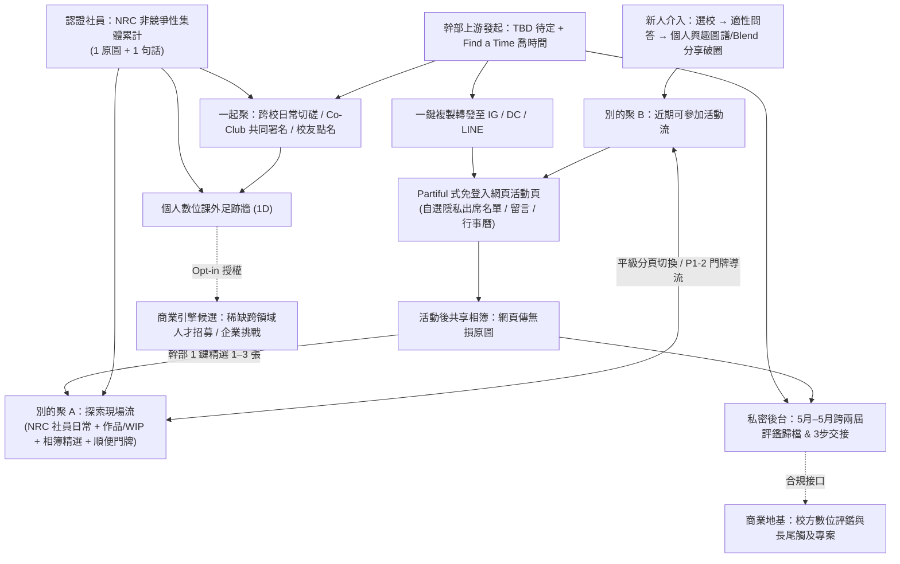

# 社團聚（CluBar）PRD v2.0 — 產品重構與體驗架構規格書

> **文件狀態**：v2.0（雙鑽石「收斂 Deliver」階段定案規格，用以重構並取代 v1.0 [clubar-prd.md](../clubar-prd.md) 產品體驗與模組架構，v1.0 原檔保留不動）  
> **文件定位**：定義重構後的產品哲學、體驗分層、全局資訊架構（IA）、核心功能規格、明確不做邊界、量化驗證指標（KPI）與雙引擎商業輪廓（What & Why）；資料庫結構、API、SSO 與 AI 實作細節留待 **SRS v2.0** 接手。開發時程不作為刪減核心社群與跨校功能的限制條件。  
> **上游脈絡**：[clubar-user-research.md](./clubar-user-research.md)（使用者研究、人物誌與現況旅程）；跨領域競品分析與多輪 5-Why 審核決策已完整內化於本文件（含各節 `[參考競品：...]` 標註與 Ch.7.2 總對照表）。

---

## 1. 產品重構背景與核心設計哲學

### 1.1 v1.0 為何必須重構（問題診斷）
1. **「學校公布欄」體感與公告海報陷阱**：v1.0 首屏被巨大搜尋牆與固定欄位表格佔滿，加上社團貼文以單向「公告聲明／倒數海報」為主並全面拔除互動，導致介面冷清、缺乏社群感。
2. **零被動曝光的校園現實**：一般社群平台（IG／Threads）不會主動推播社團貼文給未追蹤者（觸及為 `0`），多數學生根本不知道校內有哪些社團，社團只能被動守在社辦或等一年一次下午的社團博覽會讓新生克服社恐上門。
3. **高認知負荷與決策黑箱並存**：現有社團社群與 v1.0 卡片皆堆疊過多資訊元素且封面重點不明，同時卻漏掉「現在活著嗎、非社員／零基礎能不能去、費用、時數、一鍵可點報名」等行動資訊，手機端甚至常卡死在圖片 QR code。
4. **供給端重工與斷層**：大社團美宣拒絕對外多養一個會壓壞圖、重切比例的平台；小社團社長一人扛行政與美宣，發完剩個位數讚易斷更，且卸任交接與跨兩屆評鑑耗時失真。

### 1.2 四大核心體驗法則（含競品依據）
1. **高頻鋪陳 vs 低頻收網分層法則** `[參考競品：Product Hunt、Behance、Strava Clubs、Geneva]`
   - **高頻率、低重要性（過程、花絮、社員日常）**＝用來鋪陳與建立能見度、展現活人氛圍（承載於 `探索現場流`）。
   - **低頻率、高重要性（正式體驗課、成發、代表作）**＝用來收網與提升參與轉換（承載於 `近期可參加` 與社團代表作）。兩者在版面上物理分頁隔離，終結公布欄感。
2. **去毒化與反虛榮鐵則** `[參考競品：Cosmos.so、Substack、Nike Run Club]`
   - 不公開按讚數、追蹤數、觀看數與熱門排行榜，亦**不加入類似按讚或計數貼紙反應**（如 Partiful Boops 計數）。
   - 改採**質性脈搏訊號**（近 30 天活躍狀態、非社員／零基礎標籤、問答回覆率）與**非競爭性集體累計**（社員共同累積之創作與參與足跡，不設社內或跨社排行榜）。
3. **低認知負荷與漸進式揭露** `[參考競品：Airbnb、Cosmos.so、小紅書]`
   - 嚴控表面卡片元素（視覺焦點＋一句人話），將決策細節、完整文案與問答收進點擊後的詳情層；並保留原圖比例不強迫裁切，守護大社團美感與小社團瀏覽質感。
4. **上游源頭反轉＋分眾供稿** `[參考競品：Partiful、Nike Run Club、BeReal 格式減法]`
   - 搶在活動時間教室確定前，先透過「TBD 待定＋投票喬時間」成為社團發起活動的第一站，再一鍵複製發到 IG／DC／LINE；同時解放**認證社員個人**供稿權，用日常微紀錄分擔社長壓力。

---

## 2. 目標人物誌、市場細分與端到端成長飛輪

### 2.1 研究效度與市場細分前提
- 本次人物誌建立於 11 份 AI 模擬訪談趨勢與創遊社真實第一手內部紀錄之上（`C1`/`C4` 創遊社具高實務可信度；`U2` 校方決策層公開資料稀少，獲利定價留待補調研）。
- **供給端主力切入客群（Beachhead）**：**先主攻「中小型／實作型社團」**（如創遊社、美術社、讀書會），解決社外零曝光、行政斷層與評鑑歸檔痛點；同時透過原圖無損相容與置頂 FAQ 減重複私訊設計，**不排斥大型熱門社團進駐**。
- **補齊隱性受眾**：設計必須同時服務「主動找社團者」與「連社團存在都不知道、不願主動打字搜尋的社恐新生」。

### 2.2 人物誌矩陣（3 主要 ＋ 4 次要）

| 層級 | 人物誌名稱 | 核心任務與剛需 | 產品關鍵承接點 |
| :--- | :--- | :--- | :--- |
| **主要 1** | **怕踩雷的探索型學生**（整合 `S1` 新生＋`S2` 跨系同好＋隱性社恐新生） | 零社恐認識原本不知道的社團；3 分鐘判斷社團是否活著、零基礎／外系友善度與參與方式 | 適性引導破冰＋雙人興趣 Blend、極簡視覺現場流、匿名偷看 FAQ、一鍵報名 |
| **主要 2** | **一人多工的小中社團社長**（整合 `C1`＋`C3`，供給主力） | 突破 IG/FB 個位數觸及；不重工就能喬時間、發活動與積累跨兩屆（5月–5月）評鑑與組織資產 | 上游 `TBD/喬時間`＋一鍵複製外發、NRC 社員分擔供稿、公私分層評鑑歸檔、3 步交接 |
| **主要 3** | **幫百個社團補破網的一線承辦人**（對應 `U1`） | 零錯漏管名錄換屆、收齊評鑑、防冒名與炎上，**絕不增加第二套人工對帳工時** | 預留官方名冊防呆鎖定、斷層風險預警、系統內直接評鑑送審匯出、SSO 治理 |
| **次要 1** | **高挑剔視覺滑手與碎片體驗派**（`S3`＋`S4`） | 拒絕佈告欄字海；快速篩出「本週開放非社員體驗／有時數」；活動完不願被社內日常洗版 | 嚴控卡片 3–4 元素與原比例視覺、獨立 `近期可參加` 分頁、「只追活動」不追社務 |
| **次要 2** | **重視美感、嚴拒重工的大社團美宣**（`C2`） | 零畫質損失、不裁切 IG 三格視覺；一頁整合多檔活動；減少開學週重複私訊 FAQ | 原比例圖片相容＋即時改期換圖、多活動聚合門面、置頂 FAQ 擋重複私訊 |
| **次要 3** | **準備卸任的倦怠期幹部**（`C4`） | 卸任只願花 10–15 分鐘收尾，留住最易失傳的場地／時數／廠商隱性經驗 | 組織綁定免個人 2FA 移交＋3 欄位極簡「行政避雷交接便條」＋ Alumni 專長標籤 |
| **次要 4** | **守資安與績效的預算主管**（`U2`，待補調研） | 取得高教深耕／IR 去重複長尾學生參與數據，確保弱掃資安與公校採購合規 | 預留長尾觸及報表、6 年內控歸檔與離場資料完整匯出權（定價待補實證） |

### 2.3 新用戶首次介入流程（Onboarding） `[參考競品：Duolingo、Spotify Blend]`
1. **選校**：選擇就讀大專校院（免登入即可開始）。
2. **引導式適性探索**：2–3 個低負擔選擇題，挖掘使用者為何此刻關注社團（交友破冰／學特定技能／週末找活動／賺時數）與興趣取向。
3. **產出個人興趣圖譜並免註冊直接瀏覽**：立即呈現對應社團作品現場與體驗活動；並提供可選擇生成**「個人興趣特質／雙人 Blend 分享卡」**（主角為個人興趣品味而非社團推銷廣告），讓使用者自然丟進 IG 限動與朋友合拍相約、打破 0 觸及一度人脈。
4. **延後且選擇性註冊（Endowment Effect）**：直到使用者點擊「報名活動、珍藏、匿稱發問、建立雙人 Blend 或參與跨校互動」時，才引導快速註冊或校園驗證。

### 2.4 端到端雙邊產品飛輪

---

## 3. 全局資訊架構（IA）、導覽與權限矩陣

### 3.1 四大空間明確邊界

| 空間名稱 | 範圍與使用者心智定位 | 承載核心內容 | 明確不放什麼 |
| :--- | :--- | :--- | :--- |
| **別的聚** | **同校跨社團探索**（含「探索現場流」與「近期可參加」平級雙分頁） | 非公告日常／作品／相簿流、近期體驗課與活動轉換、輕量漸進式搜尋篩選 | 純文字行政公告牆、公開讚粉數、跨社排行榜 |
| **我的聚** | **社團對外門面 × 上游發起 × 私密後台** | 多活動聚合、NRC 集體日常牆、精選作品、置頂 FAQ 與問答箱；後台評鑑歸檔與交接 | 社內日常聊天室（不搶 LINE/DC）、私密會議／帳務不得暴露於前台 |
| **一起聚** | **跨校同領域橋樑**（對比別的聚為同校） | 跨校社員與社團作品試玩／接力、非創作社實務切磋、Co-Club 共辦聯展、`Alumni Ping` | 不做成純六大行政分板、不把行政報修當門口招牌 |
| **個人與足跡** | **個人探索資產與履歷** | 私密珍藏、追蹤分級（「只追公開活動」vs「全動態」）、個人大學課外數位足跡牆（`1D`）、認領／申請社團入口 | 未經使用者 Opt-in 授權不得公開個人足跡供企業瀏覽 |

### 3.2 行動版與桌機版導覽重整
- **行動版底部導覽（高頻 4 格）**：`別的聚（探索）` ／ `一起聚（跨校）` ／ `我的社團（我的聚快速切換與日常發布）` ／ `足跡與個人（含通知與申請認領社團入口）`。
- **移除項**：將一年僅用一次的「社團認領與申請」從主導覽列移出，收進「足跡與個人」選單中，釋放黃金位置。

### 3.3 多層級身分與三級供稿權限矩陣

| 動作／權限 | 訪客（未登入） | 一般登入／活動參加者 | 認證社員（本社） | 幹部／社長 | 歷屆校友（Alumni） | 校方／平台管理 |
| :--- | :---: | :---: | :---: | :---: | :---: | :---: |
| 適性測驗、瀏覽雙分頁、看社團頁與「一起聚」 | ✓ | ✓ | ✓ | ✓ | ✓ | ✓ |
| 免下載網頁端活動報名（Partiful 流程） | ✓（輕量驗證觸發登入） | ✓ | ✓ | ✓ | ✓ | ✗ |
| 活動頁內留言互動（限該場已報名者） | ✗ | ✓ | ✓ | ✓（含管理刪除） | ✓ | ✓（檢舉下架） |
| 上傳活動後共享相簿原圖 | ✗ | ✓（僅進待審相簿池） | ✓（僅進待審相簿池） | ✓（精選推首頁） | ✗ | ✗ |
| 社團頁匿稱公開提問、收藏、「只追活動」 | ✗（引導登入） | ✓ | ✓ | ✓ | ✓ | ✗ |
| 發布 **NRC 社員日常微動態**（1 原圖＋1 句話） | ✗ | ✗ | ✓（進現場流＋個人足跡） | ✓ | ✗ | ✗ |
| 於「一起聚」代表社團分享作品／接力切磋 | ✗ | ✗ | ✓（掛「校名＋社名·個人」） | ✓ | ✓（被點名或專長答疑） | ✗ |
| 勾選社員日常／相簿納入 **評鑑歸檔庫** | ✗ | ✗ | ✗ | ✓（平常順手／年底批次） | ✗ | ✗ |
| 發起 `TBD/喬時間`活動、Co-Club 共辦、FAQ 回覆、管理交接 | ✗ | ✗ | ✗ | ✓（交接與刪文限社長） | ✗（只讀交接區，禁刪改） | ✓（失聯接管） |

---

## 4. 核心模組功能規格（v2.0）

### 4.1 模組零｜適性引導與興趣 Blend（Onboarding & Virality）

#### FR-ONB-01：Duolingo 式免登入適性破冰 `[參考競品：Duolingo]`
- 首次進站先選學校，接著回答 2–3 題白話偏好題（例如參與目的、偏好動態/靜態、希望氛圍），立即產出精選社團與內容流，**無須先註冊即可完整瀏覽與操作體驗**；於執行報名、收藏、發問或建立 Blend 時再引導註冊並保留既有探索狀態。

#### FR-ONB-02：個人興趣特質與雙人 Blend 分享卡 `[參考競品：Spotify Blend]`
- 依使用者探索偏好與收藏軌跡，生成代表「個人興趣特色」的視覺分享卡；支援產生專屬邀請連結與朋友生成「雙人興趣合拍（Blend）」，推薦雙方都可能喜歡的冷門與熱門社團體驗。分享卡視覺主體為「個人興趣風格」而非社團廣告文案，便於轉發 IG 限動觸及一度人脈與相約破冰。

---

### 4.2 模組一｜別的聚：雙分頁探索與低負荷分層

#### FR-DISC-01：平級雙分頁分流（Living Stream vs Action Events） `[參考競品：Product Hunt、Behance、Strava Clubs、Geneva]`
- **分頁 A｜探索現場流（預設首屏，絕對去聲明化）**：
  - 禁止純活動海報與純招生公告進入此分頁。僅呈現 4 類高頻鋪陳內容：① 社員 `NRC` 日常微動態、② 社團實作作品與過程花絮（WIP）、③ 幹部精選之活動後共享相簿實況、④ 預填／已回覆之熱門新手 Q&A 精華。
  - **動態附屬門牌（Contextual Attachment）**：僅當該社團近期有開放參與的活動時，允許於動態卡最底部掛載一條極細單行連結（例：`本週四開放零基礎旁聽 →`），主體仍為生活與作品，不搶視覺焦點。
- **分頁 B｜近期可參加（Action / Events Layer）**：
  - 集中所有低頻高重要之體驗社課、期初社大、工作坊、成發、跨社聯合活動，支援日期、學習時數（藝文／生活／服務）、免費／材料費、非社員可、零基礎友善快速篩選。

#### FR-DISC-02：頂部輕量漸進式探索列 `[參考競品：Airbnb]`
- 合併原 v1.0 佔屏白話搜尋 Hero 牆與多層分類盒，收斂為頂部單一輕量搜尋膠囊（同時相容關鍵字與自然語言描述，如「週四晚上想學畫畫沒基礎」）搭配橫向興趣標籤，將首屏視覺空間交還給內容流。

#### FR-DISC-03：卡片層 vs 詳情層嚴格資訊分層 `[參考競品：Airbnb、Cosmos.so、小紅書]`
- **圖片比例規範**：全面支援原比例圖片呈現（相容 IG `1:1`、`4:5`、`3:4` 與橫圖），禁止強制裁切為單一 `16:10` 導致海報或人像斷頭。
- **`探索現場流` 卡片（極簡 3 元素）**：① 原比例主圖／短影預覽、② 1 句人話亮點（≤ 25–30 字）、③ 校名社團名＋單一活躍脈搏點（另可視情況附 1 行底部體驗門牌）。**移除卡片表面的摘要長文、多分類膠囊、複數 `#tag` 與學年標籤。**
- **`近期可參加` 卡片（決策 4 元素）**：① 活動主圖、② 活動名稱＋時間地點（或 `TBD 投票喬時間中` 標記）、③ 至多 3 個關鍵決策標籤（`零基礎可`／`非社員可`／`費用或時數`）、④「還有幾人想去」非虛榮提示。
- **點擊後詳情層**：展開完整故事或構造化「初心者安檢表」（地點教室、有無門檻、費用明細、行前提醒、一鍵報名／加行事曆、公開 FAQ 問答板）。

#### FR-DISC-04：溫和有限批次節奏
- 保留每次呈現 **12 則** 內容後顯示分段提示卡之克制體驗（同批次單社團不超過 2 則且不連發，保障中小型社團公平露出）；改為在分段提示卡提供明確「換下一批（12 則）」主動按鈕與其他興趣入口，不硬性堵死瀏覽路徑。

#### FR-DISC-05：去虛榮與質性信任脈搏 `[參考競品：Cosmos.so、Substack]`
- 全站探索卡與詳情頁持續隱藏按讚數、收藏數、瀏覽數、追蹤總數。改以 **質性活躍訊號** 消除新生怕遇到死社的疑慮：例如「本週剛更新」、「本學期已累積 X 次社團日常」、「幹部當日回覆提問」、「已有同校學生標記想參加」。

---

### 4.3 模組二｜我的聚：上游發布反轉、Partiful 活動引擎與跨屆後台

#### FR-MY-01：社團對外門面與預填 FAQ 提問箱 `[參考競品：Luma Hub、小紅書評論答疑]`
- **結構**：社團識別區（含校方認證標章）＋ **近期可參加活動置頂區** ＋ **NRC 社員集體日常牆（含非競爭性集體累計標示，如「本學期已共同累積 38 則實作足跡」）** ＋ **精選代表作品牆** ＋ **置頂 FAQ 與匿稱提問箱**。
- **置頂 FAQ 與匿稱公開問答**：
  - 社團建頁時預填至少 3 題新手必看 FAQ（如「零基礎能不能去」「社費怎麼算」「學期中可中途加入嗎」），消滅冷啟動空板與擋掉大社團開學重複私訊。
  - 一般登入學生可用 **匿稱或匿名** 送出提問（防社恐曝光）；幹部回覆並確認公開後顯示於社團頁並可一鍵釘選成永久 FAQ，兼顧校方言論治理風險。

#### FR-MY-02：Partiful 式上游活動引擎與互動體驗 `[參考競品：Partiful]`
- **免下載跨系統網頁體驗**：每場活動自動生成專屬手機網頁短連結，免下載 App、支援瀏覽器直接開啟並提供多種活潑主題視覺模板（或直接沿用原圖/GIF），徹底告別公文與圖片 QR code 斷鏈。
- **上游彈性起手（`TBD` ＋ `Find a Time`）**：
  - 支援活動地點或時間暫定為 **`TBD（待定）`**，讓幹部在場地未確定前即可先開頁聚人氣。
  - 內建 **`Find a Time` 投票喬時間**（與試聽主題微投票），待時段確定後幹部一鍵鎖定日期並更新全頁。
- **兩段式隱私參加者名單與互動留言**：
  - 學生報名時可自選：**「讓朋友／同校參加者看到我（顯示名字或匿稱）」**（創造從眾破冰雪球）或 **「低調參加（僅計入公開總人數與幹部後台簽到表）」**。
  - 確認參加後支援一鍵同步 **Google / Apple / Outlook 行事曆**。
  - 單場活動頁內對**已報名參加者**開放留言板炒熱氣氛（幹部可刪除不當留言，全體具檢舉入口）。
- **低重工即時修正**：活動時間、教室異動或表單連結錯誤時可隨時單項修改即時生效，並支援無須刪文即可**單張抽換圖片**（解決 IG 發錯只能整篇刪掉破壞三格排版的痛點）。

#### FR-MY-03：跨平台一鍵分發 ＆ 一貼雙用雙向發布 `[參考競品：Partiful、Notion]`
- **正向上游分發（CluBar → 外部分享，不依賴 Meta API）**：
  - 幹部在 CluBar 建立活動或完成 `TBD` 定案後，系統自動生成**「一鍵複製推廣包」**：分別排版出適合 **LINE 群組公告、Discord 頻道（含 Markdown）、IG 貼文＋限動圖片卡＋可私訊轉貼短文**，讓幹部寫一次即可 10 秒複製貼到所有既有通訊管道。
  - 活動異動或行前提醒時，提供「一鍵群發通知」：個人通知採 **站內推播 ＋ Web Push ＋ 行事曆動態更新（Email 作備援或校園信箱認證通道，不強制收手機號碼與不發付費簡訊）**；同時產出**改期提醒短文案**讓幹部一鍵轉貼回 LINE／DC 群組與 IG 限動／私訊。
- **逆向草稿整理（既有文案 → CluBar）**：
  - 若幹部習慣先在 DC／Notion 寫好文案，仍支援貼入零散文字與圖片，AI 自動抽取結構欄位（時間、地點、非社員資格、費用、時數、可點報名連結），並**主動提醒漏填的新手關鍵資訊**，產出草稿微調後發布。
  - 若上傳文字過多的活動海報，系統自動將文字抽出放進結構化安檢表，並建議改以現場實拍或作品照作為探索流封面（不強制阻擋大社團視覺需求）。

#### FR-MY-04：活動後無損共享相簿與精選回流 `[參考競品：Partiful Shared Photo Album]`
- 活動結束後，已報名參加者可免下載 App 直接透過手機網頁連結上傳現場照片進該活動之**「無損原圖待審相簿池」**（主打「不壓縮畫質、不過期」反打 LINE 相簿痛點，並借此將未註冊的線下參加者自然轉化為 CluBar 用戶）。
- 照片不直接曝光於公開首頁，須由幹部在手機或電腦端 **1 鍵勾選 1–3 張精選照**，才會同步推進 `探索現場流` 與社團評鑑檔案庫（兼顧美感與肖像權審核）。

#### FR-MY-05：NRC 認證社員日常微動態 `[參考競品：Nike Run Club、BeReal 格式減法]`
- **發文資格**：僅限該社團已驗證通過之「認證社員」與幹部。
- **極簡格式（不抄隨機通知與盲牆）**：無須美編、禁止純海報，僅須上傳 **1–3 張原比例現場照片／短影 ＋ 1 句話（選填活動或心情標籤）**。支援在社課或練習結束時順手一拍，直接進入 `探索現場流`、累計社團「非競爭性集體足跡」，並同步寫入個人足跡牆。

#### FR-MY-06：公私分層評鑑歸檔與雙時機勾選 `[參考競品：Read.cv]`
- **嚴格公私分層**：會議紀錄、帳務收支明細、社產器材清冊、僅供審查之佐證文件存於「社團私密後台歸檔層」，絕不混入對外作品牆。
- **減負採納機制（平時順手／年底批次）**：一般社員發的 `NRC 日常微動態` 與活動相簿預設**不自動擠進正式評鑑報告**；社長或幹部可選擇在**平時滑到時順手 1 鍵勾選「收進評鑑」**，或在**評鑑前於後台清單批次勾選**，免去重寫與考古之苦。
- **跨兩屆區間匯出**：支援自訂起迄月份（預設對接實務上 **5 月至隔年 5 月** 跨兩屆評鑑週期），自動分類彙整活動、社課、成果與組織檔案並一鍵匯出結構化清單／列印 PDF。

#### FR-MY-07：組織綁定資產與 3 步換屆交接
- **組織級所有權**：社團檔案、相簿、雙重驗證與發布權限全數綁定「社團職位」而非個人手機與私人雲端空間，禁止批次刪除全部歷史紀錄。
- **3 步雙向換屆＋行政避雷便條**：現任社長指派下屆接任人 → 對方法規確認接受後角色自動轉移（原社長轉為校友身分）→ 卸任者僅需花 5 分鐘填寫極簡 **3 欄位「行政避雷便條」**（場地借用眉角／時數與服學死線／講師與友社窗口），僅對社內接任幹部可見。

---

### 4.4 模組三｜一起聚：跨校日常舞台與協作網絡

#### FR-TOG-01：細分興趣領域與跨校日常實作流 `[參考競品：Hugging Face Spaces、Dribbble Rebound]`
- 廢除依賴行政六大分類（學術／藝文／康樂等）的線性純文字 BBS 討論版，改以**細分興趣領域標籤**（如 `#遊戲開發` `#影像攝影` `#音樂展演` `#工藝美術` `#戶外探索` `#社會服務` `#投資與研究`）聚合跨校同好。
- **解放社員個人出沒權**：認證社員與幹部皆可將作品與實務分享推入跨校領域流（署名 `校名＋社名 · 個人`）：
  - **創作／技術類**：支援內嵌試玩／試聽展示（如 `itch.io`、GitHub、影音）與跨校 **`Rebound` 接力回應**。
  - **非創作類（登山／服務／體育／研究）**：承載路線實測紀錄、友社友誼賽與聯合出隊邀約、專題書單與深度觀點交換。

#### FR-TOG-02：`Co-Club` 雙向共同署名共辦 `[參考競品：Instagram Collabs、Luma Co-hosts]`
- 兩個以上校內跨社或跨校社團合辦聯合社課、GameJam、聯展或合聘講師時，發起社團可發送 `Co-Club` 署名邀請；受邀方一鍵同意後，該活動與成果作品**同時出現於雙方「我的聚」門面與各自年度評鑑歸檔庫**，共享報名導流紅利。

#### FR-TOG-03：跨校主題挑戰（Jam）與徵友社募集卡 `[參考競品：itch.io Jams、Strava Club Challenges]`
- 支援社團主動發起具時限的跨校聯合活動、友社交流賽或聯展徵集卡（標明目標校數、徵求角色、合作形式），取代傳統容易沉底的文字徵求帖。

#### FR-TOG-04：次級支援資源（`Alumni Ping` ＋ 副產品資源庫） `[參考競品：ADPList、Figma Community]`
- **不放門口招牌，收於領域子分頁內**避免變成「出事才來的報修區」。
- **`Alumni Ping` 校友定向點名**：卸任校友可自選掛上 1–3 個專長標籤（如「中大教研借用」「評鑑簡報」「遊戲音效」），僅在後輩或同好有特定需求標記時通知協助，不打擾日常。
- **實務資源自動匯聚**：幹部填寫交接避雷便條或結案紀錄時，可一鍵去識別化分享給同領域社團，自動生成可參考之實務清單，不強求額外撰寫精美模板。

---

### 4.5 模組四｜個人課外數位足跡（Campus Portfolio）與輕互動

#### FR-ME-01：收藏與「只追活動」分離訂閱 `[參考競品：小紅書]`
- 區分「私密收藏單篇作品／活動」、「追蹤整個社團（含日常）」與「**只追蹤公開體驗活動**（避免被社內慶生與練團日常洗版）」，滿足碎片時間學生需求。

#### FR-ME-02：個人大學課外數位足跡牆（`1D`） `[參考競品：Letterboxd、Strava、Read.cv]`
- 自動彙整使用者在校期間參與過的體驗活動紀錄、學習時數軌跡、發表的 `NRC` 社團日常貢獻、與透過 `Co-Club`／「一起聚」累積的跨校專案角色與作品成果，成為長期留存的情感複利與能力證明。
- **未來人才接口預設隱私**：個人足跡牆預設僅本人或校內互動場景可見；未來開放稀缺人才招募時，須由學生主動開啟 **Opt-in「開放企業與專案機會看見我的作品足跡」** 方可被外部檢索。

---

### 4.6 模組五｜平台治理與校方管理預留接口（P1 延伸對接）

- **官方名冊鎖定與認證**：預先匯入合作校方社團名冊並綁定 **校園身分驗證（預留校內 SSO 接口）**，採下拉鎖死防手打錯名，區分「官方認證社團」與「未認領名錄社團／認證學生社群」。
- **承辦減量儀表板接口**：預留高風險斷層社團預警燈號（未完成換屆／連續期間無活躍動態）、評鑑期間線上審查狀態追蹤、一鍵匯出完全對齊校方規格之報表結構與 **6 年內控歸檔保留** 欄位。
- **內容安全與合規底線**：維持先發後審＋全站檢舉下架／暫停發文權限；所有公開發布與相簿精選前皆須確認原創與肖像授權聲明；不綁定任何強制手機號碼簡訊收集，降低個資稽核風險。

---

## 5. 明確不做清單（Anti-Scope Guardrails）

| 不做項目 | 明確理由 |
| :--- | :--- |
| **1. 不做社內即時聊天室／跟 LINE & Discord 搶日常群聊** | 社團內部運作已深度綁定 LINE 與 DC，硬撞必敗；站內專注「對外門面、活動組織上游、跨社／跨校連接與資產留存」。 |
| **2. 不做公開讚數、追蹤數、熱門榜，也不做類按讚計數互動（如 Boops）** | 保護初期互動少的中小社團不被誤判死社，避免陷入演算法流量焦慮與馬太效應。 |
| **3. 不做「NRC 個人／社團貢獻度排行榜」** | 保留共同累積的正向成就感，消除社員被比較壓榨或跨社惡性刷分的內捲風險。 |
| **4. Home Feed 禁止塞入純活動海報與單向招募聲明** | 守住「活人社群流」與「學校公布欄」的分水嶺，所有活動報名集中於平級分頁與動態底部極細門牌。 |
| **5. 不做「未經幹部篩選就自動公開的相簿或未過濾自由留言牆」** | 保護社團視覺門面、未授權肖像隱私，並控制校方審核與言論風險。 |
| **6. 不強迫下載 App 才能看活動頁／傳活動照** | 採用手機網頁優先，讓一度人脈與線下活動參加者零阻礙完成瀏覽與相簿轉換。 |
| **7. 不做商業廣告版位與校園場地營利抽成** | 避開公立大學主計採購與校內場地不得營利之法規紅線，同時維持學生對推薦內容的信任。 |

---

## 6. 量化成功指標（KPI）與驗證基準

取代主觀 `10x` 標籤，所有改版前後與試營運驗證一律以 **可量測行為指標** 檢驗（具體數值基準於真實試營運前兩週建立 Baseline）：

| 服務對象 | 指標名稱 | 衡量方式與驗收方向 |
| :--- | :--- | :--- |
| **未入社新人** | **破除 0 觸及與決策耗時** | ① 首次透過適性引導或 Blend 進入者，點擊「先前不知其名之社團」比例； ② 從開啟平台到確認門檻並完成報名／收藏之耗時（目標從傳統跨 4–5 平台 45 分鐘壓縮至 **< 3 分鐘**）。 |
| **已入社／活躍學生** | **雙生命週期學期留存** | 已追蹤或加入 ≥ 1 個社團之學生，學期中 **30 天回訪率**（檢驗 `一起聚` 跨校切磋與 `1D` 個人足跡是否產生日常回訪動力）。 |
| **社團幹部（`C1`–`C4`）** | **上游使用率、省時度與社外流量** | ① 使用 `TBD/喬時間` 發起活動並執行一鍵複製外發之比例與發布耗時（目標 **< 3 分鐘**）； ② 中小社團貼文獲得「非原 IG 追蹤者／社外學生」點擊與提問佔比； ③ 卸任交接完成時間與年度評鑑匯出使用率。 |
| **校方承辦／主管** | **長尾觸及與行政減量** | ① 全校透過平台接觸或參與社團活動之**不重複長尾學生數（Long-tail Reach）**； ② 承辦人名錄對帳、催件與評鑑收件人工耗時降幅；斷層社團提早預警數。 |

---

## 7. 雙引擎商業模式藍圖與競品參考總表

### 7.1 雙引擎架構（待補實務調研定價）
1. **左腳地基｜校方數位評鑑與長尾觸及服務** `[參考競品：Suitable、Anthology Engage]`
   - **定位**：不作主要高毛利增長來源，用以取得**校方官方背書、名冊防冒名與單校全覆蓋率**。
   - **交付價值**：對標台灣公立大學 15 萬元以下小額採購／教育部高教深耕專案（長尾學生參與數據、IR 對接、5 月–5 月評鑑無紙化與斷層預警），中期評估進駐數發部「電腦軟體共同供應契約－雲端服務」，合約明確承諾不續約時完整資料移轉權。
   - **待補缺口**：須實地調研政府電子採購網決標金額與真實訪談課外組／主管後定案價格。
2. **右腳高毛利引擎候選｜稀缺跨領域熱情人才招募與企業挑戰贊助** `[參考競品：Handshake]`
   - **核心洞見**：學生參與特定專業／創作社團代表高度自發熱情與跨領域實戰篩選（例如遊戲開發社聚集超過 10% 具備程式＋美術能力的 TA 技術美術人才，遠高於單一科系常態分佈）。
   - **運作原則**：免費養大學生與社團生態；當累積跨校實作足跡牆（`1D`）後，向有實際徵才預算的中大型科技／遊戲／設計／金融科技企業提供 **嚴格學生 Opt-in 授權之精準專案人才接觸** 或 **贊助跨校主題 Jam／工作坊**（支援部分社團資源與跨校舞台）。
3. **遠期停車場（P3 靈感，不進近期規格）**：去識別化校園趨勢與青年興趣調查洞察報告（須待全國多校規模成形，且須嚴格評估台灣《個資法》與學校審查紅線後再議）。

---

### 7.2 全文件競品機制引用總對照表

| 參考競品 | 本文件直接借鏡之具體機制 | 落點模組 |
| :--- | :--- | :--- |
| **Duolingo** | 選校→引導問題→立即給結果瀏覽→操作互動才註冊（零阻礙先給價值） | 模組零（`FR-ONB-01`） |
| **Spotify (`Blend`)** | 個人興趣特質／雙人品味合拍分享卡，自然打進 IG 限動一度人脈 | 模組零（`FR-ONB-02`） |
| **Product Hunt / Behance / Strava / Geneva** | 高頻過程流與低頻活動／公告聲明物理隔離（平級雙分頁＋頻道分離） | 模組一（`FR-DISC-01`） |
| **Airbnb** | 漸進式揭露（卡片僅留最少視覺錨點，決策細節收進詳情）＋ 輕量頂部探索列 | 模組一（`FR-DISC-02`–`03`） |
| **Cosmos.so / Substack** | 暖色留白降低眼壓與認知負荷、全面去讚粉數、定性活躍脈搏訊號 | 模組一（`FR-DISC-03`–`05`） |
| **小紅書** | 原比例封面與 0.5 秒標題視覺優先、「收藏」與「只追活動」分級、新手答疑評論區 | 模組一、四（`FR-DISC-03`、`FR-ME-01`） |
| **Partiful** | 免下載跨系統網頁、TBD 待定＋投票喬時間、一鍵複製外發、自選隱私出席名單、行事曆連動、活動頁留言、活動後無損共享相簿（**剔除付費簡訊與計數 Boops**） | 模組二（`FR-MY-02`–`04`） |
| **Nike Run Club (NRC) ＋ BeReal 格式減法** | 認證社員個人隨手拍（1 原圖＋1 句話免美編）累積社團非競爭性集體足跡（**剔除 BeReal 盲牆、隨機推播與競爭排行**） | 模組二（`FR-MY-05`） |
| **Luma / Read.cv** | 社團多活動聚合 Hub 門面、結構化欄位一鍵匯出標準履歷／評鑑文件 | 模組二（`FR-MY-01`、`FR-MY-06`） |
| **Instagram Collabs / Luma Co-hosts** | `Co-Club` 雙向共同署名，合作活動與作品同步掛載雙方主頁與評鑑 | 模組三（`FR-TOG-02`） |
| **Dribbble (`Rebound`) / Hugging Face Spaces / itch.io Jams** | 跨校可互動試玩展示、作品接力切磋、時限主題聯合創作徵集 | 模組三（`FR-TOG-01`、`FR-TOG-03`） |
| **ADPList / Figma Community** | 校友掛專長標籤定向召喚答疑；交接紀錄去敏自動轉化為實務資源（退居子分頁） | 模組三（`FR-TOG-04`） |
| **Letterboxd / Strava** | 個人參與與作品數位足跡長期複利（`1D` Campus Portfolio） | 模組四（`FR-ME-02`） |
| **Suitable / Anthology Engage / Handshake** | 賣給校方「長尾觸及與減量」作信任地基；靠免費生態＋跨界稀缺人才招募作高毛利引擎 | 商業模式（Ch.7） |
