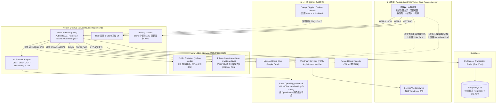
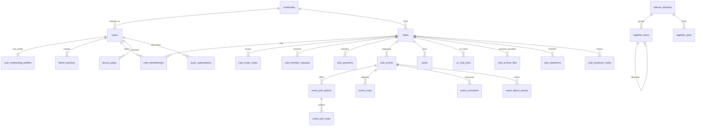
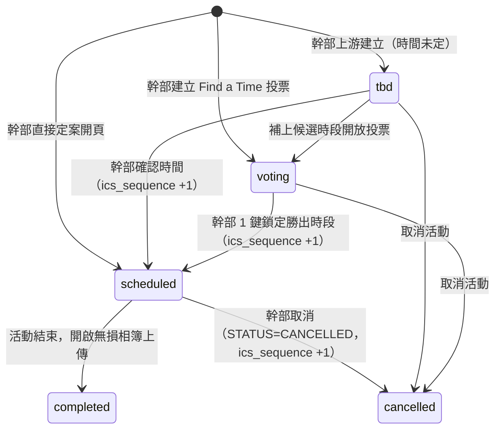

# 社團聚（CluBar）軟體需求規格書（SRS v2.0）

> **文件版本**：v2.0（正式規格基線，全新 v2 Schema 重建；用以取代 v1.0；v1.0 原檔已刪除，需要時從 git 歷史取回）  
> **上位文件**：[clubar-prd-v2.md](./clubar-prd-v2.md)（PRD v2.0）、[clubar-user-research.md](./clubar-user-research.md)  
> **依循國際與工程標準**：ISO/IEC/IEEE 29148:2018、ISO/IEC 25010:2023（SQuaRE）、INCOSE Guide to Writing Requirements（GtWR）、EARS（Easy Approach to Requirements Syntax，Alistair Mavin）、RFC 2119、RFC 5545（iCalendar）、RFC 8030 / 8292（Web Push / VAPID）  
> **目標讀者**：前後端工程師、資料庫與 AI 工程師、QA 測試人員、資安與校方技術對接窗口

---

## 1. 緒論（Introduction — ISO/IEC/IEEE 29148 §9.6.1）

### 1.1 文件目的
本軟體需求規格書（SRS v2.0）將 [clubar-prd-v2.md](./clubar-prd-v2.md) 定義之產品體驗重構目標，轉化為**無歧義、單一原子、可驗證且可雙向追蹤**的系統與軟體工程規格，作為 CluBar v2.0 資料庫重建、前後端開發、AI 管線實作與自動化驗收測試的唯一技術依據。

### 1.2 系統範圍與明確不做邊界（Scope & Anti-Scope Guardrails）

#### 1.2.1 納入範圍（In-Scope）
- **核心完整實作規格（v2 Core Release）**：
  - **模組零**：免登入適性破冰引導、個人興趣特質與雙人 `Blend` 分享卡。
  - **模組一（別的聚）**：同校跨社團「探索現場流」與「近期可參加」平級雙分頁、頂部輕量漸進探索列、嚴格卡片／詳情分層、原比例視覺呈現、有限批次翻頁公平重排與質性信任脈搏。
  - **模組二（我的聚）**：社團對外門面、認證社員雙軌認證、預填 FAQ 與匿稱公開問答、Partiful 式免下載活動頁（`TBD`、`Find a Time` 喬時間、兩段隱私報名、活動頁留言、RFC 5545 行事曆動態同步）、跨平台一鍵推廣包、活動異動多通道通知（站內＋Web Push＋行事曆＋Email）、Vision 海報文字抽取與逆向草稿整理、無損原圖共享相簿池、NRC 社員日常微動態、公私分層 5 月–5 月跨兩屆評鑑歸檔、3 步換屆交接與行政避雷便條。
  - **模組三（一起聚）**：細分興趣領域跨校實作流、互動內嵌與 `Rebound` 接力、`Co-Club` 雙向共同署名共辦、跨校主題挑戰（Jam）募集卡、`Alumni Ping` 校友定向召喚與去敏實務資源庫。
  - **模組四（個人與足跡）**：私密收藏與「只追活動」分離訂閱、個人大學課外數位足跡牆（`1D`）與預設隱私／Opt-in 授權邊界。
  - **模組五（平台治理）**：官方名冊鎖定、先發後審檢舉處置、稽核日誌與匿名轉換統計。
- **P1 預留接口契約（Interface & Schema Contracts Only）**：
  - 校方正式 SSO（OIDC / SAML 2.0）介面抽象、校方承辦減量儀表板（斷層預警、評鑑線上審核狀態、6 年內控保留、離場資料完整匯出、不可逆雜湊長尾去重統計）與企業稀缺人才 Opt-in 檢索介面。本文件針對 P1 模組僅定義**資料表預留欄位、權限邊界與 API 接口契約（Stub/Interface）**，不涵蓋 P1 專屬商業定價與後台前端細節。

#### 1.2.2 明確不做紅線（Anti-Scope Guardrails — 系統不可違背之負向約束）
以下 7 項約束具備與功能需求同等之強制驗證效力（任一違規視同驗收失敗）：

| 紅線編號 | 負向約束條款（EARS） | 驗證方法 |
| :--- | :--- | :---: |
| `AS-01` | 系統**不得**提供社團內部即時聊天室或跨社團一對一私訊功能。 | `[I]` |
| `AS-02` | 系統**不得**於任何公開 API 或前端介面輸出按讚數、收藏總數、瀏覽次數、追蹤總數、熱門排行榜或類按讚計數貼紙（如 Boops）。 | `[T][I]` |
| `AS-03` | 系統**不得**提供任何個人或社團之 NRC 發文數／貢獻度排行榜或跨社競爭排名。 | `[I]` |
| `AS-04` | 系統**不得**允許純活動海報或純招生公告進入「別的聚｜探索現場流（分頁 A）」。 | `[T]` |
| `AS-05` | 系統**不得**將參加者上傳至活動共享相簿之照片，於未經幹部手動精選核准前自動曝光至公開探索流或社團公開頁；亦**不得**將學生提問於未經幹部回覆公開前直接曝光。 | `[T]` |
| `AS-06` | 系統**不得**強制訪客下載原生 App 始可開啟活動頁、檢視詳情、報名或於活動後上傳共享相簿。 | `[D]` |
| `AS-07` | 系統**不得**內建商業廣告版位、校園場地營利抽成金流，或於註冊／通知流程強制收集使用者手機號碼及發送付費簡訊。 | `[I]` |

> **反虛榮數值邊界澄清（消除歧義）**：依據 PRD v2.0 `FR-DISC-03`、`FR-MY-01`、`FR-MY-02`，系統僅於兩處合法顯示非虛榮計數：① 活動卡片／活動頁之「參加／想參加人數」（屬活動參與動能，不作為跨社排名）；② 社團主頁 NRC 牆之「非競爭性集體累計則數」（如「本學期已共同累積 38 則實作足跡」，不拆分個人排行亦不跨社比較）。除上述兩處外，全站禁止公開呈現任何互動計數。

### 1.3 規範詞彙、EARS 句型與驗證方法約定
- **規範動詞（RFC 2119 / ISO 29148）**：
  - **必須（SHALL）**：強制性系統需求，缺漏即不通過驗收。
  - **不得（SHALL NOT）**：強制性禁止行為。
  - **建議（SHOULD）**：強烈建議實作，偏離須有書面理由。
  - **得（MAY）**：可選實作項目。
- **EARS 語法模板（Alistair Mavin）**：本文件第 4 章與第 7 章所有需求皆依循下列 5 種句型撰寫，每條編號僅表達單一原子行為：
  1. **全域型（Ubiquitous）**：`系統必須 <行為>。`
  2. **事件驅動型（Event-driven）**：`當 <觸發事件> 時，系統必須 <行為>。`
  3. **狀態驅動型（State-driven）**：`於 <系統狀態> 下，系統必須 <行為>。`
  4. **可選功能型（Optional）**：`當啟用 <選項條件> 時，系統必須 <行為>。`
  5. **異常防護型（Unwanted behavior）**：`若 <異常條件> 發生，系統必須 <防禦或降級行為>。`
- **驗證方法代碼（INCOSE GtWR）**：
  - `[T]` **Test（自動化／量化測試）**：以單元測試、整合測試、API 斷言或壓測驗證。
  - `[D]` **Demonstration（操作展示）**：於瀏覽器或裝置實際執行端對端流程驗證。
  - `[I]` **Inspection（審查檢視）**：檢視原始碼、DDL、序列化白名單、設定檔或匯出檔案。
  - `[A]` **Analysis（分析計算）**：透過演算法分析、日誌彙總或覆蓋率模型驗證。

### 1.4 領域術語、縮寫與參考文件
| 術語／縮寫 | 定義 |
| :--- | :--- |
| **NRC 微動態** | 認證社員或幹部發布之極簡日常動態（1–3 個原比例圖片／短影＋1 句話），累計社團非競爭性集體足跡並寫入個人 `1D` 足跡牆。 |
| **1D 足跡牆** | 個人大學課外數位足跡牆（Campus Portfolio），自動彙整參與活動、學習時數、NRC 貢獻與跨校 `Co-Club`／`一起聚` 作品角色。 |
| **TBD / Find a Time** | 活動時間或地點尚未定案前之「待定」狀態，並內建時段／主題投票讓參加者共同喬時間。 |
| **Co-Club** | 兩個以上社團（校內跨社或跨校）雙向同意共同署名合辦活動或作品，成果同步顯示於各參與社團門面與評鑑歸檔庫。 |
| **Rebound** | 跨校「一起聚」作品流中，他校社員或社團基於某篇作品發起之接力回應、延伸實作或改作連結。 |
| **Alumni Ping** | 歷屆校友自選掛載 1–3 個專長標籤，供後輩或同好依需求定向點名通知協助之低干擾機制。 |
| **Blend** | 依兩位使用者探索偏好與收藏軌跡，以確定性演算法計算興趣交集並產出可轉發 IG 限動之合拍推薦卡。 |
| **PII** | 個人可識別資訊（Personally Identifiable Information），包含信箱、學號、OAuth Subject ID、IP、EXIF GPS 座標等。 |
| **RTM** | 需求追蹤矩陣（Requirements Traceability Matrix）。 |

---

## 2. 系統整體描述（Overall Description — ISO/IEC/IEEE 29148 §9.6.2）

### 2.1 產品脈絡與系統架構圖
CluBar v2.0 沿用並擴充 v1.0 經實戰驗證之無伺服器全端架構（Next.js 15 + Supabase PostgreSQL 16 + Drizzle ORM + Azure Blob Storage + Auth.js v5 + Vercel），並針對 v2.0 核心需求新增：**Azure Blob 公私雙容器分離（Public Media + Private Archive）**、**Web Push（VAPID + Service Worker）**、**`next/og` 伺服器端分享圖卡渲染**、**RFC 5545 可訂閱行事曆 Feed** 與 **Vision 多模態海報解析通道**。資料庫採**全新 v2 Schema 重建**（取代 v1 Migration 並重新建立種子腳本，零歷史債務）。



### 2.2 技術棧與環境變數契約
| 層級 | 選用技術 | v2.0 變更重點與約束 |
| :--- | :--- | :--- |
| **前端與圖卡渲染** | Next.js 15 (App Router, TypeScript) + Tailwind CSS v4 + `next/og` | 新增 `next/og`（內建 Satori）產出 Blend 分享卡與 IG 限動推廣 PNG；保留 `images.unoptimized = true` 與標準 ``/`<video>`。 |
| **資料庫與檢索** | Supabase PostgreSQL 16 + `pgvector` + `pg_trgm` + Drizzle ORM | 全新 v2 Schema 重建；Runtime 走 Port `6543`（`prepare: false`），Migration 走 Port `5432`（SQL Migration 管理自訂 HNSW/GIN 索引）。 |
| **AI 抽象層** | Azure OpenAI Service（預設） / OpenRouter 熱切換 + Zod | 擴充為 **Chat / Vision / Embedding 三軌獨立組態**，支援海報影像解析並保留嚴格逾時降級。 |
| **媒體與私密儲存** | Azure Blob Storage（**雙容器**） | Public Container 存預覽圖／短影／相簿原圖；Private Container 存評鑑私密檔（禁止公開讀取，僅經權限驗證簽發 5 分鐘 Read SAS）。 |
| **身分驗證** | Auth.js (NextAuth v5) Stateless JWT + `.edu.tw` OTP | 沿用 Google + Microsoft Entra ID；訪客報名活動透過 OAuth 一鍵登入回跳；預留 P1 `SchoolSsoProvider` 抽象介面。 |
| **推播與行事曆** | `web-push`（VAPID）+ Service Worker + RFC 5545 `.ics` + Resend | 新增 VAPID Web Push 與個人可訂閱 `webcal://` Feed（HMAC 簽章個人 Token），未授權自動降級站內通知＋Email。 |
| **託管部署** | Vercel（`sin1`） | 嚴守 4.5MB Function Payload 上限，所有媒體與私密檔皆走 SAS 直傳。 |

#### v2.0 新增環境變數（疊加於 v1 `.env.example` 既有變數）
```bash
# Azure Blob Private Container（社團私密評鑑與行政歸檔，嚴禁設為公開存取）
AZURE_STORAGE_PRIVATE_CONTAINER_NAME="clubar-private-archive"

# AI Vision（海報文字抽取與結構化欄位辨識，未設時沿用 CHAT 模型組態）
AI_VISION_PROVIDER="azure"                  # azure | openrouter | disabled
AI_VISION_TIMEOUT_MS="12000"
AZURE_OPENAI_VISION_DEPLOYMENT="gpt-4o-mini"
OPENROUTER_VISION_MODEL="openai/gpt-4o-mini"

# Web Push（VAPID 金鑰對，npx web-push generate-vapid-keys）
NEXT_PUBLIC_VAPID_PUBLIC_KEY=""
VAPID_PRIVATE_KEY=""
VAPID_SUBJECT="mailto:noreply@clubar.example.com"

# 個人行事曆訂閱 Token 與匿名長尾雜湊鹽值（須為 ≥32 bytes 隨機密鑰）
CALENDAR_TOKEN_SECRET=""
LONGTAIL_REACH_SALT=""
```

### 2.3 使用者角色與 Server-Side RBAC 守衛規格

v2.0 對應 PRD v2.0 §3.3 建立 **6 層使用者身分**，所有寫入、私密讀取與管理端點**必須**於伺服器端即時查詢 `users`、`club_memberships` 與 `clubs.verification_status` 驗證權限（不得信任前端傳入角色或過期 JWT Claim）：

| 守衛函式 | 檢查條件（Server-Side） | 失敗 HTTP 狀態與錯誤碼 |
| :--- | :--- | :--- |
| `requireAuth()` | 有效 Auth.js Session 且對應 `users` 存在 | `401 UNAUTHENTICATED` |
| `requireVerifiedStudent()` | `requireAuth()` 且 `users.campus_verified_at IS NOT NULL` | `403 CAMPUS_VERIFICATION_REQUIRED` |
| `requireSameUniversity(univId)` | `requireVerifiedStudent()` 且 `users.university_id === univId` | `403 UNIVERSITY_MISMATCH` |
| `requireClubMember(clubId)` | `requireSameUniversity(club.university_id)` 且存在 `club_memberships(ended_at IS NULL, role IN ('owner','editor','member'))` 且 `clubs.verification_status = 'verified'` | `403 CLUB_MEMBER_REQUIRED` 或 `403 CLUB_SUSPENDED` |
| `requireClubOfficer(clubId)` | 同上，限 `role IN ('owner','editor')` | `403 CLUB_OFFICER_REQUIRED` 或 `403 CLUB_SUSPENDED` |
| `requireClubOwner(clubId)` | 同上，限 `role = 'owner'` | `403 CLUB_OWNER_REQUIRED` |
| `requireClubArchiveAccess(clubId)` | `requireAuth()` 且為該社團現行 `owner`/`editor`、歷屆 `alumni`、該校 `school_admin`（僅評鑑審查期）或 `platform_admin` | `403 ARCHIVE_ACCESS_DENIED` |
| `requireEventAttendee(eventId)` | `requireAuth()` 且存在 `event_rsvps(status = 'going')` 或具任一主辦／Co-Club 社團之 `owner`/`editor` 身分 | `403 EVENT_ATTENDEE_REQUIRED` |
| `requireSchoolAdmin(univId)` | `requireAuth()` 且 `platform_role = 'school_admin'` 且 `managed_university_id === univId`（或 `platform_admin`） | `403 SCHOOL_ADMIN_REQUIRED` |
| `requirePlatformAdmin()` | `requireAuth()` 且 `platform_role = 'platform_admin'` | `403 ADMIN_REQUIRED` |

### 2.4 設計約束、假設與外部相依
1. **Payload 上限約束**：Vercel Serverless Function 單次請求 Body 上限 4.5 MB；除 `POST /api/ai/draft-from-raw`（檔案 ≤ 4 MB）外，所有圖片、短影與私密評鑑附件皆**必須**經瀏覽器透過短時效 SAS 直傳 Azure Blob Storage。
2. **iOS Web Push 平台現實約束**：iOS Safari 16.4+ 僅於使用者「加入主畫面（PWA）」後支援 Web Push API；系統**必須**於設定頁明確提示，並對未訂閱 Web Push 之帳號自動降級使用「站內通知＋Email 備援」。
3. **台灣大專評鑑週期約束**：實務社團評鑑常跨越兩屆（預設每年 5 月 1 日至隔年 5 月 31 日），系統所有日期與學年度計算預設採 `Asia/Taipei`（UTC+8）時區。
4. **個資法與無手機收集約束**：依台灣《個人資料保護法》最小必要原則，不收集手機號碼；所有公開回應與匿名統計嚴禁洩漏 PII。

---

## 3. 外部介面需求（External Interface Requirements — ISO/IEC/IEEE 29148 §9.6.3.1）

### 3.1 使用者介面與路由架構（Mobile-First RWD）

#### 3.1.1 全域導覽列約束
- **行動版（viewport `< 768px`）固定底部 4 格導覽列**：
  1. `別的聚`（`/`）
  2. `一起聚`（`/together`）
  3. `我的社團`（`/my-clubs`，含所屬社團快速切換與「發一則 NRC 日常」捷徑）
  4. `足跡與個人`（`/me`，含通知鈴鐺、1D 個人足跡、收藏／追蹤管理與「認領／申請社團」入口）
- **主導覽列移除項**：「社團認領／申請」不得佔用底部 4 格主導覽，必須收納於 `/me` 選單內。

#### 3.1.2 頁面路由規格總表
| 路由路徑 | 裝置優先 | 存取權限 | 核心承載功能與介面邊界 |
| :--- | :--- | :--- | :--- |
| `/` | Mobile-first | 公開（免登入） | **別的聚**：頂部單一輕量漸進探索膠囊＋橫向興趣標籤；平級雙分頁 `探索現場流`（預設）與 `近期可參加`；每次 12 則分段提示卡＋「換下一批（12 則）」按鈕。首次未選校訪客顯示免登入適性破冰引導覆蓋層／卡片。 |
| `/onboarding` | Mobile-first | 公開（免登入） | 獨立適性破冰測驗頁（選校 → 2–3 題偏好 → 產出個人興趣圖譜與 `Blend` 分享入口，立即導向個人化 `/`）。 |
| `/blend/[code]` | Mobile-first | 公開預覽／互動需登入 | **雙人興趣 Blend 頁**：顯示邀請者興趣特質與合拍按鈕；受邀方登入完成比對後顯示雙方共同推薦之冷門／熱門社團與活動，提供 9:16 PNG 下載分享至 IG 限動。 |
| `/e/[shortCode]` | Mobile-first | 公開（免下載） | **Partiful 式活動專屬頁**：支援主題視覺或原比例主圖、`TBD`／`Find a Time` 投票區、初心者安檢表、兩段式隱私報名與出席名單、Google/Apple/Outlook 行事曆與 `webcal://` 訂閱、已報名者留言板、活動後無損共享相簿上傳與下載。 |
| `/clubs/[slug]` | Mobile-first | 公開 | **我的聚（社團公開門面）**：認證／示範標章、近期可參加活動置頂區、NRC 社員集體日常牆（含非競爭性集體累計標示）、精選代表作品牆、置頂 FAQ 與匿稱公開提問箱、「追蹤全動態／只追活動」切換。 |
| `/posts/[id]` | Mobile-first | 公開 | 現場流／作品詳情頁（原比例多圖／短影播放、完整文案、底部體驗門牌、社團直達、收藏／分享／檢舉；**零公開讚／收藏／觀看數**）。 |
| `/together` | Mobile-first | 公開瀏覽 | **一起聚（跨校舞台）**：細分興趣領域切換（廢除六大行政板）、跨校日常實作／作品流（含試玩內嵌與 `Rebound`）、`Jam` 徵友社募集卡；次級子分頁承載 `Alumni Ping` 與去敏實務資源庫。 |
| `/together/[id]` | Mobile-first | 公開瀏覽 | 跨校作品／實務紀錄詳情、`Rebound` 接力子樹與回應串、作者「校名＋社名 · 個人」跳轉卡。 |
| `/my-clubs` | Mobile-first | Verified Student+ | 個人已加入社團清單、快速發布 NRC 微動態入口、邀請碼加入社員入口。 |
| `/clubs/[slug]/manage` | Desktop 優先（相容手機） | Officer / Owner | 社團管理後台：基本資料、活動引擎管理（建立／鎖定時間／群發異動／複製推廣包／簽到表／相簿精選）、認證社員管理（邀請碼／申請審核／名單）、FAQ 問答審核、私密評鑑歸檔庫與批次勾選、3 步換屆交接與 3 欄位避雷便條。 |
| `/clubs/[slug]/evaluation/print` | Print / A4 | `requireClubArchiveAccess` | 跨兩屆區間（預設 5 月–隔年 5 月）評鑑報告專用列印頁（`@media print` 另存 PDF＋Markdown／清單匯出）。 |
| `/me` | Mobile-first | Member+ | 個人中心：1D 課外數位足跡牆預覽與隱私／Opt-in 開關、私密收藏、追蹤分級管理、`.edu.tw` 校園驗證、Web Push 訂閱與個人 `webcal://` 行事曆連結、通知中心、認領／申請社團入口、校友專長標籤設定。 |
| `/u/[handle]` | Mobile-first | 依使用者隱私設定 | 個人大學課外數位足跡公開／校內檢視頁（`1D` Campus Portfolio）。 |
| `/clubs/apply` | RWD | Verified Student | 官方名冊鎖定認領／新社團開頁申請／社長失聯接管申訴表單。 |
| `/admin` | Desktop 優先 | Platform Admin | 平台治理後台：社團申請審核、檢舉處置、匿名指標 CSV 匯出、校方管理帳號指派。 |
| `/login` | Mobile-first | 公開 | Auth.js（Microsoft Entra ID / Google）登入頁（支援 `callbackUrl` 自動回跳原活動報名動作；開發環境啟用 `ENABLE_DEV_LOGIN` 快速切換）。 |

### 3.2 REST API 契約規格

#### 3.2.1 統一錯誤與 RSC 邊界契約
- 所有 `/api/*` 錯誤回應**必須**遵守固定 JSON 結構：`{ "error": { "code": "<UPPER_SNAKE_CODE>", "message": "<繁體中文使用者可讀訊息>", "details"?: object } }`。
- 頁面首次載入所需之靜態或個人清單讀取優先由 Next.js RSC 透過共用 Service 與 Zero-PII 序列化器查詢；下表定義所有互動查詢、圖卡生成、寫入操作與外部整合端點。

#### 3.2.2 模組零：適性引導與雙人 Blend
| Method & Path | 權限守衛 | 請求重點 | 回應重點／關鍵錯誤碼 |
| :--- | :--- | :--- | :--- |
| `GET /api/universities` | 公開 | `?q=` | 支援之大專校院清單與細分興趣領域清單 `interest_domains` |
| `POST /api/onboarding/recommend` | 公開 | `{ university_id, goals: string[], domain_ids: string[], vibe?: string }` | 確定性推薦之初始社團／活動清單＋個人特質代碼（`< 300ms`，免登入） |
| `POST /api/me/onboarding-sync` | `requireAuth` | `{ university_id, goals, domain_ids, vibe }` | 將訪客端 `localStorage` 適性偏好合併寫入 `user_onboarding_profiles`（冪等） |
| `POST /api/blends` | `requireAuth` | `{ domain_ids?, goals? }` | 建立個人 Blend 邀請短碼 `/blend/[code]`（有效 30 天） |
| `POST /api/blends/[code]/join` | `requireAuth` | — | 以登入者興趣與邀請者計算雙人合拍分數、共同推薦社團／活動；自邀回 `400 CANNOT_BLEND_SELF` |
| `GET /api/og/blend/[code]` | 公開 | `?format=story\|post` | `image/png`（`next/og` 渲染 1080×1920 或 1080×1350 分享圖卡，不含 PII） |

#### 3.2.3 模組一：別的聚（雙分頁探索與公平重排）
| Method & Path | 權限守衛 | 請求重點 | 回應重點／關鍵錯誤碼 |
| :--- | :--- | :--- | :--- |
| `GET /api/discover/stream` | 公開 | `?university_id=&domain_id=&exclude_ids=&seed=` | **分頁 A 探索現場流**：僅回 `nrc_moment`/`wip_work`/`album_highlight`/`qa_highlight`；經 `applyFairnessPolicy`（每批 ≤12、單社 ≤2、不連續），附 `contextual_event` 與 `pulse_signal`、`has_more` |
| `GET /api/discover/events` | 公開 | `?university_id=&domain_id=&date_range=&hours_type=&free_only=&beginner_only=&non_member_only=&exclude_ids=` | **分頁 B 近期可參加**：回傳開放中／TBD 投票中之活動卡片（至多 4 元素）＋公平批次控制 |
| `POST /api/discover/query` | 公開（限流 15/min/IP） | `{ query (2..300字), university_id?, tab: 'stream'\|'events', exclude_ids? }` | 4 階段語意檢索＋LLM 精篩＋公平重排；失敗降級回 `degraded: true`＋`warning_message` |

#### 3.2.4 模組二：社團門面、認證社員、FAQ 與問答箱
| Method & Path | 權限守衛 | 請求重點 | 回應重點／關鍵錯誤碼 |
| :--- | :--- | :--- | :--- |
| `GET /api/clubs/directory` | 公開 | `?q=&university_id=&status=` | 校方名錄與社團檢索（下拉鎖定防錯名） |
| `GET /api/clubs/[slug]` | 公開 | `?domain_id=` | 社團門面資料、質性脈搏、近期活動、NRC 集體日常（含非競爭累計總數）、精選作品、置頂 FAQ 與已公開問答 |
| `PATCH /api/clubs/[slug]` | `requireClubOfficer` | 簡介、興趣領域、頭像／封面、外部連結 | 更新社團門面 |
| `POST /api/clubs/[slug]/invite-code` | `requireClubOfficer` | `{ expires_in_days?: 1..30, max_uses?: number }` | 產生或重設認證社員邀請碼／邀請連結（立即作廢舊碼） |
| `POST /api/clubs/join-by-code` | `requireVerifiedStudent` | `{ code }` | 驗同校 `.edu.tw` 與邀請碼有效性後直接建立 `club_memberships(role='member')`；跨校回 `403 UNIVERSITY_MISMATCH`、過期回 `410 INVITE_EXPIRED` |
| `POST /api/clubs/[slug]/member-requests` | `requireSameUniversity` | `{ note? }` | 學生主動申請成為認證社員；重複申請回 `409 REQUEST_ALREADY_PENDING` |
| `POST /api/clubs/[slug]/member-requests/[id]/review` | `requireClubOfficer` | `{ action: 'approve'\|'reject' }` | 一鍵核准加入 `member` 或婉拒並發送站內通知 |
| `POST /api/clubs/[slug]/members` | `requireClubOwner` | `{ user_campus_email_or_id, role: 'editor'\|'member', title? }` | 指派或升降級社團角色；未驗校信箱統一回 `400 TARGET_NOT_ELIGIBLE` |
| `DELETE /api/clubs/[slug]/members` | `requireClubOfficer` | `{ user_id, archive_as_alumni?: boolean }` | 撤銷社員／幹部資格（僅 Owner 可移除 Editor） |
| `POST /api/clubs/[slug]/questions` | `requireAuth` | `{ question_text (5..300字), is_anonymous: boolean, display_alias? }` | 送出提問（狀態 `pending_reply`，不公開曝光） |
| `POST /api/clubs/[slug]/questions/[id]/reply` | `requireClubOfficer` | `{ answer_text, publish_publicly: boolean, pin_as_faq?: boolean }` | 回覆提問；`publish_publicly=true` 始公開顯示於社團頁與納入 QA 精華 |

#### 3.2.5 模組二：Partiful 式活動引擎、喬時間、通知、推廣與無損相簿
| Method & Path | 權限守衛 | 請求重點 | 回應重點／關鍵錯誤碼 |
| :--- | :--- | :--- | :--- |
| `POST /api/clubs/[slug]/events` | `requireClubOfficer` | 標題、視覺主題／原圖、時間狀態（`scheduled`/`tbd`/`voting`）、地點（可 TBD）、時段／主題投票選項、初心者安檢表欄位（費用、學習時數、零基礎、非社員、限本校）、選填外連表單 | 建立活動並產出 8 碼短網址 `/e/[shortCode]`（初始 `ics_sequence = 0`） |
| `GET /api/events/[shortCode]` | 公開 | — | 活動完整資訊、投票統計、依兩段隱私過濾之參加者名單（嚴禁外洩 `private_count_only` 個人身分與任何 PII）、總參加人數 |
| `PATCH /api/events/[shortCode]` | `requireClubOfficer` | 即時修改時間／教室／連結／單張換圖／鎖定投票結果 | 更新活動；若時間或地點變動自動遞增 `ics_sequence` |
| `POST /api/events/[shortCode]/poll-vote` | `requireAuth` | `{ option_ids: uuid[] }` | 於 `voting` 狀態下投票喬時間／選主題（冪等覆寫本人選擇） |
| `POST /api/events/[shortCode]/rsvp` | `requireAuth`（`campus_only` 時升級 `requireSameUniversity`） | `{ status: 'going'\|'interested'\|'cancelled', privacy_mode: 'public_to_attendees'\|'private_count_only', display_alias? }` | 報名或取消報名；若額滿回 `409 EVENT_CAPACITY_FULL` |
| `PATCH /api/events/[shortCode]/attendance` | `requireClubOfficer` | `{ updates: [{ user_id, attended: boolean }] }` | 幹部簽到確認，同步更新參加者 `1D` 學習時數認列狀態 |
| `POST /api/events/[shortCode]/comments` | `requireEventAttendee` | `{ content (1..500字) }` | 已報名者／幹部於活動頁留言 |
| `DELETE /api/events/[shortCode]/comments/[id]` | 留言者或 `requireClubOfficer` | — | 軟刪除不當留言並寫入稽核 |
| `GET /api/events/[shortCode]/promo-pack` | `requireClubOfficer` | — | 回傳 3 平台自動排版文案（LINE / Discord Markdown / IG 貼文＋私訊短文）與 `og_story_image_url` |
| `GET /api/og/events/[shortCode]` | 公開 | `?format=story\|og` | `image/png`（`next/og` 渲染 9:16 IG 限動推廣圖卡或 1200×630 OG 預覽圖） |
| `POST /api/events/[shortCode]/broadcast` | `requireClubOfficer` | `{ message (5..300字), type: 'reminder'\|'schedule_change' }` | 群發異動通知（寫入 `notifications`＋派發 Web Push＋未訂閱者寄 Email 備援），同步回傳可複製至 LINE/DC/IG 之改期短文案；單活動每小時限流 2 次 |
| `POST /api/events/[shortCode]/album` | `requireEventAttendee` | `{ items: [{ original_url, preview_url, width, height, mime_type, size_bytes }], consent_confirmed: true }` | 活動後上傳無損原圖至 `pending_review` 待審相簿池（不直接公開） |
| `PATCH /api/events/[shortCode]/album/[photoId]` | `requireClubOfficer` | `{ status: 'approved_album'\|'featured_stream'\|'rejected', include_in_evaluation?: boolean, caption?, consent_confirmed?: boolean }` | 幹部審核或 1 鍵精選（單活動精選上限 3 張推送 `探索現場流`）；推公開須 `consent_confirmed=true` |
| `GET /api/calendar/events/[shortCode].ics` | 公開 | — | 回傳 `text/calendar; charset=utf-8` 單場活動 RFC 5545 `.ics` 檔 |
| `GET /api/calendar/me/[token].ics` | HMAC Token 驗證 | — | 個人所有已報名活動之可訂閱 `webcal://` RFC 5545 Feed（含動態 `SEQUENCE` 版號，支援改期同步） |

#### 3.2.6 模組二：NRC 微動態、作品發布、AI 整理、評鑑歸檔與換屆
| Method & Path | 權限守衛 | 請求重點 | 回應重點／關鍵錯誤碼 |
| :--- | :--- | :--- | :--- |
| `POST /api/clubs/[slug]/posts` | `nrc_moment`: `requireClubMember`；`wip_work`: `requireClubOfficer` | `post_kind`（`nrc_moment`/`wip_work`）、標題或一句話、內文、原比例媒體陣列（1–3 張圖或 1 支短影）、選填 `event_id`、`include_in_evaluation?`、`originality_confirmed: true` | 建立並發布；未勾原創／肖像授權回 `400 ORIGINALITY_REQUIRED`；非同步更新 `embedding` |
| `PATCH /api/clubs/[slug]/posts/[id]` | 作者或 `requireClubOfficer` | 內容／單張抽換圖片／勾選 `include_in_evaluation` | 即時修正不須刪文 |
| `DELETE /api/clubs/[slug]/posts/[id]` | `requireClubOwner`（NRC 亦可由原作者刪） | `{ confirm: true }` | 軟下架為 `hidden_by_owner`，禁止批次刪除 |
| `POST /api/ai/draft-from-raw` | `requireClubOfficer` | `multipart/form-data`（`raw_text`、`.pdf`/`.txt`/`.md` 或 **海報圖片 `.jpg`/`.png`/`.webp` ≤ 4MB**）＋`club_id`＋`target_type: 'event'\|'work'` | 回傳結構化草稿＋`missing_beginner_fields[]`＋`poster_text_heavy: boolean`（建議探索流換實拍照） |
| `POST /api/media/sas` | 依 `purpose` 分級驗證 | `{ purpose, container: 'public'\|'private', content_type, size_bytes, club_id?, event_id? }` | 簽發 5 分鐘 Write SAS URL（驗 MIME 白名單與單檔上限：預覽圖 ≤5MB、相簿原圖 ≤20MB、短影 ≤25MB、私密評鑑檔 ≤20MB） |
| `GET /api/clubs/[slug]/archive-files` | `requireClubArchiveAccess` | `?from=&to=&archive_category=` | 列出社團私密評鑑檔案清單（會議紀錄／帳務／器材／佐證） |
| `POST /api/clubs/[slug]/archive-files` | `requireClubOfficer` | `{ title, archive_category, file_blob_path, mime_type, size_bytes, occurred_on }` | 登錄私密歸檔檔案紀錄（寫入 `retention_until = +6 years`） |
| `GET /api/clubs/[slug]/archive-files/[id]/download` | `requireClubArchiveAccess` | — | 動態簽發 5 分鐘 **Private Container Read SAS** URL 並寫入 `audit_logs` |
| `PATCH /api/clubs/[slug]/evaluation/batch-select` | `requireClubOfficer` | `{ items: [{ target_type: 'post'\|'event'\|'album_photo', target_id, include: boolean }] }` | 評鑑前批次勾選／取消納入年度評鑑歸檔庫 |
| `GET /api/clubs/[slug]/evaluation/export` | `requireClubArchiveAccess` | `?from=YYYY-MM-DD&to=YYYY-MM-DD&format=md\|json` | 預設彙整 5 月–隔年 5 月區間之已勾選項目與私密檔案清單匯出 |
| `POST /api/clubs/[slug]/handovers` | `requireClubOwner` | `{ to_campus_email_or_id, pitfall_note: { venue_tips, hours_and_deadlines, contacts_and_vendors }, share_deidentified?: boolean }` | 發起 3 步換屆（先惰性清理過期邀請，建立 7 天有效邀請並暫存避雷便條） |
| `POST /api/handovers/[id]/respond` | 受邀人／原社長 | `{ action: 'accept'\|'reject'\|'cancel' }` | 原子切換 Owner → Alumni / 新 Owner，寫入避雷便條（若勾選去敏分享則同步寫入 `practical_resources`）與 `audit_logs` |

#### 3.2.7 模組三：一起聚（跨校日常、Co-Club、Jam、Alumni Ping）
| Method & Path | 權限守衛 | 請求重點 | 回應重點／關鍵錯誤碼 |
| :--- | :--- | :--- | :--- |
| `GET /api/together/items` | 公開 | `?domain_id=&item_type=&cursor=` | 跨校細分領域實作流（作品試玩／實務紀錄／Rebound），回傳作者「校名＋社名 · 個人」 |
| `POST /api/together/items` | `requireClubMember` | `{ acting_club_id, domain_id, item_type, title, content_md, media_urls?, embed_url?, parent_item_id? }` | 發布跨校作品或 `Rebound` 接力；`embed_url` 強制驗證安全內嵌白名單 |
| `POST /api/together/items/[id]/replies` | `requireClubMember`（或被點名之 `alumni`） | `{ acting_club_id, content_md }` | 回覆跨校交流 |
| `POST /api/co-club/invitations` | `requireClubOfficer` | `{ target_type: 'event'\|'post', target_id, invitee_club_id }` | 發起 `Co-Club` 共同署名邀請並通知受邀社團幹部 |
| `POST /api/co-club/invitations/[id]/respond` | 受邀社團 `requireClubOfficer` | `{ action: 'accept'\|'reject' }` | 同意後該活動／作品立即同步掛載於受邀社團門面與評鑑歸檔庫 |
| `GET/POST /api/together/jams` | 讀公開／寫 `requireClubOfficer` | `{ acting_club_id, domain_id, title, summary, target_schools_count, needed_roles[], collab_format, deadline_at }` | 瀏覽或發起跨校主題挑戰（Jam）與徵友社募集卡 |
| `GET /api/together/alumni` | `requireAuth` | `?domain_id=&expertise_tag=` | 列出已開啟受召喚意願之校友專長清單（不暴露信箱與私人個資） |
| `POST /api/together/alumni/[userId]/ping` | `requireVerifiedStudent`（限流 3/天/人） | `{ domain_id, expertise_tag, message (10..300字), club_id? }` | 定向點名校友通知協助（寫入 `alumni_pings` 與 `notifications`） |
| `GET /api/together/resources` | 公開 | `?domain_id=&q=` | 瀏覽同領域去敏實務資源庫（來自幹部自願去敏分享之交接避雷便條與結案紀錄） |

#### 3.2.8 模組四與模組五：個人足跡、訂閱、Web Push、治理與 P1 接口契約
| Method & Path | 權限守衛 | 請求重點 | 回應重點／關鍵錯誤碼 |
| :--- | :--- | :--- | :--- |
| `POST/DELETE /api/me/bookmarks` | `requireAuth` | `{ target_type: 'post'\|'event', target_id }` | 私密收藏／取消收藏（冪等） |
| `PUT/DELETE /api/me/follows/[clubId]` | `requireAuth` | `{ follow_mode: 'all'\|'events_only' }` | 追蹤整個社團或「只追公開活動」 |
| `GET/PATCH /api/me/portfolio` | `requireAuth` | `{ handle?, visibility: 'private'\|'campus_only'\|'public', talent_discovery_opt_in?: boolean, alumni_expertise_tags?: string[] }` | 讀取或更新個人 `1D` 足跡隱私與 Opt-in 設定（預設 `talent_discovery_opt_in = false`） |
| `POST/DELETE /api/me/push-subscriptions` | `requireAuth` | `{ endpoint, keys: { p256dh, auth } }` | 註冊或取消瀏覽器 Web Push 訂閱 |
| `GET /api/me/calendar-token` | `requireAuth` | `{ regenerate?: boolean }` | 取得或重設個人 `webcal://` 訂閱網址 |
| `POST /api/club-applications` | `requireVerifiedStudent` | `directory_claim` / `new_club` / `owner_takeover` | 名錄認領／新設／失聯接管申請 |
| `POST /api/reports` | `requireAuth` | `{ target_type, target_id, reason, detail? }` | 全站檢舉（涵蓋 `post`/`event`/`event_comment`/`album_photo`/`club_question`/`together_item`/`club`） |
| `POST /api/events/analytics` | 公開（限流 60/min/IP） | `{ event_type, club_id?, target_id?, source_surface? }` | 寫入零 PII 匿名轉換事件（回 `204`） |
| `GET/POST /api/admin/*` | `requirePlatformAdmin` | 沿用 v1 申請審核、檢舉處置、復原與 CSV 匯出 | 全數強制寫入 `audit_logs` 與 `notifications` |
| `GET /api/p1/school-admin/overview` *(P1 契約)* | `requireSchoolAdmin` | `?academic_year=` | **介面契約**：回傳斷層風險社團清單、評鑑繳交進度、去重長尾觸及人數（`COUNT(DISTINCT student_reach_hash)`） |
| `GET /api/p1/school-admin/export-archive` *(P1 契約)* | `requireSchoolAdmin` | `?from=&to=` | **介面契約**：離場資料完整移轉匯出（NDJSON/ZIP Manifest） |
| `GET /api/p1/talent/candidates` *(P1 契約)* | 企業 API Key（未來授權） | `?domain_id=&university_id=` | **介面契約**：嚴格只回傳 `talent_discovery_opt_in = true` 之 `1D` 摘要（無信箱／學號） |

### 3.3 外部服務與通訊協定介面
1. **RFC 5545（iCalendar）協定要求**：產出之 `.ics` 必須包含 `BEGIN:VCALENDAR`、`VERSION:2.0`、`PRODID:-//CluBar//Events v2//ZH`、`METHOD:PUBLISH`，每筆 `VEVENT` 必須帶不可變 `UID:event-{uuid}@clubar.tw`、`DTSTAMP`、`DTSTART`、`DTEND`（UTC `Z` 格式）、`SUMMARY`、`LOCATION`、`URL` 與遞增整數 `SEQUENCE`（每次時間／地點異動 `+1`；取消時設 `STATUS:CANCELLED`）。
2. **Web Push（RFC 8030 / 8292）協定要求**：以 VAPID 簽章推送 JSON Payload `{ title, body, url, tag }`；若 Push Service 回傳 `404` 或 `410 Gone`，系統**必須**自動刪除該失效 `push_subscriptions` 紀錄並降級補寄 Email 通知。
3. **互動作品安全內嵌白名單**：`together_items.embed_url` 僅允許解析後 `https:` 且主機名屬白名單（`itch.io`、`*.itch.io`、`youtube.com`、`youtu.be`、`vimeo.com`、`soundcloud.com`、`figma.com`、`github.com`）；內嵌 `<iframe>` 必須設 `sandbox="allow-scripts allow-same-origin allow-presentation"` 與 `referrerPolicy="no-referrer"`。

---

## 4. 系統功能需求規格（Functional Requirements — EARS 原子條款）

### 4.1 模組零｜適性引導與雙人興趣 Blend（`FR-ONB-01`–`02`）

| 需求 ID | EARS 需求陳述 | 驗證 | 對應 PRD |
| :--- | :--- | :---: | :--- |
| `SRS-ONB-001` | 當未登入訪客首次開啟 `/` 且本機無 `selected_university_id` 紀錄時，系統**必須**引導選擇大專校院並顯示 2 至 3 題選擇式偏好問題（參與目的、興趣領域、期望氛圍），且**不得**要求登入或註冊即可完成。 | `[D]` | `FR-ONB-01` |
| `SRS-ONB-002` | 當訪客完成適性偏好選擇時，系統**必須**於 300 毫秒內依確定性興趣加權演算法呈現該校之「探索現場流」與「近期可參加」結果，並將選擇結果保存於瀏覽器 `localStorage`（與非敏感 Cookie 供 SSR 讀取）。 | `[T][D]` | `FR-ONB-01` |
| `SRS-ONB-003` | 當具訪客適性紀錄之使用者觸發需登入操作（報名、收藏、提問、建立 Blend）並完成 OAuth 登入時，系統**必須**自動呼叫 `/api/me/onboarding-sync` 合併其選校與偏好紀錄，並導回原觸發頁面不遺失瀏覽脈絡。 | `[T][D]` | `FR-ONB-01` |
| `SRS-ONB-004` | 當登入使用者點擊「產生興趣分享卡／邀請朋友 Blend」時，系統**必須**建立唯一 8 碼邀請連結 `/blend/[code]`，並透過 `/api/og/blend/[code]` 渲染以「個人興趣風格特質」為主視覺（不含特定社團廣告文案與任何 PII）之 9:16 PNG 圖卡供下載轉發。 | `[T][D]` | `FR-ONB-02` |
| `SRS-ONB-005` | 當另一位已登入使用者開啟有效之 `/blend/[code]` 並確認合拍時，系統**必須**以確定性交集與互補演算法計算兩人契合度與共同推薦清單（至少包含 1 個中小型／低曝光冷門社團與 1 場近期可參加活動），並產出雙人 Blend PNG 分享卡。 | `[T][D]` | `FR-ONB-02` |
| `SRS-ONB-006` | 若使用者嘗試接受自己建立之 Blend 邀請連結，系統**必須**拒絕建立雙人配對並回傳 `400 CANNOT_BLEND_SELF`。 | `[T]` | `FR-ONB-02` |

### 4.2 模組一｜別的聚：雙分頁探索與低負荷分層（`FR-DISC-01`–`05`）

| 需求 ID | EARS 需求陳述 | 驗證 | 對應 PRD |
| :--- | :--- | :---: | :--- |
| `SRS-DISC-001` | 系統**必須**於 `/` 提供平級雙分頁切換：`探索現場流`（預設首屏）與 `近期可參加`，並於資料庫查詢層強制物理隔離兩分頁之資料來源。 | `[T][D]` | `FR-DISC-01` |
| `SRS-DISC-002` | 於 `探索現場流` 分頁中，系統**必須**僅回傳 4 類核准內容：① 認證社員 `nrc_moment`、② 社團實作與過程花絮 `wip_work`、③ 幹部精選相簿 `album_highlight`、④ 已公開且釘選／標記精華之 `qa_highlight`；系統**不得**將純活動海報或公告混入此分頁。 | `[T]` | `FR-DISC-01` |
| `SRS-DISC-003` | 當 `探索現場流` 某張卡片所屬社團存在未來 14 天內開放報名或投票中之活動時，系統**必須**允許於卡片最底部附掛至多 1 行單行體驗門牌連結（字數 ≤ 24 字，指向 `/e/[shortCode]`），且不得改變卡片主視覺比例。 | `[D][I]` | `FR-DISC-01` |
| `SRS-DISC-004` | 於 `近期可參加` 分頁中，系統**必須**提供日期範圍、學習時數類別（藝文／生活／服務）、免費／收費、`非社員可`、`零基礎可` 與 `TBD 喬時間中` 之組合篩選條件，且僅顯示狀態為 `voting`、`tbd` 或 `scheduled` 且尚未結束之活動。 | `[T][D]` | `FR-DISC-01` |
| `SRS-DISC-005` | 系統**必須**於 `/` 頂部收斂探索輸入為單一輕量膠囊搜尋列（同時接受關鍵字與 2–300 字自然語言描述）搭配橫向細分興趣領域標籤列；系統**不得**於首屏渲染佔屏搜尋 Hero 牆或傳統六大行政分類方塊陣列。 | `[D][I]` | `FR-DISC-02` |
| `SRS-DISC-006` | 於全站卡片與詳情頁渲染圖片與短影封面時，系統**必須**依資料庫紀錄之 `width` 與 `height` 保留原始長寬比（支援 `1:1`、`4:5`、`3:4`、`16:9` 等比例，限縮極端長圖渲染高度比於 `[0.56, 1.91]` 並採 `object-contain` 或留白避免裁切人像／海報文字），**不得**強制裁切為單一 `16:10`。 | `[D][I]` | `FR-DISC-03` |
| `SRS-DISC-007` | 於 `探索現場流` 卡片表面，系統**必須**嚴格限制最多呈現 3 項核心元素：① 原比例主圖／短影預覽、② 1 句人話亮點（≤ 30 字）、③ 校名社團名＋單一質性活躍脈搏點（另得附 §`SRS-DISC-003` 之 1 行底部門牌），**不得**於卡片表面渲染長文摘要、複數 `#tag` 或學年度標籤。 | `[I][D]` | `FR-DISC-03` |
| `SRS-DISC-008` | 於 `近期可參加` 卡片表面，系統**必須**嚴格限制最多呈現 4 項決策元素：① 活動原比例主圖、② 活動名稱＋時間地點（或 `TBD 投票喬時間中` 標記）、③ 至多 3 個決策標籤（`零基礎可`/`非社員可`/`免費或費用`/`學習時數`）、④ 非虛榮參與提示（「已有 X 人想去／報名」）。 | `[I][D]` | `FR-DISC-03` |
| `SRS-DISC-009` | 當執行 `GET /api/discover/stream`、`GET /api/discover/events` 或 `POST /api/discover/query` 時，系統**必須**呼叫確定性公平重排函式 `applyFairnessPolicy()`，強制每批上限 **12 則**、同批次內單一社團**不超過 2 則**、同社團項目**絕不連續出現**，且候選不足時**不得**硬塞無關項目湊滿 12 則。 | `[T]` | `FR-DISC-04` |
| `SRS-DISC-010` | 當使用者瀏覽完單批（≤ 12 則）內容至分段提示卡時，系統**必須**顯示「換下一批（12 則）」主動按鈕與其他興趣領域捷徑；當使用者點擊「換下一批」時，系統**必須**傳入已瀏覽之 `exclude_ids` 重新抽樣並對新批次套用相同公平規則（不採無限自動捲動）。 | `[T][D]` | `FR-DISC-04` |
| `SRS-DISC-011` | 系統**必須**為每個 `verified` 社團計算質性活躍脈搏訊號（依優先序選取 1 則呈現：`本週剛更新`［近 7 天有發布］、`幹部當日回覆提問`［近 90 天問答回覆中位數 ≤ 24 小時］、`近 30 天活躍`［近 30 天有活動或動態］），且於任何探索回應中**不得**出現按讚、收藏、瀏覽或追蹤總數欄位。 | `[T][I]` | `FR-DISC-05` |

### 4.3 模組二｜我的聚：門面、認證社員雙軌制與 FAQ 問答（`FR-MY-01`）

| 需求 ID | EARS 需求陳述 | 驗證 | 對應 PRD |
| :--- | :--- | :---: | :--- |
| `SRS-MY-001` | 當新社團完成認證開頁或名錄認領核准時，系統**必須**自動為該社團預建至少 3 題新手必看預設 FAQ 草稿（「零基礎能不能去」「社費與體驗課費用怎麼算」「學期中可中途加入嗎」），供幹部微調啟用以消除空板冷啟動。 | `[T]` | `FR-MY-01` |
| `SRS-MY-002` | 當社團幹部於後台產生「認證社員邀請碼」時，系統**必須**生成加密隨機 8 碼（或短連結）並設定有效天數（預設 7 天，範圍 1–30 天），同時立即作廢該社團先前所有未過期邀請碼。 | `[T]` | `FR-MY-05` |
| `SRS-MY-003` | 當已通過 `.edu.tw` 驗證之學生輸入有效邀請碼呼叫 `POST /api/clubs/join-by-code` 時，系統**必須**驗證 `user.university_id === club.university_id` 且邀請碼未過期／未達上限，驗證通過後立即建立 `club_memberships(role='member', ended_at=NULL)`；若跨校或邀請碼失效，系統**必須**分別回傳 `403 UNIVERSITY_MISMATCH` 或 `410 INVITE_EXPIRED`。 | `[T]` | `FR-MY-05` |
| `SRS-MY-004` | 當同校已驗證學生於社團頁提交社員認證申請（`club_member_requests`）並由社團幹部點擊「核准」時，系統**必須**於單一交易內將申請改為 `approved`、建立 `club_memberships(role='member')` 並發送站內通知給申請人。 | `[T]` | `FR-MY-05` |
| `SRS-MY-005` | 當社團幹部撤銷某社員資格時，系統**必須**於伺服器端將該筆 `club_memberships.ended_at` 設為 `now()`，該使用者於毫秒內失去該社團發布 NRC 微動態與掛社名於「一起聚」發文之權限，但其過往已發布內容歸屬社團不得一併刪除。 | `[T]` | `FR-MY-05`、`FR-MY-07` |
| `SRS-MY-006` | 當登入使用者於社團頁送出提問（可選匿稱或完全匿名）時，系統**必須**將紀錄存為 `status = 'pending_reply'` 且**不得**顯示於公開頁面；僅當幹部回覆並明確勾選 `publish_publicly = true` 後，該問答始公開呈現，並得一鍵切換 `is_pinned_faq = true` 釘選至置頂 FAQ。 | `[T]` | `FR-MY-01` |
| `SRS-MY-007` | 系統**必須**於公開問答回應中嚴格隱藏匿名／匿稱提問者之真實 `user_id`、`display_name` 與 `email`（資料庫僅留 `asker_user_id` 供檢舉與回覆通知使用）。 | `[T][I]` | `FR-MY-01` |

### 4.4 模組二｜Partiful 式上游活動引擎、喬時間、報名、通知與推廣（`FR-MY-02`–`03`）

| 需求 ID | EARS 需求陳述 | 驗證 | 對應 PRD |
| :--- | :--- | :---: | :--- |
| `SRS-EVT-001` | 當社團幹部建立活動時，系統**必須**允許將時間與地點設為 `TBD（待定）`（`schedule_mode = 'tbd'` 或 `'voting'`），並自動產出唯一 8 碼免下載手機網頁短連結 `/e/[shortCode]` 與自選視覺主題或原比例封面。 | `[T][D]` | `FR-MY-02` |
| `SRS-EVT-002` | 於 `schedule_mode = 'voting'`（`Find a Time`）狀態下，系統**必須**允許已登入使用者對 2 至 8 個候選時段或試聽主題進行複選投票並即時顯示各選項票數；當幹部選定勝出時段點擊「鎖定時間」時，系統**必須**於單一交易內將活動狀態轉為 `scheduled`、寫入 `starts_at`/`ends_at`、將 `ics_sequence` 加 1 並提供一鍵通知已投票者。 | `[T][D]` | `FR-MY-02` |
| `SRS-EVT-003` | 當未登入訪客於 `/e/[shortCode]` 點擊「報名參加」或「投票喬時間」時，系統**必須**導向 Auth.js OAuth（Google / Microsoft Entra ID）登入並攜帶原活動 `callbackUrl`；登入成功後自動返回原活動完成動作。若該活動 `campus_only = false`（預設），系統**不得**要求先通過 `.edu.tw` 驗證；若 `campus_only = true`，系統**必須**要求先完成同校 `.edu.tw` 驗證。 | `[T][D]` | `FR-MY-02` |
| `SRS-EVT-004` | 當使用者完成活動報名（`status = 'going'`）時，系統**必須**強制選擇兩段式隱私模式之一：① `public_to_attendees`（於公開出席名單顯示使用者名稱或自訂匿稱）；② `private_count_only`（僅計入公開總人數與幹部後台簽到表，嚴禁於任何公開 API 輸出其名稱或頭像）。 | `[T][I]` | `FR-MY-02` |
| `SRS-EVT-005` | 當活動同時設定選填之 `external_registration_url` 時，系統**必須**於活動頁同時保留 CluBar 原生報名（支援名單、行事曆、留言、相簿、足跡）與明確標示之外連報名按鈕，且外連 URL 必須通過 `https:` 白名單檢核。 | `[T][D]` | `FR-MY-02` |
| `SRS-EVT-006` | 當使用者於 `/e/[shortCode]` 留言板送出留言時，系統**必須**透過 `requireEventAttendee(eventId)` 驗證其為該場已報名者或主辦／Co-Club 幹部，否則回傳 `403 EVENT_ATTENDEE_REQUIRED`；幹部得軟刪除不當留言，所有登入者得檢舉留言。 | `[T]` | `FR-MY-02` |
| `SRS-EVT-007` | 當社團幹部修改已發布活動之時間、地點、說明、外連或抽換單張主圖時，系統**必須**即時原地更新並保持 `/e/[shortCode]` 短連結不變；若 `starts_at`、`ends_at`、`location_text` 或活動取消狀態異動，系統**必須**將 `ics_sequence` 遞增 `1`。 | `[T]` | `FR-MY-02` |
| `SRS-EVT-008` | 系統**必須**為每場已定案活動提供 ① 單次 RFC 5545 `.ics` 下載、② Google / Outlook 行事曆快捷深度連結、③ 個人化可訂閱 `webcal://` Feed（`/api/calendar/me/[token].ics`），使外部行事曆客戶端於活動改期時依 `UID` 與遞增 `SEQUENCE` 自動同步更新。 | `[T][D]` | `FR-MY-02`、`FR-MY-03` |
| `SRS-EVT-009` | 當幹部於後台開啟「一鍵複製推廣包」時，系統**必須**即時生成並提供一鍵複製以下 3 套格式：① LINE 純文字公告版（含時間／地點／初心者標籤／可點短鏈）、② Discord Markdown 版、③ IG 貼文文案＋私訊短文＋由 `/api/og/events/[shortCode]?format=story` 生成之 9:16 限動推廣 PNG 圖卡。 | `[T][D]` | `FR-MY-03` |
| `SRS-EVT-010` | 當幹部執行活動異動／行前「一鍵群發通知」時，系統**必須**對所有 `status IN ('going','interested')` 之使用者同時寫入站內 `notifications`、對具有效 `push_subscriptions` 者派發 VAPID Web Push、對無有效 Web Push 訂閱或推送失敗（`404`/`410`）者寄發 Email 備援通知，並立即回傳可一鍵貼回 LINE／DC／IG 之改期提醒短文案；單場活動每小時限群發 2 次（超出回 `429 RATE_LIMITED`）。 | `[T]` | `FR-MY-03` |
| `SRS-EVT-011` | 當幹部透過 `POST /api/ai/draft-from-raw` 貼入零散文字、上傳文字型 `.pdf`/`.txt`/`.md` 或上傳活動海報圖片（≤ 4 MB）時，系統**必須**透過 `AIAdapter`（Chat 或 Vision 模型）抽取結構化草稿欄位（標題、時間、地點、費用、學習時數、零基礎／非社員資格、報名連結），並於回應附帶 `missing_beginner_fields[]` 主動提醒漏填項目；若 Vision 模型判定海報文字密度過高（`poster_text_heavy = true`），系統**必須**建議幹部於探索流改用現場實拍或作品照作為封面，但**不得**強制阻擋發布。 | `[T][D]` | `FR-MY-03` |
| `SRS-EVT-012` | 若 AI 草稿／海報解析逾時（> 12s）或回傳格式驗證失敗，系統**必須**回傳明確非 500 降級錯誤提示並保留前端已輸入之原始文字／圖片，供幹部直接手動填表完成發布。 | `[T]` | `FR-MY-03` |

### 4.5 模組二｜活動無損相簿池與 NRC 社員微動態（`FR-MY-04`–`05`）

| 需求 ID | EARS 需求陳述 | 驗證 | 對應 PRD |
| :--- | :--- | :---: | :--- |
| `SRS-ALB-001` | 當活動狀態進入進行中或已結束後，系統**必須**允許已報名參加者（`requireEventAttendee`）免下載 App 直接於 `/e/[shortCode]` 上傳活動現場照片至該場次之「待審相簿池」（`status = 'pending_review'`），每次上傳須勾選原創與肖像授權聲明。 | `[T][D]` | `FR-MY-04` |
| `SRS-ALB-002` | 當參加者上傳相簿照片時，前端**必須**透過 2 組短時效 SAS 同時直傳 Azure Blob Public Container：① 未經壓縮之原始檔案（JPEG/PNG/WebP/HEIC，單檔 ≤ 20 MB，供無損原圖下載）；② 瀏覽器端去除 EXIF GPS 後生成之原比例預覽圖（WebP 品質 0.85、最長邊 ≤ 1920px，供探索流與卡片渲染）。 | `[T][I]` | `FR-MY-04` |
| `SRS-ALB-003` | 未經社團幹部審核之 `pending_review` 照片**必須**僅對該社團幹部與上傳者本人可見，**不得**曝光於公開相簿或探索現場流；當幹部於單場活動 1 鍵勾選 1 至 3 張照片為 `featured_stream`（並確認肖像授權）時，系統**必須**自動建立對應之 `album_highlight` 項目推進「別的聚｜探索現場流」，且得同步標記 `include_in_evaluation = true`。 | `[T]` | `FR-MY-04` |
| `SRS-NRC-001` | 當認證社員或幹部（`requireClubMember`）發布 NRC 日常微動態時，系統**必須**僅要求極簡欄位：① 1 至 3 個原比例媒體（高畫質 WebP 圖片或 ≤ 15 秒 / ≤ 25 MB 之 MP4/WebM 短影附首幀封面）、② 1 句話說明（2–120 字）、③ 選填關聯活動或心情標籤、④ 原創與肖像授權勾選。 | `[T][D]` | `FR-MY-05` |
| `SRS-NRC-002` | 當 NRC 日常微動態發布成功時，系統**必須**於同一請求內使其可進入「別的聚｜探索現場流」、累計該社團之非競爭性集體足跡總數，並同步寫入作者之 `1D` 個人課外足跡牆；預設 `include_in_evaluation = false`（不自動塞進正式評鑑報告）。 | `[T]` | `FR-MY-05`、`FR-MY-06` |

### 4.6 模組二｜公私分層評鑑歸檔與 3 步換屆交接（`FR-MY-06`–`07`）

| 需求 ID | EARS 需求陳述 | 驗證 | 對應 PRD |
| :--- | :--- | :---: | :--- |
| `SRS-EVAL-001` | 系統**必須**將社團私密行政檔案（會議紀錄、帳務收支明細、社產器材清冊、評鑑佐證文件）實體隔離存放在 Azure Blob **Private Container**（`clubar-private-archive`，停用一切匿名公開讀取），並將資料紀錄存於獨立之 `club_archive_files` 表，**不得**於任何公開頁面或公開 API 暴露。 | `[T][I]` | `FR-MY-06` |
| `SRS-EVAL-002` | 當具 `requireClubArchiveAccess` 權限之使用者請求下載私密評鑑檔案時，系統**必須**動態簽發僅限讀取且有效期限 ≤ 5 分鐘之 Read SAS URL，並於 `audit_logs` 記錄存取者、檔案 ID 與時間戳。 | `[T]` | `FR-MY-06` |
| `SRS-EVAL-003` | 系統**必須**支援「雙時機評鑑採納」：社團幹部得於平時瀏覽 NRC 微動態／活動／相簿時 1 鍵切換 `include_in_evaluation`，亦得於後台評鑑清單頁面批次勾選或取消多筆項目。 | `[T][D]` | `FR-MY-06` |
| `SRS-EVAL-004` | 當具權限者開啟 `/clubs/[slug]/evaluation/print` 或呼叫匯出 API 時，系統**必須**預設查詢「前一年 5 月 1 日至當年 5 月 31 日」跨兩屆區間（亦支援自訂起迄月份），自動彙整該區間內所有 `include_in_evaluation = true` 之活動、作品、NRC 精華與 `club_archive_files` 清單，支援 A4 `@media print` 另存 PDF 與結構化 Markdown 下載。 | `[T][D]` | `FR-MY-06` |
| `SRS-HAND-001` | 系統**必須**將所有社團貼文、活動、相簿、私密歸檔與管理權限綁定於 `club_id` 組織層級；系統**不得**提供批次刪除社團歷史紀錄之 API，且單筆貼文刪除僅執行軟下架（`hidden_by_owner`）並須帶 `confirm: true`。 | `[T][I]` | `FR-MY-07` |
| `SRS-HAND-002` | 當現任社長發起 3 步換屆交接時，系統**必須**先清理逾期 `pending` 邀請、建立 7 天有效交接紀錄並引導填寫 3 欄位「行政避雷便條」（`venue_tips`、`hours_and_deadlines`、`contacts_and_vendors`）；當受邀之已驗證學生點擊「接受交接」時，系統**必須**於單一資料庫原子交易內將原社長轉為 `alumni`（`ended_at = now()`）、新接任人升為唯一現行 `owner`、生效避雷便條（僅社內現行幹部可見）並寫入 `audit_logs`。 | `[T]` | `FR-MY-07` |
| `SRS-HAND-003` | 當社長或卸任幹部於填寫行政避雷便條或活動結案紀錄時勾選「去識別化分享給同領域社團」時，系統**必須**提示檢視移除真實人名／電話／個資後，將該份實務條目寫入 `practical_resources`（不綁定個人姓名），自動匯聚至「一起聚」對應領域之次級資源子分頁。 | `[T][D]` | `FR-TOG-04` |

### 4.7 模組三｜一起聚：跨校日常舞台與協作網絡（`FR-TOG-01`–`04`）

| 需求 ID | EARS 需求陳述 | 驗證 | 對應 PRD |
| :--- | :--- | :---: | :--- |
| `SRS-TOG-001` | 系統**必須**於 `/together` 以細分興趣領域標籤（`interest_domains`，如 `#遊戲開發`、`#影像攝影`、`#音樂展演`、`#戶外探索`、`#社會服務`、`#投資與研究` 等）聚合跨校貼文，取代 v1 之六大行政分類討論板。 | `[D][I]` | `FR-TOG-01` |
| `SRS-TOG-002` | 系統**必須**允許認證社員與幹部（`requireClubMember`）代表所屬認證社團於「一起聚」發布作品試玩（含安全白名單內嵌）、非創作實務紀錄（路線實測、友誼賽邀約、書單觀點）或對現有作品發起 `Rebound` 接力（連結 `parent_item_id`），並統一署名 `校名＋社名 · 個人`。 | `[T][D]` | `FR-TOG-01` |
| `SRS-TOG-003` | 當任一社團幹部對某場活動或作品發送 `Co-Club` 共同署名邀請給另一認證社團（校內或跨校），且受邀社團幹部接受邀請時，系統**必須**於單一交易內建立 `co_club_links(status='accepted')`，使該活動或作品即時同時呈現於雙方「我的聚」門面，並各自擁有獨立之評鑑採納開關與評鑑匯出權。 | `[T]` | `FR-TOG-02` |
| `SRS-TOG-004` | 系統**必須**允許社團幹部於「一起聚」發布具截止日期之跨校主題挑戰（`Jam`）與徵友社募集卡（含目標校數、徵求角色、合作形式），逾期後自動標示為已截止並退離預設進行中清單。 | `[T][D]` | `FR-TOG-03` |
| `SRS-TOG-005` | 系統**必須**將 `Alumni Ping` 與去敏實務資源庫收納於「一起聚」領域內之次級子分頁（**不得**設為 `/together` 首屏主入口）；已驗證學生每日限發起 3 次定向 `Alumni Ping`，僅通知具備相符專長標籤且開啟受召喚意願之校友，不暴露校友個人信箱。 | `[T][D]` | `FR-TOG-04` |

### 4.8 模組四｜個人課外數位足跡與分離訂閱（`FR-ME-01`–`02`）

| 需求 ID | EARS 需求陳述 | 驗證 | 對應 PRD |
| :--- | :--- | :---: | :--- |
| `SRS-ME-001` | 系統**必須**區分「私密收藏（單篇動態／活動）」與社團追蹤之兩種模式：`all`（含日常微動態與活動）及 `events_only`（僅追蹤公開體驗活動，不推播社內日常）；預設提供使用者隨時切換且嚴禁對外公開追蹤人數。 | `[T][D]` | `FR-ME-01` |
| `SRS-ME-002` | 系統**必須**自動彙整使用者於平台內之 4 類足跡至個人 `1D` 課外數位足跡牆：① 已報名／已簽到確認之體驗活動紀錄、② 依已簽到活動自動累計之各類學習時數軌跡（區分「已確認」與「已報名待簽到」）、③ 本人發表之 NRC 社員貢獻紀錄、④ 參與之 `Co-Club` 與「一起聚」跨校作品角色。 | `[T][D]` | `FR-ME-02` |
| `SRS-ME-003` | 個人 `1D` 課外數位足跡牆之預設隱私**必須**為 `campus_only`（或使用者自選 `private` / `public`），且 `talent_discovery_opt_in` 欄位預設**必須**為 `false`；未經使用者主動開啟 `talent_discovery_opt_in = true` 前，任何外部商業或人才檢索接口皆**不得**回傳該使用者資料。 | `[T][I]` | `FR-ME-02` |

### 4.9 模組五｜平台治理與 P1 校方／企業預留接口契約（`FR-GOV` / P1）

| 需求 ID | EARS 需求陳述 | 驗證 | 對應 PRD |
| :--- | :--- | :---: | :--- |
| `SRS-GOV-001` | 系統**必須**維持官方名冊下拉鎖定防重名防錯名機制（`unclaimed_directory` → `verified`），支援新社團申請（`new_club`）與社長失聯接管（`owner_takeover`），所有核准與駁回動作皆須於單一交易寫入 `audit_logs` 與 `notifications`。 | `[T]` | §4.6 |
| `SRS-GOV-002` | 系統**必須**維持先發後審與全站檢舉機制（涵蓋貼文、活動、活動留言、相簿照片、社團問答、一起聚項目與社團）；平台管理員處置下架或停權（`suspended`）時，**必須**於交易內同步生效權限阻斷、寫入不可刪之 `audit_logs` 並通知社團現任社長。 | `[T]` | §4.6 |
| `SRS-P1-001` | *(P1 契約)* 資料庫與認證架構**必須**於 `universities` 保留 `sso_config JSONB`（OIDC / SAML 2.0 端點設定）與 `users.sso_subject_id`，使未來簽署校方合約時無須修改核心 RBAC 即可掛載校內 SSO。 | `[I]` | §4.6 |
| `SRS-P1-002` | *(P1 契約)* 系統**必須**於 `club_archive_files` 與 `evaluation_submissions` 保留 `retention_until`（預設寫入 `+6 years`）與不可實體刪除之保護鎖，並於 `/api/p1/school-admin/overview` 契約中定義斷層預警條件（連續 60 天無動態或逾 14 個月未完成換屆）及去重長尾觸及指標（`HMAC-SHA256(user_id || academic_year, LONGTAIL_REACH_SALT)`，不揭露個別學生身分）。 | `[I]` | §4.6、§7.1 |
| `SRS-P1-003` | *(P1 契約)* 系統**必須**保留 `/api/p1/school-admin/export-archive` 接口契約，確保校方合約終止離場時能完整匯出所屬社團結構化資料與評鑑歸檔清冊。 | `[I]` | §7.1 |

---

## 5. 邏輯資料庫與核心狀態機規格（ISO/IEC/IEEE 29148 §9.6.3.5）

### 5.1 全新 v2 核心實體關聯圖（ER Diagram）



### 5.2 全新 v2 PostgreSQL 16 + `pgvector` 完整 DDL 規格

所有時間戳統一採 `TIMESTAMPTZ`（UTC 儲存，前端轉 `Asia/Taipei` 呈現）；主鍵除高速寫入統計表外一律採 `UUID`（`gen_random_uuid()`）。Drizzle Schema 與 `drizzle/0000_v2_init.sql` **必須**嚴格對應以下約束：

#### 5.2.1 擴充與列舉型別（Enums）
```sql
CREATE EXTENSION IF NOT EXISTS pgcrypto;
CREATE EXTENSION IF NOT EXISTS vector;
CREATE EXTENSION IF NOT EXISTS pg_trgm;

-- 官方行政六大分類（保留供校方名冊與評鑑報表對齊）
CREATE TYPE club_category AS ENUM ('academic', 'arts', 'recreation', 'sports', 'service', 'social');
CREATE TYPE platform_role AS ENUM ('user', 'school_admin', 'platform_admin');
CREATE TYPE club_verification_status AS ENUM ('unclaimed_directory', 'pending_review', 'verified', 'suspended');
-- v2 新增 'member'（認證社員，具 NRC 微動態與一起聚出沒權）
CREATE TYPE club_member_role AS ENUM ('owner', 'editor', 'member', 'alumni');
CREATE TYPE member_request_status AS ENUM ('pending', 'approved', 'rejected');
CREATE TYPE handover_status AS ENUM ('pending', 'accepted', 'rejected', 'cancelled', 'expired');

-- 分頁 A（探索現場流）物理隔離列舉：僅允許 4 類非公告高頻鋪陳內容
CREATE TYPE post_kind AS ENUM ('nrc_moment', 'wip_work', 'album_highlight', 'qa_highlight');
CREATE TYPE post_status AS ENUM ('draft', 'published', 'hidden_by_owner', 'removed_by_admin');

-- 分頁 B（Partiful 式活動引擎）相關列舉
CREATE TYPE event_schedule_mode AS ENUM ('scheduled', 'tbd', 'voting');
CREATE TYPE event_status AS ENUM ('draft', 'open', 'completed', 'cancelled');
CREATE TYPE learning_hours_category AS ENUM ('none', 'art', 'life', 'service');
CREATE TYPE rsvp_status AS ENUM ('going', 'interested', 'cancelled');
CREATE TYPE rsvp_privacy_mode AS ENUM ('public_to_attendees', 'private_count_only');
CREATE TYPE album_photo_status AS ENUM ('pending_review', 'approved_album', 'featured_stream', 'rejected');

-- FAQ 提問箱、Co-Club 與評鑑私密歸檔
CREATE TYPE club_question_status AS ENUM ('pending_reply', 'answered_private', 'published', 'hidden');
CREATE TYPE co_club_target_type AS ENUM ('event', 'post');
CREATE TYPE co_club_status AS ENUM ('pending', 'accepted', 'rejected');
CREATE TYPE archive_file_category AS ENUM ('meeting_minutes', 'finance_ledger', 'equipment_inventory', 'evaluation_evidence', 'other');

-- 一起聚（跨校舞台）
CREATE TYPE together_item_type AS ENUM ('showcase', 'rebound', 'field_log', 'match_invite', 'reading_notes');
CREATE TYPE together_status AS ENUM ('published', 'hidden_by_author', 'removed_by_admin');

-- 個人訂閱、足跡隱私、治理與統計
CREATE TYPE follow_mode AS ENUM ('all', 'events_only');
CREATE TYPE portfolio_visibility AS ENUM ('private', 'campus_only', 'public');
CREATE TYPE bookmark_target_type AS ENUM ('post', 'event');
CREATE TYPE application_type AS ENUM ('directory_claim', 'new_club', 'owner_takeover');
CREATE TYPE application_status AS ENUM ('pending', 'approved', 'rejected');
CREATE TYPE report_target_type AS ENUM ('post', 'event', 'event_comment', 'album_photo', 'club_question', 'together_item', 'club');
CREATE TYPE report_reason AS ENUM ('impersonation', 'copyright', 'privacy_leak', 'portrait_violation', 'inappropriate', 'other');
CREATE TYPE report_status AS ENUM ('open', 'resolved_takedown', 'resolved_keep', 'resolved_suspend_club');
CREATE TYPE analytics_event_type AS ENUM (
  'onboarding_complete', 'blend_create', 'blend_join',
  'discover_stream_click', 'discover_event_click', 'discover_query_submit',
  'club_page_view', 'event_rsvp_going', 'event_promo_copy',
  'album_upload', 'nrc_publish', 'together_item_click',
  'official_link_click', 'club_follow', 'bookmark_add'
);
```

#### 5.2.2 學校、興趣領域、使用者、Onboarding 與 Blend
```sql
CREATE TABLE universities (
  id              UUID PRIMARY KEY DEFAULT gen_random_uuid(),
  code            TEXT NOT NULL UNIQUE,
  name            TEXT NOT NULL,
  short_name      TEXT NOT NULL,
  email_domains   TEXT[] NOT NULL,
  sso_config      JSONB,                              -- P1 校方 OIDC / SAML 2.0 預留契約
  created_at      TIMESTAMPTZ NOT NULL DEFAULT now()
);

-- 細分興趣領域（取代六大行政板供 Onboarding / 別的聚 / 一起聚共用）
CREATE TABLE interest_domains (
  id              UUID PRIMARY KEY DEFAULT gen_random_uuid(),
  slug            TEXT NOT NULL UNIQUE,               -- e.g. 'game-dev', 'photo-film', 'outdoor'
  name_zh         TEXT NOT NULL,
  sort_order      SMALLINT NOT NULL DEFAULT 0
);

CREATE TABLE users (
  id                      UUID PRIMARY KEY DEFAULT gen_random_uuid(),
  email                   TEXT NOT NULL UNIQUE,       -- PII：嚴禁對外序列化
  display_name            TEXT NOT NULL,
  handle                  TEXT UNIQUE,                -- /u/{handle} 個人足跡短網址
  avatar_url              TEXT,
  platform_role           platform_role NOT NULL DEFAULT 'user',
  campus_email            TEXT UNIQUE,                -- PII：嚴禁對外序列化
  university_id           UUID REFERENCES universities(id),
  campus_verified_at      TIMESTAMPTZ,
  sso_subject_id          TEXT,                       -- P1 校方 SSO 預留欄位
  managed_university_id   UUID REFERENCES universities(id),
  portfolio_visibility    portfolio_visibility NOT NULL DEFAULT 'campus_only',
  talent_discovery_opt_in BOOLEAN NOT NULL DEFAULT false, -- 預設關閉，須使用者主動 Opt-in
  alumni_ping_enabled     BOOLEAN NOT NULL DEFAULT false,
  alumni_expertise_tags   TEXT[] NOT NULL DEFAULT '{}',   -- 上限 3 個專長標籤
  calendar_token_version  SMALLINT NOT NULL DEFAULT 1,    -- 重設 webcal:// Token 用
  created_at              TIMESTAMPTZ NOT NULL DEFAULT now(),
  updated_at              TIMESTAMPTZ NOT NULL DEFAULT now(),
  CHECK (cardinality(alumni_expertise_tags) <= 3)
);

CREATE TABLE oauth_accounts (
  id                  UUID PRIMARY KEY DEFAULT gen_random_uuid(),
  user_id             UUID NOT NULL REFERENCES users(id) ON DELETE CASCADE,
  provider            TEXT NOT NULL,
  provider_account_id TEXT NOT NULL,                  -- PII：嚴禁對外序列化
  created_at          TIMESTAMPTZ NOT NULL DEFAULT now(),
  UNIQUE (provider, provider_account_id)
);
CREATE INDEX idx_oauth_accounts_user ON oauth_accounts(user_id);

CREATE TABLE campus_email_otps (
  id              UUID PRIMARY KEY DEFAULT gen_random_uuid(),
  user_id         UUID NOT NULL REFERENCES users(id) ON DELETE CASCADE,
  campus_email    TEXT NOT NULL,
  university_id   UUID NOT NULL REFERENCES universities(id),
  otp_hash        TEXT NOT NULL,
  attempts        SMALLINT NOT NULL DEFAULT 0,
  expires_at      TIMESTAMPTZ NOT NULL,
  consumed_at     TIMESTAMPTZ,
  created_at      TIMESTAMPTZ NOT NULL DEFAULT now()
);
CREATE INDEX idx_otp_user_active ON campus_email_otps(user_id, created_at DESC) WHERE consumed_at IS NULL;

CREATE TABLE user_onboarding_profiles (
  user_id               UUID PRIMARY KEY REFERENCES users(id) ON DELETE CASCADE,
  selected_university_id UUID REFERENCES universities(id),
  goals                 TEXT[] NOT NULL DEFAULT '{}', -- e.g. 'make_friends','learn_skill','weekend_fun','earn_hours'
  domain_ids            UUID[] NOT NULL DEFAULT '{}',
  vibe                  TEXT,                         -- 'active' | 'chill' | 'hands_on' | 'discussion'
  persona_archetype     TEXT,                         -- 確定性計算之個人興趣風格標籤
  updated_at            TIMESTAMPTZ NOT NULL DEFAULT now()
);

CREATE TABLE blend_sessions (
  id                    UUID PRIMARY KEY DEFAULT gen_random_uuid(),
  short_code            TEXT NOT NULL UNIQUE,         -- 8 碼 base62，URL: /blend/{short_code}
  creator_user_id       UUID NOT NULL REFERENCES users(id) ON DELETE CASCADE,
  partner_user_id       UUID REFERENCES users(id) ON DELETE SET NULL,
  university_id         UUID NOT NULL REFERENCES universities(id),
  shared_domain_ids     UUID[] NOT NULL DEFAULT '{}',
  match_score           SMALLINT,                     -- 0..100 確定性契合分數
  recommended_club_ids  UUID[] NOT NULL DEFAULT '{}',
  recommended_event_ids UUID[] NOT NULL DEFAULT '{}',
  expires_at            TIMESTAMPTZ NOT NULL DEFAULT (now() + INTERVAL '30 days'),
  joined_at             TIMESTAMPTZ,
  created_at            TIMESTAMPTZ NOT NULL DEFAULT now(),
  CHECK (partner_user_id IS NULL OR partner_user_id <> creator_user_id)
);
```

#### 5.2.3 社團、認證社員雙軌制、預填 FAQ 與問答箱
```sql
CREATE TABLE clubs (
  id                      UUID PRIMARY KEY DEFAULT gen_random_uuid(),
  university_id           UUID NOT NULL REFERENCES universities(id),
  slug                    TEXT NOT NULL UNIQUE,
  name                    TEXT NOT NULL,
  category                club_category NOT NULL,     -- 校方行政六大分類
  domain_ids              UUID[] NOT NULL DEFAULT '{}', -- 細分興趣領域（探索與一起聚用）
  tagline                 TEXT NOT NULL DEFAULT '',
  description             TEXT NOT NULL DEFAULT '',
  avatar_url              TEXT,
  cover_url               TEXT,
  external_links          JSONB NOT NULL DEFAULT '[]'::jsonb,
  verification_status     club_verification_status NOT NULL DEFAULT 'pending_review',
  is_demo                 BOOLEAN NOT NULL DEFAULT false,
  official_directory_url  TEXT,
  last_activity_at        TIMESTAMPTZ,                -- 計算質性脈搏與 P1 斷層預警
  last_handover_at        TIMESTAMPTZ,                -- P1 逾 14 個月未換屆預警
  created_at              TIMESTAMPTZ NOT NULL DEFAULT now(),
  updated_at              TIMESTAMPTZ NOT NULL DEFAULT now(),
  UNIQUE (university_id, name)
);
CREATE INDEX idx_clubs_univ_status ON clubs(university_id, verification_status);
CREATE INDEX idx_clubs_domains_gin ON clubs USING GIN (domain_ids);

CREATE TABLE club_memberships (
  id          UUID PRIMARY KEY DEFAULT gen_random_uuid(),
  club_id     UUID NOT NULL REFERENCES clubs(id) ON DELETE CASCADE,
  user_id     UUID NOT NULL REFERENCES users(id) ON DELETE CASCADE,
  role        club_member_role NOT NULL,              -- owner | editor | member | alumni
  title       TEXT,
  joined_at   TIMESTAMPTZ NOT NULL DEFAULT now(),
  ended_at    TIMESTAMPTZ
);
CREATE UNIQUE INDEX uq_club_single_active_owner ON club_memberships(club_id) WHERE role = 'owner' AND ended_at IS NULL;
CREATE UNIQUE INDEX uq_club_active_member ON club_memberships(club_id, user_id) WHERE ended_at IS NULL;

CREATE TABLE club_invite_codes (
  id            UUID PRIMARY KEY DEFAULT gen_random_uuid(),
  club_id       UUID NOT NULL REFERENCES clubs(id) ON DELETE CASCADE,
  code          TEXT NOT NULL UNIQUE,                 -- 8 碼加密隨機碼
  created_by    UUID NOT NULL REFERENCES users(id),
  max_uses      INTEGER,
  used_count    INTEGER NOT NULL DEFAULT 0,
  expires_at    TIMESTAMPTZ NOT NULL,
  revoked_at    TIMESTAMPTZ,
  created_at    TIMESTAMPTZ NOT NULL DEFAULT now()
);
CREATE INDEX idx_invite_codes_club_active ON club_invite_codes(club_id) WHERE revoked_at IS NULL;

CREATE TABLE club_member_requests (
  id              UUID PRIMARY KEY DEFAULT gen_random_uuid(),
  club_id         UUID NOT NULL REFERENCES clubs(id) ON DELETE CASCADE,
  user_id         UUID NOT NULL REFERENCES users(id) ON DELETE CASCADE,
  note            TEXT,
  status          member_request_status NOT NULL DEFAULT 'pending',
  reviewer_id     UUID REFERENCES users(id),
  reviewed_at     TIMESTAMPTZ,
  created_at      TIMESTAMPTZ NOT NULL DEFAULT now()
);
CREATE UNIQUE INDEX uq_club_member_req_pending ON club_member_requests(club_id, user_id) WHERE status = 'pending';

CREATE TABLE club_questions (
  id              UUID PRIMARY KEY DEFAULT gen_random_uuid(),
  club_id         UUID NOT NULL REFERENCES clubs(id) ON DELETE CASCADE,
  asker_user_id   UUID REFERENCES users(id) ON DELETE SET NULL, -- 預填 FAQ 時為 NULL；公開 API 嚴禁輸出
  is_anonymous    BOOLEAN NOT NULL DEFAULT true,
  display_alias   TEXT,                               -- 匿稱；完全匿名時固定渲染「匿名同學」
  question_text   TEXT NOT NULL,
  answer_text     TEXT,
  answered_by     UUID REFERENCES users(id),
  answered_at     TIMESTAMPTZ,
  status          club_question_status NOT NULL DEFAULT 'pending_reply',
  is_pinned_faq   BOOLEAN NOT NULL DEFAULT false,
  created_at      TIMESTAMPTZ NOT NULL DEFAULT now(),
  updated_at      TIMESTAMPTZ NOT NULL DEFAULT now()
);
CREATE INDEX idx_club_questions_public ON club_questions(club_id, is_pinned_faq DESC, answered_at DESC)
  WHERE status = 'published';
```

#### 5.2.4 Partiful 式活動引擎、投票喬時間、兩段隱私報名、留言與無損相簿池
```sql
CREATE TABLE club_events (
  id                        UUID PRIMARY KEY DEFAULT gen_random_uuid(),
  club_id                   UUID NOT NULL REFERENCES clubs(id) ON DELETE RESTRICT,
  created_by                UUID NOT NULL REFERENCES users(id),
  short_code                TEXT NOT NULL UNIQUE,     -- /e/{short_code} 免下載短鏈
  title                     TEXT NOT NULL,
  summary                   TEXT NOT NULL DEFAULT '',
  description_md            TEXT NOT NULL DEFAULT '',
  theme_preset              TEXT NOT NULL DEFAULT 'warm_paper',
  -- cover_media: { "url": "...", "width": 1080, "height": 1350, "alt": "" }
  cover_media               JSONB,
  schedule_mode             event_schedule_mode NOT NULL DEFAULT 'scheduled',
  starts_at                 TIMESTAMPTZ,              -- schedule_mode='scheduled' 時必填
  ends_at                   TIMESTAMPTZ,
  location_text             TEXT NOT NULL DEFAULT 'TBD 待定',
  -- 初心者安檢表結構化欄位
  beginner_friendly         BOOLEAN NOT NULL DEFAULT true,
  non_members_welcome       BOOLEAN NOT NULL DEFAULT true,
  campus_only               BOOLEAN NOT NULL DEFAULT false,
  fee_ntd                   INTEGER NOT NULL DEFAULT 0 CHECK (fee_ntd >= 0),
  fee_note                  TEXT,
  learning_hours_category   learning_hours_category NOT NULL DEFAULT 'none',
  learning_hours_count      NUMERIC(4,1) NOT NULL DEFAULT 0 CHECK (learning_hours_count >= 0),
  pre_event_notes           TEXT,                     -- 行前提醒
  capacity                  INTEGER CHECK (capacity IS NULL OR capacity > 0),
  external_registration_url TEXT,                     -- 選填外連表單，與原生報名並存
  domain_ids                UUID[] NOT NULL DEFAULT '{}',
  status                    event_status NOT NULL DEFAULT 'open',
  ics_sequence              INTEGER NOT NULL DEFAULT 0, -- RFC 5545 改期動態更新版號
  include_in_evaluation     BOOLEAN NOT NULL DEFAULT true,
  embedding                 vector(1536),
  created_at                TIMESTAMPTZ NOT NULL DEFAULT now(),
  updated_at                TIMESTAMPTZ NOT NULL DEFAULT now(),
  CHECK (schedule_mode <> 'scheduled' OR starts_at IS NOT NULL)
);
CREATE INDEX idx_events_discover ON club_events(status, starts_at ASC) WHERE status = 'open';
CREATE INDEX idx_events_club ON club_events(club_id, created_at DESC);
CREATE INDEX idx_events_embedding_hnsw ON club_events USING hnsw (embedding vector_cosine_ops)
  WHERE status = 'open' AND embedding IS NOT NULL;

CREATE TABLE event_poll_options (
  id            UUID PRIMARY KEY DEFAULT gen_random_uuid(),
  event_id      UUID NOT NULL REFERENCES club_events(id) ON DELETE CASCADE,
  option_type   TEXT NOT NULL CHECK (option_type IN ('time_slot', 'topic')),
  label         TEXT NOT NULL,
  starts_at     TIMESTAMPTZ,
  ends_at       TIMESTAMPTZ,
  is_selected   BOOLEAN NOT NULL DEFAULT false,
  created_at    TIMESTAMPTZ NOT NULL DEFAULT now()
);

CREATE TABLE event_poll_votes (
  option_id     UUID NOT NULL REFERENCES event_poll_options(id) ON DELETE CASCADE,
  user_id       UUID NOT NULL REFERENCES users(id) ON DELETE CASCADE,
  created_at    TIMESTAMPTZ NOT NULL DEFAULT now(),
  PRIMARY KEY (option_id, user_id)
);

CREATE TABLE event_rsvps (
  event_id          UUID NOT NULL REFERENCES club_events(id) ON DELETE CASCADE,
  user_id           UUID NOT NULL REFERENCES users(id) ON DELETE CASCADE,
  status            rsvp_status NOT NULL DEFAULT 'going',
  privacy_mode      rsvp_privacy_mode NOT NULL DEFAULT 'public_to_attendees',
  display_alias     TEXT,                             -- public_to_attendees 時可覆寫顯示名稱
  attended          BOOLEAN NOT NULL DEFAULT false,   -- 幹部簽到確認，供 1D 學習時數認列
  attended_at       TIMESTAMPTZ,
  created_at        TIMESTAMPTZ NOT NULL DEFAULT now(),
  updated_at        TIMESTAMPTZ NOT NULL DEFAULT now(),
  PRIMARY KEY (event_id, user_id)
);
CREATE INDEX idx_rsvps_user ON event_rsvps(user_id, status);

CREATE TABLE event_comments (
  id              UUID PRIMARY KEY DEFAULT gen_random_uuid(),
  event_id        UUID NOT NULL REFERENCES club_events(id) ON DELETE CASCADE,
  author_user_id  UUID NOT NULL REFERENCES users(id) ON DELETE CASCADE,
  content         TEXT NOT NULL,
  is_deleted      BOOLEAN NOT NULL DEFAULT false,
  deleted_by      UUID REFERENCES users(id),
  created_at      TIMESTAMPTZ NOT NULL DEFAULT now()
);
CREATE INDEX idx_event_comments_active ON event_comments(event_id, created_at ASC) WHERE is_deleted = false;

CREATE TABLE event_album_photos (
  id                    UUID PRIMARY KEY DEFAULT gen_random_uuid(),
  event_id              UUID NOT NULL REFERENCES club_events(id) ON DELETE CASCADE,
  uploader_user_id      UUID NOT NULL REFERENCES users(id),
  original_url          TEXT NOT NULL,                -- 無損原圖 Blob URL（≤ 20MB）
  preview_url           TEXT NOT NULL,                -- EXIF 去除之原比例 WebP 預覽圖
  width                 INTEGER NOT NULL CHECK (width > 0),
  height                INTEGER NOT NULL CHECK (height > 0),
  mime_type             TEXT NOT NULL,
  size_bytes            INTEGER NOT NULL,
  caption               TEXT,
  status                album_photo_status NOT NULL DEFAULT 'pending_review',
  consent_confirmed     BOOLEAN NOT NULL DEFAULT false,
  curated_by            UUID REFERENCES users(id),
  include_in_evaluation BOOLEAN NOT NULL DEFAULT false,
  created_at            TIMESTAMPTZ NOT NULL DEFAULT now(),
  CHECK (status <> 'featured_stream' OR consent_confirmed = true)
);
CREATE INDEX idx_album_event_status ON event_album_photos(event_id, status, created_at DESC);
```

#### 5.2.5 探索現場流內容（NRC／WIP／精選相簿／QA 精華）與 Co-Club 共辦
```sql
CREATE TABLE posts (
  id                    UUID PRIMARY KEY DEFAULT gen_random_uuid(),
  club_id               UUID NOT NULL REFERENCES clubs(id) ON DELETE RESTRICT,
  author_user_id        UUID NOT NULL REFERENCES users(id),
  post_kind             post_kind NOT NULL,           -- 物理限縮於 4 類非公告現場內容
  headline              TEXT NOT NULL,                -- 卡片 1 句人話亮點（≤ 120 字；卡片層截顯 30 字）
  content_md            TEXT NOT NULL DEFAULT '',
  -- media_items: [{ "kind": "image"|"video", "url": "...", "poster_url"?: "...", "width": 1080, "height": 1350, "duration_sec"?: 12, "alt"?: "" }]
  media_items           JSONB NOT NULL DEFAULT '[]'::jsonb,
  related_event_id      UUID REFERENCES club_events(id) ON DELETE SET NULL,
  source_album_photo_id UUID REFERENCES event_album_photos(id) ON DELETE SET NULL,
  source_question_id    UUID REFERENCES club_questions(id) ON DELETE SET NULL,
  mood_tag              TEXT,
  domain_ids            UUID[] NOT NULL DEFAULT '{}',
  originality_confirmed BOOLEAN NOT NULL DEFAULT false,
  include_in_evaluation BOOLEAN NOT NULL DEFAULT false, -- NRC 預設 false，由幹部雙時機勾選
  status                post_status NOT NULL DEFAULT 'draft',
  embedding             vector(1536),
  published_at          TIMESTAMPTZ,
  created_at            TIMESTAMPTZ NOT NULL DEFAULT now(),
  updated_at            TIMESTAMPTZ NOT NULL DEFAULT now(),
  CHECK (status <> 'published' OR originality_confirmed = true)
);
CREATE INDEX idx_posts_stream_recent ON posts(published_at DESC) WHERE status = 'published';
CREATE INDEX idx_posts_club_eval ON posts(club_id, include_in_evaluation, published_at DESC);
CREATE INDEX idx_posts_embedding_hnsw ON posts USING hnsw (embedding vector_cosine_ops)
  WHERE status = 'published' AND embedding IS NOT NULL;

-- Co-Club 雙向共同署名（連結活動或作品至多個協辦社團，各社團獨立評鑑開關）
CREATE TABLE co_club_links (
  id                    UUID PRIMARY KEY DEFAULT gen_random_uuid(),
  target_type           co_club_target_type NOT NULL,
  target_id             UUID NOT NULL,
  host_club_id          UUID NOT NULL REFERENCES clubs(id) ON DELETE CASCADE,
  partner_club_id       UUID NOT NULL REFERENCES clubs(id) ON DELETE CASCADE,
  status                co_club_status NOT NULL DEFAULT 'pending',
  partner_include_eval  BOOLEAN NOT NULL DEFAULT true,
  invited_by            UUID NOT NULL REFERENCES users(id),
  responded_by          UUID REFERENCES users(id),
  responded_at          TIMESTAMPTZ,
  created_at            TIMESTAMPTZ NOT NULL DEFAULT now(),
  CHECK (host_club_id <> partner_club_id),
  UNIQUE (target_type, target_id, partner_club_id)
);
```

#### 5.2.6 私密評鑑歸檔層、3 步換屆與行政避雷便條
```sql
-- 嚴格私密後台歸檔：實體檔案存於 Azure Blob Private Container，禁止任何公開查詢
CREATE TABLE club_archive_files (
  id                UUID PRIMARY KEY DEFAULT gen_random_uuid(),
  club_id           UUID NOT NULL REFERENCES clubs(id) ON DELETE RESTRICT,
  uploaded_by       UUID NOT NULL REFERENCES users(id),
  archive_category  archive_file_category NOT NULL,
  title             TEXT NOT NULL,
  description       TEXT,
  blob_path         TEXT NOT NULL,                    -- Private Container 內部路徑，非公開 URL
  mime_type         TEXT NOT NULL,
  size_bytes        INTEGER NOT NULL,
  occurred_on       DATE NOT NULL,                    -- 供 5 月–5 月跨兩屆區間篩選
  retention_until   TIMESTAMPTZ NOT NULL DEFAULT (now() + INTERVAL '6 years'), -- 6 年內控保留
  is_archived       BOOLEAN NOT NULL DEFAULT false,   -- 僅軟封存，留存期內禁止實體刪除
  created_at        TIMESTAMPTZ NOT NULL DEFAULT now()
);
CREATE INDEX idx_archive_club_date ON club_archive_files(club_id, occurred_on DESC);

CREATE TABLE club_handovers (
  id                UUID PRIMARY KEY DEFAULT gen_random_uuid(),
  club_id           UUID NOT NULL REFERENCES clubs(id) ON DELETE CASCADE,
  from_user_id      UUID NOT NULL REFERENCES users(id),
  to_user_id        UUID NOT NULL REFERENCES users(id),
  status            handover_status NOT NULL DEFAULT 'pending',
  pending_note_json JSONB,                            -- 暫存 3 欄位避雷便條草稿
  share_deidentified BOOLEAN NOT NULL DEFAULT false,
  expires_at        TIMESTAMPTZ NOT NULL DEFAULT (now() + INTERVAL '7 days'),
  resolved_at       TIMESTAMPTZ,
  created_at        TIMESTAMPTZ NOT NULL DEFAULT now(),
  CHECK (from_user_id <> to_user_id)
);
CREATE UNIQUE INDEX uq_club_pending_handover ON club_handovers(club_id) WHERE status = 'pending';

-- 3 欄位行政避雷便條：僅社內現行 Owner / Editor 可讀
CREATE TABLE club_handover_notes (
  id                    UUID PRIMARY KEY DEFAULT gen_random_uuid(),
  club_id               UUID NOT NULL REFERENCES clubs(id) ON DELETE CASCADE,
  handover_id           UUID REFERENCES club_handovers(id) ON DELETE SET NULL,
  author_user_id        UUID NOT NULL REFERENCES users(id),
  venue_tips            TEXT NOT NULL DEFAULT '',     -- 場地借用眉角
  hours_and_deadlines   TEXT NOT NULL DEFAULT '',     -- 時數與服學死線
  contacts_and_vendors  TEXT NOT NULL DEFAULT '',     -- 講師與友社窗口
  created_at            TIMESTAMPTZ NOT NULL DEFAULT now()
);
```

#### 5.2.7 一起聚（跨校舞台）、個人訂閱、Web Push、治理與匿名統計
```sql
CREATE TABLE together_items (
  id                UUID PRIMARY KEY DEFAULT gen_random_uuid(),
  domain_id         UUID NOT NULL REFERENCES interest_domains(id),
  item_type         together_item_type NOT NULL,
  club_id           UUID NOT NULL REFERENCES clubs(id) ON DELETE RESTRICT,
  author_user_id    UUID NOT NULL REFERENCES users(id),
  parent_item_id    UUID REFERENCES together_items(id) ON DELETE SET NULL, -- Rebound 接力母帖
  title             TEXT NOT NULL,
  content_md        TEXT NOT NULL,
  media_items       JSONB NOT NULL DEFAULT '[]'::jsonb,
  embed_url         TEXT,                             -- 僅允許白名單試玩／影音內嵌
  status            together_status NOT NULL DEFAULT 'published',
  reply_count       INTEGER NOT NULL DEFAULT 0,
  last_activity_at  TIMESTAMPTZ NOT NULL DEFAULT now(),
  created_at        TIMESTAMPTZ NOT NULL DEFAULT now()
);
CREATE INDEX idx_together_domain_activity ON together_items(domain_id, last_activity_at DESC) WHERE status = 'published';

CREATE TABLE together_replies (
  id              UUID PRIMARY KEY DEFAULT gen_random_uuid(),
  item_id         UUID NOT NULL REFERENCES together_items(id) ON DELETE CASCADE,
  club_id         UUID NOT NULL REFERENCES clubs(id),
  author_user_id  UUID NOT NULL REFERENCES users(id),
  content_md      TEXT NOT NULL,
  status          together_status NOT NULL DEFAULT 'published',
  created_at      TIMESTAMPTZ NOT NULL DEFAULT now()
);

CREATE TABLE together_jams (
  id                    UUID PRIMARY KEY DEFAULT gen_random_uuid(),
  host_club_id          UUID NOT NULL REFERENCES clubs(id) ON DELETE CASCADE,
  domain_id             UUID NOT NULL REFERENCES interest_domains(id),
  created_by            UUID NOT NULL REFERENCES users(id),
  title                 TEXT NOT NULL,
  summary               TEXT NOT NULL,
  target_schools_count  SMALLINT NOT NULL DEFAULT 2 CHECK (target_schools_count >= 2),
  needed_roles          TEXT[] NOT NULL DEFAULT '{}',
  collab_format         TEXT NOT NULL,
  deadline_at           TIMESTAMPTZ NOT NULL,
  status                TEXT NOT NULL DEFAULT 'open' CHECK (status IN ('open', 'closed', 'removed_by_admin')),
  created_at            TIMESTAMPTZ NOT NULL DEFAULT now()
);

CREATE TABLE alumni_pings (
  id              UUID PRIMARY KEY DEFAULT gen_random_uuid(),
  from_user_id    UUID NOT NULL REFERENCES users(id) ON DELETE CASCADE,
  to_alumni_id    UUID NOT NULL REFERENCES users(id) ON DELETE CASCADE,
  domain_id       UUID NOT NULL REFERENCES interest_domains(id),
  expertise_tag   TEXT NOT NULL,
  message         TEXT NOT NULL,
  created_at      TIMESTAMPTZ NOT NULL DEFAULT now(),
  CHECK (from_user_id <> to_alumni_id)
);

CREATE TABLE practical_resources (
  id                  UUID PRIMARY KEY DEFAULT gen_random_uuid(),
  domain_id           UUID NOT NULL REFERENCES interest_domains(id),
  source_university_id UUID REFERENCES universities(id),
  title               TEXT NOT NULL,
  content_md          TEXT NOT NULL,                  -- 已去識別化之實務避雷／結案經驗
  status              TEXT NOT NULL DEFAULT 'published' CHECK (status IN ('published', 'removed_by_admin')),
  created_at          TIMESTAMPTZ NOT NULL DEFAULT now()
);

-- 私密收藏與追蹤分級：嚴禁公開 COUNT(*)
CREATE TABLE user_bookmarks (
  user_id       UUID NOT NULL REFERENCES users(id) ON DELETE CASCADE,
  target_type   bookmark_target_type NOT NULL,
  target_id     UUID NOT NULL,
  created_at    TIMESTAMPTZ NOT NULL DEFAULT now(),
  PRIMARY KEY (user_id, target_type, target_id)
);

CREATE TABLE user_follows (
  user_id       UUID NOT NULL REFERENCES users(id) ON DELETE CASCADE,
  club_id       UUID NOT NULL REFERENCES clubs(id) ON DELETE CASCADE,
  follow_mode   follow_mode NOT NULL DEFAULT 'all',   -- all | events_only
  created_at    TIMESTAMPTZ NOT NULL DEFAULT now(),
  PRIMARY KEY (user_id, club_id)
);

CREATE TABLE push_subscriptions (
  id          UUID PRIMARY KEY DEFAULT gen_random_uuid(),
  user_id     UUID NOT NULL REFERENCES users(id) ON DELETE CASCADE,
  endpoint    TEXT NOT NULL UNIQUE,
  p256dh      TEXT NOT NULL,
  auth        TEXT NOT NULL,
  created_at  TIMESTAMPTZ NOT NULL DEFAULT now()
);

-- 治理（沿用並擴充 v1）：club_applications / reports / notifications / audit_logs
CREATE TABLE club_applications (
  id                      UUID PRIMARY KEY DEFAULT gen_random_uuid(),
  type                    application_type NOT NULL,
  applicant_user_id       UUID NOT NULL REFERENCES users(id),
  target_club_id          UUID REFERENCES clubs(id),
  proposed_university_id  UUID REFERENCES universities(id),
  proposed_name           TEXT,
  proposed_slug           TEXT,
  proposed_category       club_category,
  evidence_text           TEXT NOT NULL,
  evidence_urls           JSONB NOT NULL DEFAULT '[]'::jsonb,
  status                  application_status NOT NULL DEFAULT 'pending',
  reviewer_user_id        UUID REFERENCES users(id),
  review_note             TEXT,
  reviewed_at             TIMESTAMPTZ,
  created_at              TIMESTAMPTZ NOT NULL DEFAULT now()
);
CREATE UNIQUE INDEX uq_pending_club_application ON club_applications(applicant_user_id, target_club_id)
  WHERE status = 'pending' AND target_club_id IS NOT NULL;
CREATE UNIQUE INDEX uq_pending_new_club_slug ON club_applications(proposed_slug)
  WHERE status = 'pending' AND proposed_slug IS NOT NULL;

CREATE TABLE reports (
  id                UUID PRIMARY KEY DEFAULT gen_random_uuid(),
  reporter_user_id  UUID NOT NULL REFERENCES users(id),
  target_type       report_target_type NOT NULL,
  target_id         UUID NOT NULL,
  reason            report_reason NOT NULL,
  detail            TEXT,
  status            report_status NOT NULL DEFAULT 'open',
  handler_user_id   UUID REFERENCES users(id),
  resolution_note   TEXT,
  resolved_at       TIMESTAMPTZ,
  created_at        TIMESTAMPTZ NOT NULL DEFAULT now()
);

CREATE TABLE notifications (
  id          UUID PRIMARY KEY DEFAULT gen_random_uuid(),
  user_id     UUID NOT NULL REFERENCES users(id) ON DELETE CASCADE,
  type        TEXT NOT NULL,
  title       TEXT NOT NULL,
  body        TEXT NOT NULL,
  link_url    TEXT,
  read_at     TIMESTAMPTZ,
  created_at  TIMESTAMPTZ NOT NULL DEFAULT now()
);
CREATE INDEX idx_notifications_user_unread ON notifications(user_id, created_at DESC) WHERE read_at IS NULL;

CREATE TABLE audit_logs (
  id              UUID PRIMARY KEY DEFAULT gen_random_uuid(),
  actor_user_id   UUID REFERENCES users(id),
  action          TEXT NOT NULL,
  target_type     TEXT NOT NULL,
  target_id       UUID NOT NULL,
  metadata        JSONB NOT NULL DEFAULT '{}'::jsonb,
  created_at      TIMESTAMPTZ NOT NULL DEFAULT now()
);

-- P1 校方評鑑審查狀態表（契約預留）
CREATE TABLE evaluation_submissions (
  id                UUID PRIMARY KEY DEFAULT gen_random_uuid(),
  club_id           UUID NOT NULL REFERENCES clubs(id) ON DELETE RESTRICT,
  period_start      DATE NOT NULL,
  period_end        DATE NOT NULL,
  status            TEXT NOT NULL DEFAULT 'draft' CHECK (status IN ('draft', 'submitted', 'under_review', 'approved', 'revision_requested')),
  submitted_by      UUID REFERENCES users(id),
  reviewer_user_id  UUID REFERENCES users(id),
  review_comment    TEXT,
  retention_until   TIMESTAMPTZ NOT NULL DEFAULT (now() + INTERVAL '6 years'),
  updated_at        TIMESTAMPTZ NOT NULL DEFAULT now()
);

-- 零 PII 匿名轉換事件表（支援 P1 去重長尾觸及統計，不含 user_id / IP）
CREATE TABLE analytics_events (
  id                  BIGSERIAL PRIMARY KEY,
  event_type          analytics_event_type NOT NULL,
  university_id       UUID REFERENCES universities(id),
  club_id             UUID REFERENCES clubs(id) ON DELETE SET NULL,
  target_id           UUID,
  source_surface      TEXT,
  student_reach_hash  TEXT,                           -- HMAC-SHA256(user_id || academic_year, LONGTAIL_REACH_SALT)
  created_at          TIMESTAMPTZ NOT NULL DEFAULT now()
);
CREATE INDEX idx_analytics_type_time ON analytics_events(event_type, created_at DESC);
```

### 5.3 核心業務狀態機與原子交易規格

#### 5.3.1 Partiful 式活動與相簿精選狀態機


- **相簿 1 鍵精選推進現場流（原子交易）**：
  1. 鎖定 `event_album_photos` 紀錄並檢查所屬活動 `status = 'featured_stream'` 計數 `< 3`（超過回 `409 FEATURED_PHOTO_LIMIT_REACHED`）。
  2. 驗證 `consent_confirmed === true`（未勾肖像授權回 `400 CONSENT_REQUIRED`）。
  3. 更新 `event_album_photos.status = 'featured_stream'` 與 `include_in_evaluation`。
  4. 於 `posts` 插入對應 `post_kind = 'album_highlight'`（使用 `preview_url` 與 `width`/`height`、`originality_confirmed = true`、`related_event_id = event_id`），並更新 `clubs.last_activity_at = now()`。

#### 5.3.2 3 步雙向換屆與行政避雷便條（原子交易）
1. 優先執行惰性過期清理：`UPDATE club_handovers SET status='expired', resolved_at=now() WHERE club_id=$1 AND status='pending' AND expires_at <= now();`。
2. `SELECT ... FOR UPDATE` 鎖定 `club_handovers`，驗證 `status='pending'`、`to_user_id = currentUser.id`、`expires_at > now()` 且受邀人仍為同校已驗證學生。
3. 將原社長現行 `club_memberships` 更新為 `role='alumni', ended_at=now()`。
4. 若新社長已存在現行 `editor`/`member` 紀錄則升級 `role='owner'`，否則插入 `role='owner', ended_at=NULL`（受 `uq_club_single_active_owner` 唯一索引防護，杜絕併發雙社長）。
5. 將 `pending_note_json` 寫入 `club_handover_notes`；若 `share_deidentified = true` 同步插入 `practical_resources`。
6. 更新 `clubs.last_handover_at = now()`、`club_handovers.status = 'accepted'`，並寫入 `audit_logs` 與雙方 `notifications`。

---

## 6. AI 管線、確定性演算法與媒體處理規格

### 6.1 AI Provider 三軌抽象層（Chat / Vision / Embedding）
- 集中封裝於 `src/lib/ai/client.ts` 與 `src/lib/ai/config.ts`，三軌可獨立於環境變數切換 Azure OpenAI 或 OpenRouter，互不阻塞：
  - **Chat 軌**：`AI_CHAT_PROVIDER`（預設逾時 `8,000 ms`），用於探索精篩推薦理由與文字草稿整理。
  - **Vision 軌**：`AI_VISION_PROVIDER`（預設逾時 `12,000 ms`），用於海報圖片文字抽取、安檢表欄位辨識與文字過多偵測。
  - **Embedding 軌**：`AI_EMBEDDING_PROVIDER`（預設逾時 `4,000 ms`），用於貼文／活動寫入向量索引（`vector(1536)`）與語意初篩。
- **防幻覺與安全底線**：
  - 所有 LLM 輸出強制經 `response_format: { type: 'json_object' }` 與伺服器端 **Zod Schema** 嚴格驗證；任一欄位非法視同失敗並進入降級流程。
  - 所有使用者輸入與抽取文字一律以 XML 分隔符（`<user_query>`、`<raw_material>`）包裹，System Prompt 明示僅作資料解析、忽略內含覆蓋指令。

### 6.2 探索語意檢索與跨頁公平重排演算法（`applyFairnessPolicy` v2）
- 支援 `GET /api/discover/stream`、`GET /api/discover/events` 與 `POST /api/discover/query` 共用同一確定性模組 `src/lib/discovery/fairness.ts`：
  1. **排除已瀏覽批次**：查詢層先過濾 `id <> ALL($exclude_ids)`（上限紀錄最近 240 筆已看 ID）。
  2. **嚴禁虛榮權重**：綜合分計算公式為：
     - 語意查詢：`finalScore = 0.80 * relevanceScore + 0.15 * freshnessScore(publishedAt) + 0.05 * domainMatchBoost`
     - 純探索流：`finalScore = 0.70 * freshnessScore(publishedAt) + 0.30 * domainMatchBoost`
     - `freshnessScore`：7 天內 100 分、30 天內線性遞減至 75 分、365 天內遞減至 30 分保底。**嚴禁引入任何點擊、收藏、追蹤或按讚數。**
  3. **批次公平約束**：每批上限 `maxBatchSize = 12`、單批同社團上限 `maxPerClub = 2`、連續兩則絕不同社團（`item.clubId !== lastClubId`）；無法滿足即提前結束批次並設 `has_more = (remainingEligibleCount > 0)`，不補塞無關項目。
  4. **AI 降級契約**：若 Embedding 或 Chat 逾時／失敗，自動切換 PostgreSQL `pg_trgm` / `ILIKE` 關鍵字檢索並套用同套 `applyFairnessPolicy()`，回應 `degraded: true` 與 `warning_message`，前端於結果流頂部渲染不阻斷瀏覽之提示 Banner。

### 6.3 適性破冰與雙人 Blend 確定性演算法＋`next/og` 圖卡契約
- **免 LLM 零延遲計算（`< 300 ms`）**：
  - 興趣向度 Jaccard 交集分：`domainOverlap = |A.domains ∩ B.domains| / max(1, |A.domains ∪ B.domains|)`
  - 目標重疊分：`goalOverlap = |A.goals ∩ B.goals| / max(1, |A.goals ∪ B.goals|)`
  - 雙人契合度：`matchScore = Math.round(45 + 35 * domainOverlap + 20 * goalOverlap)`（區間 `45..100`，避免低分打擊社交互動）。
  - 共同推薦抽樣：從同校 `verified` 社團中至少挑選 1 個「近 30 天有活躍但非熱門大社（以歷史活動與貼文數中位數以下界定冷門）」與 1 場未來 14 天內 `non_members_welcome = true` 之開放活動。
- **`next/og`（Satori）圖卡規格**：
  - `/api/og/blend/[code]` 與 `/api/og/events/[shortCode]` 使用 Next.js 內建 `ImageResponse`，內嵌繁體中文字型子集（Noto Sans TC），回傳 `Content-Type: image/png` 與 `Cache-Control: public, max-age=300, stale-while-revalidate=600`。
  - IG 限動版固定 `1080 × 1920`（9:16）；社群預覽 OG 版固定 `1200 × 630`。

### 6.4 逆向草稿與 Vision 海報文字抽取契約（`POST /api/ai/draft-from-raw`）
- **輸入限制**：純文字 20–12,000 字元；或單檔 ≤ 4 MB（`.pdf`、`.txt`、`.md`、`.jpg`、`.png`、`.webp`）。掃描 PDF（`unpdf` 抽取 `< 30` 字）回傳 `422 PDF_NO_EXTRACTABLE_TEXT` 並引導改上傳海報圖片檔走 Vision 管線。
- **Zod 輸出契約**：
```ts
const DraftExtractSchema = z.object({
  title: z.string().min(2).max(80),
  summary: z.string().min(10).max(160),
  description_md: z.string().min(20).max(4000),
  starts_at_iso: z.string().datetime().nullable(),
  ends_at_iso: z.string().datetime().nullable(),
  location_text: z.string().max(120).nullable(),
  fee_ntd: z.number().int().min(0).nullable(),
  learning_hours_category: z.enum(['none', 'art', 'life', 'service']).nullable(),
  learning_hours_count: z.number().min(0).max(40).nullable(),
  beginner_friendly: z.boolean().nullable(),
  non_members_welcome: z.boolean().nullable(),
  external_registration_url: z.string().url().nullable(),
  poster_text_heavy: z.boolean(),        // 海報文字佔比過高時為 true，建議探索流換現場照
  missing_beginner_fields: z.array(z.string()),
});
```
- **人工把關強制規則**：僅回傳預填草稿 JSON，**絕不自動寫入公開活動或貼文**。

### 6.5 媒體雙檔分流上傳、短影限制與 Private Read SAS 規格
| 媒體類型 | 目標容器 | 單檔上限 | 允許 MIME | 處理與安全規則 |
| :--- | :--- | :--- | :--- | :--- |
| **相簿無損原圖** | Public (`albums/orig/{eventId}/{uuid}.{ext}`) | 20 MB | `image/jpeg`, `image/png`, `image/webp`, `image/heic` | 原位元組直傳不重壓；僅供活動頁與後台下載原圖。 |
| **相簿／卡片預覽圖** | Public (`albums/prev/...` 或 `posts/...`) | 5 MB | `image/webp`, `image/jpeg`, `image/png` | 瀏覽器端保留原比例轉 WebP（最長邊 ≤ 1920px，相簿預覽品質 0.85、NRC/作品 0.90），Canvas 重繪自動剝除 EXIF GPS 並記錄真實 `width`/`height`。 |
| **NRC／作品短影** | Public (`videos/{clubId}/{uuid}.{ext}`) | 25 MB | `video/mp4`, `video/webm` | 上傳前瀏覽器檢核時長 ≤ 15 秒並擷取第 0.5 秒首幀 WebP 作為 `poster_url`；頁面採 `preload="metadata"`。 |
| **私密評鑑歸檔檔** | **Private** (`archive/{clubId}/{uuid}.{ext}`) | 20 MB | `application/pdf`, `image/*`, `.docx`, `.xlsx`, `.csv`, `.zip` | 容器停用匿名存取；下載一律經 `requireClubArchiveAccess` 簽發 5 分鐘 Read SAS 並寫 `audit_logs`。 |

---

## 7. 非功能性需求與品質屬性（ISO/IEC 25010:2023 SQuaRE）

本節依 **ISO/IEC 25010** 品質模型定義所有可量測、可驗證之非功能性需求（每項皆附客觀通過門檻）：

| 需求 ID | ISO 25010 品質特性 | 量化需求規格（EARS） | 通過門檻 | 驗證 |
| :--- | :--- | :--- | :--- | :---: |
| `NFR-PERF-01` | **效能效率（時間行為）** | 當使用者存取公開頁面（`/`、`/e/[shortCode]`、`/clubs/[slug]`、`/together`）時，系統**必須**透過 RSC 與索引查詢完成首屏回應。 | P95 TTFB ≤ 1.2 s；LCP ≤ 2.5 s（4G 行動網路） | `[T]` |
| `NFR-PERF-02` | **效能效率（時間行為）** | 當執行適性破冰推薦（`/api/onboarding/recommend`）、雙人 Blend 計算或純 SQL 探索分頁篩選時，系統**必須**不呼叫外部 LLM。 | P95 API 延遲 ≤ 300 ms（篩選 ≤ 500 ms） | `[T]` |
| `NFR-PERF-03` | **效能效率（時間行為）** | 當執行語意探索（`/api/discover/query`）或 AI 海報／草稿整理（`/api/ai/draft-from-raw`）時，系統**必須**施加硬逾時保護並於逾時前完成降級回應。 | 語意探索 P95 ≤ 4.5 s（硬逾時 12 s）；草稿整理 P95 ≤ 8.0 s（硬逾時 12 s） | `[T]` |
| `NFR-PERF-04` | **效能效率（資源使用）** | 當使用者捲動「探索現場流」時，系統**必須**對所有媒體套用 `loading="lazy"` 與短影 `preload="metadata"`，且使用已記錄之 `width`/`height` 保留佔位高度。 | 累計版面配置位移 CLS ≤ 0.05 | `[T][D]` |
| `NFR-USAB-01` | **互動能力（行動可用性）** | 於 `390 × 844 px` 手機視窗下，全站公開與互動核心頁面**必須**無任何非預期水平捲動條，且所有互動按鈕點擊熱區不小於 `44 × 44 px`。 | 0 橫向溢位；按鈕 ≥ 44×44 px | `[D][I]` |
| `NFR-USAB-02` | **互動能力（無障礙）** | 系統文字與背景色彩對比度、表單標籤與鍵盤焦點順序**必須**符合 WCAG 2.1 Level AA 規範。 | 一般文字對比 ≥ 4.5:1；大字體 ≥ 3:1 | `[I]` |
| `NFR-COMP-01` | **相容性（跨平台）** | 活動短鏈 `/e/[shortCode]` 與 `.ics` 匯出**必須**於最新兩版 Chrome、Safari（iOS/macOS）、Edge、Firefox 及 LINE／IG 內建瀏覽器中正常瀏覽、報名與匯入行事曆。 | 5 大環境端對端流程 100% 通過 | `[D]` |
| `NFR-REL-01` | **可靠性（容錯降級）** | 若 AI Provider（Chat/Vision/Embedding）或 Web Push 服務中斷、逾時或回傳錯誤，系統**必須**自動執行預設降級（關鍵字檢索／保留原文字手動填表／站內通知＋Email 備援），**不得**阻斷貼文發布、活動建立或頁面載入。 | 故障注入測試 0 次未處理 HTTP 500 | `[T]` |
| `NFR-SEC-01` | **安全性（機密性／Zero-PII）** | 系統所有公開 API 與 RSC Props 皆**必須**通過統一序列化白名單，嚴禁輸出 `email`、`campus_email`、`provider_account_id`、`sso_subject_id`、`private_count_only` 報名者身分及匿名提問者 `asker_user_id`。 | 自動化深度鍵值掃描 0 違規 | `[T]` |
| `NFR-SEC-02` | **安全性（存取與注入防禦）** | 所有 API 輸入**必須**經 Zod 驗證；Markdown 渲染禁止原始 HTML（防 XSS）；外部連結僅允 `https:`/`http:`/`mailto:`；`embed_url` 僅允白名單網域；Blob 網址僅允自家 Storage 網域白名單（防 SSRF／路徑穿越）。 | 惡意 Payload 測試 100% 攔截 | `[T][I]` |
| `NFR-SEC-03` | **安全性（速率限制）** | 系統**必須**對高成本或公開寫入端點實施速率限制：`/api/discover/query`（15/min/IP）、`/api/ai/draft-from-raw`（10/min/user）、`/api/me/campus-verify/request`（1/min/user）、`/api/events/[shortCode]/broadcast`（2/hr/event）、`/api/together/alumni/[userId]/ping`（3/day/user）、`/api/events/analytics`（60/min/IP）。 | 超限一律回傳 `429 RATE_LIMITED` | `[T]` |
| `NFR-SEC-04` | **安全性（評鑑私密隔離）** | Azure Blob Private Container 停用公開存取；所有私密檔案僅能透過 5 分鐘 Read SAS 存取且強制寫入 `audit_logs`。 | 未授權直接請求 Blob URL 回 `403`/`404` | `[T]` |
| `NFR-MNT-01` | **可維護性與可移植性** | 資料庫結構由單一 Drizzle Schema 與版本化 SQL Migration 管理；AI、Email、Blob 與未來校方 SSO 均採介面抽象可由環境變數切換；P1 保留完整離場匯出契約避免廠商鎖定。 | `npm run typecheck` 與 `npm test` 0 錯誤 | `[T][I]` |

---

## 8. 雙向需求追蹤矩陣、驗收測試與簡化對照（ISO/IEC/IEEE 29148 §9.6.4）

### 8.1 PRD v2.0 ↔ SRS v2.0 雙向需求追蹤矩陣（RTM）

| PRD v2.0 編號 | SRS v2.0 需求 ID | 核心資料表 | 核心 API / 路由 | 必過驗收案例 |
| :--- | :--- | :--- | :--- | :--- |
| `FR-ONB-01` | `SRS-ONB-001`–`003` | `universities`, `interest_domains`, `user_onboarding_profiles` | `/onboarding`, `POST /api/onboarding/recommend`, `/api/me/onboarding-sync` | `T-ONB-01` |
| `FR-ONB-02` | `SRS-ONB-004`–`006` | `blend_sessions` | `/blend/[code]`, `POST /api/blends*`, `GET /api/og/blend/[code]` | `T-ONB-02` |
| `FR-DISC-01` | `SRS-DISC-001`–`004`, `AS-04` | `posts`, `club_events` | `GET /api/discover/stream`, `GET /api/discover/events` | `T-DISC-01` |
| `FR-DISC-02` | `SRS-DISC-005` | `interest_domains`, `posts`, `club_events` | `POST /api/discover/query` | `T-DISC-02` |
| `FR-DISC-03` | `SRS-DISC-006`–`008` | `posts`, `club_events` | `/`, `/posts/[id]`, `/e/[shortCode]` | `T-DISC-03` |
| `FR-DISC-04` | `SRS-DISC-009`–`010` | `src/lib/discovery/fairness.ts` | `GET /api/discover/*`, `POST /api/discover/query` | `T-FAIR-01` |
| `FR-DISC-05` | `SRS-DISC-011`, `AS-02` | `clubs`, `club_questions`, `posts` | `GET /api/discover/*`, `GET /api/clubs/[slug]` | `T-AUTHZ-01` |
| `FR-MY-01` | `SRS-MY-001`, `006`–`007`, `AS-05` | `clubs`, `club_questions` | `/clubs/[slug]`, `POST /api/clubs/[slug]/questions*` | `T-QA-01` |
| `FR-MY-02` | `SRS-EVT-001`–`008`, `AS-06` | `club_events`, `event_poll_*`, `event_rsvps`, `event_comments` | `/e/[shortCode]`, `/api/events/[shortCode]/*`, `/api/calendar/*` | `T-EVT-01` |
| `FR-MY-03` | `SRS-EVT-009`–`012`, `AS-07` | `push_subscriptions`, `notifications` | `/api/events/[shortCode]/promo-pack`, `broadcast`, `/api/ai/draft-from-raw` | `T-EVT-02`, `T-AI-01` |
| `FR-MY-04` | `SRS-ALB-001`–`003`, `AS-05` | `event_album_photos`, `posts` | `POST/PATCH /api/events/[shortCode]/album*`, `/api/media/sas` | `T-ALB-01` |
| `FR-MY-05` | `SRS-MY-002`–`005`, `SRS-NRC-001`–`002`, `AS-03` | `club_invite_codes`, `club_member_requests`, `club_memberships`, `posts` | `/api/clubs/join-by-code`, `/api/clubs/[slug]/posts` | `T-MEM-01` |
| `FR-MY-06` | `SRS-EVAL-001`–`004` | `club_archive_files`, `posts`, `club_events`, `event_album_photos` | `/api/clubs/[slug]/archive-files*`, `/evaluation/export`, `/evaluation/print` | `T-EVAL-01` |
| `FR-MY-07` | `SRS-HAND-001`–`003` | `club_handovers`, `club_handover_notes`, `practical_resources` | `POST /api/clubs/[slug]/handovers`, `/api/handovers/[id]/respond` | `T-HAND-01` |
| `FR-TOG-01` | `SRS-TOG-001`–`002`, `AS-01` | `interest_domains`, `together_items`, `together_replies` | `/together`, `/api/together/items*` | `T-TOG-01` |
| `FR-TOG-02` | `SRS-TOG-003` | `co_club_links` | `POST /api/co-club/invitations*` | `T-COCLUB-01` |
| `FR-TOG-03` | `SRS-TOG-004` | `together_jams` | `/api/together/jams` | `T-TOG-01` |
| `FR-TOG-04` | `SRS-TOG-005`, `SRS-HAND-003` | `alumni_pings`, `practical_resources` | `/api/together/alumni*`, `/api/together/resources` | `T-TOG-02` |
| `FR-ME-01` | `SRS-ME-001` | `user_bookmarks`, `user_follows` | `/api/me/bookmarks`, `/api/me/follows/[clubId]` | `T-ME-01` |
| `FR-ME-02` | `SRS-ME-002`–`003` | `users`, `event_rsvps`, `posts`, `together_items` | `/me`, `/u/[handle]`, `/api/me/portfolio` | `T-ME-01` |
| §4.6 / §7.1 | `SRS-GOV-001`–`002`, `SRS-P1-001`–`003`, `AS-07` | `club_applications`, `reports`, `audit_logs`, `evaluation_submissions`, `analytics_events` | `/api/admin/*`, `/api/p1/*` | `T-AUTHZ-01`, `T-EVAL-01` |

### 8.2 自動化驗證測試套件與種子資料規格

#### 8.2.1 必過自動化測試（`npm test` — `node:test` + `assert/strict`）
1. **`tests/fairness-v2.test.ts`（`T-FAIR-01`, `T-DISC-01`）**：驗證每批 ≤ 12、單社團 ≤ 2、絕不連續、傳入 `exclude_ids` 換下一批不重複且仍守公平規則、純活動海報無法進入 `stream`、任何外部熱度欄位不影響排序。
2. **`tests/authz-privacy-v2.test.ts`（`T-AUTHZ-01`, `T-MEM-01`, `T-ME-01`）**：驗證認證社員跨校邀請碼回 `403`、非社員發 NRC 回 `403`、撤銷社員立即失權；深度掃描所有公開 API 回應不含 PII（`email`/`campus_email`/`asker_user_id`）、不含 `private_count_only` 個人資料、不含讚／追蹤／收藏數；未 Opt-in 使用者不出現在 P1 人才介面。
3. **`tests/events-album-ics.test.ts`（`T-EVT-01`, `T-EVT-02`, `T-ALB-01`, `T-QA-01`）**：驗證 `TBD → voting → scheduled` 鎖定時間遞增 `ics_sequence`、產出合法 RFC 5545 `.ics`、非報名者留言回 `403`、相簿 `pending_review` 不外洩於探索流且單活動精選上限 3 張、未公開問答不外洩。
4. **`tests/handover-eval-coclub.test.ts`（`T-HAND-01`, `T-EVAL-01`, `T-COCLUB-01`）**：驗證併發雙向換屆不產生雙 Owner、原社長即時降為 `alumni`、避雷便條僅現行幹部可見且可去敏進資源庫、私密歸檔檔禁止公開存取且 Read SAS 寫入 `audit_logs`、5 月–5 月區間匯出準確、`Co-Club` 同意後雙方主頁與評鑑庫同步顯示。
5. **`tests/ai-fallback-v2.test.ts`（`T-AI-01`, `T-DISC-02`, `T-ONB-01`, `T-ONB-02`）**：模擬 Chat / Vision / Embedding 逾時與非法 JSON，驗證探索與海報整理均零 500 並正確降級；驗證 Onboarding 與 Blend 確定性計分（含禁止自邀 `400` 與 9:16 PNG 回應）。

#### 8.2.2 冪等種子資料規格（`scripts/seed.ts` v2）
- **學校與興趣領域**：至少預載中央大學（`ncu.edu.tw`）＋ 6 所跨校示範大專校院；預載 12 個標準 `interest_domains`。
- **社團與角色**：涵蓋中小型實作社團（如創遊社、美術社、登山社）與大型熱門社團共 ≥ 12 個 `verified` 社團（皆附 3 題預設 FAQ 與示範 `is_demo` 標記）＋ 2 個 `unclaimed_directory` 名錄社團；每個主力社團預建 `owner`、`editor`、`member`、`alumni` 測試帳號。
- **內容與互動**：至少 36 則涵蓋 4 類 `post_kind` 之現場流內容（測試多批次翻頁）、8 場涵蓋 `scheduled`/`tbd`/`voting` 與 `Co-Club` 之活動、1 組待審與精選相簿照片、6 篇跨校「一起聚」作品（含 1 組 `Rebound` 接力與 2 張 `Jam` 募集卡）、3 筆已開啟專長標籤之校友資料與 3 篇去敏實務資源。

### 8.3 已知務實簡化與升級路徑（`ponytail:` Ceiling Registry）

| 模組 | v2.0 務實實作方案 | 已知上限（Ceiling） | P1 / P2 升級路徑 |
| :--- | :--- | :--- | :--- |
| **語意檢索** | Supabase `pgvector` HNSW + `pg_trgm` 降級 | 單表約 5 萬筆內表現佳，缺多語 BM25 精細權重 | 接軌 Azure AI Search（Hybrid Vector + BM25） |
| **速率限制** | 輕量應用層／Postgres 計數視窗 | Vercel 多實例非嚴格全域同步（約單機 100 RPS） | 導入 Upstash Redis Ratelimit |
| **短影處理** | 瀏覽器直傳 ≤ 15 秒 / 25MB MP4/WebM | 無伺服器端多碼率 HLS 轉檔，受限原始上傳格式 | 導入 Cloudflare Stream 或 Azure Media 轉碼 |
| **相簿原圖雙檔** | 瀏覽器端產出 WebP 預覽並雙檔直傳 Blob | 依賴客戶端瀏覽器解碼 HEIC（不支援時僅存原檔並提示） | 加上 Azure Function（`sharp`/`libvips`）非同步生成縮圖 |
| **評鑑套表匯出** | A4 `@media print` 另存 PDF + Markdown/JSON | 依賴瀏覽器列印引擎，未直接產出各校客製 Word 表格 | 簽約校方後依官方範本新增 `docx` 模板生成器 |
| **校方 SSO** | Auth.js（Entra ID / Google）+ `.edu.tw` OTP | 非微軟校園信箱須多一步收 OTP 信 | 啟用 `universities.sso_config` 掛載校方 OIDC / SAML 2.0 |
