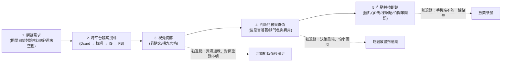

# CluBar 第一階段：使用者訪談深度分析、User Personas 與 User Journeys（修訂版）

> **方法論與資料效度說明（必讀）**：  
> 1. **方向性趨勢參考，非實證量測**：本次 11 份訪談皆為 AI 模擬，真實訪談通常不會給出如此整齊的細節與工時數字（如「60–80 小時」「10–15 分鐘」等皆屬**模擬推估值**），僅作問題方向與趨勢參考。  
> 2. **外部素材經人工粗篩**：受訪角色閱讀的貼文截圖與網頁文字皆由團隊事先篩選提供，未完全還原學生在網路上隨機滑到的雜訊環境。  
> 3. **第一手領域資料權重**：`C1`（創遊社）與 `C4`（創遊社）雖為同一社團，但因研究團隊成員本身即為創遊社社員，所提供的 Discord 公告、跨校 GameJam 與行政流程屬**真實第一手內部資料**，可信度最高，非重複無效樣本。  
> 4. **未測 CluBar 介面**：因專案尚未完成，本輪未對 CluBar 現有畫面進行測試；現有介面「資訊過多導致認知負荷」之判斷來自團隊與既有社群媒體對照之體感診斷。  
> 5. **模擬語氣與公開資料偏差**：指令中要求「禁止客套」導致各角色（特別是 `U1`、`U2`）回覆偏情緒化與否定；且校方決策層（`U2`）公開資料極少（僅社團評鑑辦法與公開網頁），該層級擬真度較低，獲利空間與採購條件仍需補蒐實務資料。  
> **關聯文件**：[clubar-prd.md (v1.0)](../clubar-prd.md)、[clubar-pitch-deck.md](../clubar-pitch-deck.md)、[clubar-prd-v2.md (v2.0)](./clubar-prd-v2.md)

---

## 一、分析目的（Analysis Objectives）

本次分析為重構 CluBar 產品定位、商業模式與 UI/UX 架構，聚焦解決 **4 個核心決策問題**：

1. **破解「學校公布欄感」與「認知負荷過高」的根因**：找出學生從「萌生興趣」到「放棄點擊／報名」的行為斷點，定義如何在**降低視覺與資訊負荷**的同時，保留足夠讓人敢行動的關鍵資訊。
2. **釐清供給端（社團幹部）的市場細分與更新門檻**：區分小社團與大社團截然不同的交換價值與拒用紅線，找出避免「開學後斷更」的切入點。
3. **盤點 B2B 校方端的操作痛點與待補研究缺口**：先整理第一線承辦人的減量需求與法規／資安風險方向，並標定「主管決策與獲利空間」需額外蒐集的實證資訊。
4. **壓力測試既有 PRD 假設**：檢視「零虛榮指標、禁止留言、有限批次、一起聚跨校交流、校方商業模式」哪些需要調整、哪些不可因訪談漏問而誤刪。

---

## 二、跨角色訪談深度分析（Trend & Directional Insights）

### 1. 學生端（S1–S4）：找社團像在辦案，介面又陷入資訊過載

- **趨勢 1｜跨平台碎片搜尋消耗耐心**：學生在 Threads → Dcard 校版 → 學校社團總覽 → IG → FB 間反覆切換搜尋（`S1`, `S2`, `S4`）。學校官方名錄資訊嚴重過時（留存已倒閉之 `blog.yam.com`、沒看介紹先叫人按「申請入社」），已失去探索信任（`S1`, `U1`）。
- **趨勢 2｜兩極化的視覺災難：「資訊量過大（高認知負荷）」vs「決策關鍵資訊缺失」**：
  - **高認知負荷與公布欄感**：現有社團 IG 普遍貼文過多、滿版「倒數 N 天」洗版、海報字海塞爆且封面無法一眼傳達重點，或縮圖裁切斷字（`S3`）。**CluBar 現有卡片與介面目前也有同樣「資訊塞太多導致認知負荷」的問題**（團隊現況診斷）。
  - **關鍵行動資訊反而在黑箱裡**：看了一堆雜訊，真正決定「去不去」的資訊——**社團現在還活著嗎、非社員／零基礎可否參加、費用、學習時數、確切時間地點**——卻常漏寫，且海報把報名做進圖片 QR code 或 IG 內文不可點擊的網址，導致手機行動斷鏈（`S1`, `S2`, `S4`）。
- **趨勢 3｜破冰訊號靠「真實成果＋人話低壓感」**：無壓字高質感作品照（`S3`）、實拍專案 Demo 短片（`S2`）、白話零壓力說明（如「不用先繳錢」「七點半就能閃人」「下週來試聽也行」）（`S1`），遠比企劃書口號更吸睛。
- **趨勢 4｜潛水看問答避雷**：多數學生不敢實名留言（怕熟人看見，如 `S3`）或直接私訊問基本問題（`S2`），但高度依賴「看別人問過的問答」確認氣氛與門檻（`S1`, `S3`）。
- **趨勢 5｜單次活動參與後怕被洗版**：碎片時間學生（`S4`）參加完活動會退追社團 IG 避免被日常動態洗版；重度社群滑手（`S3`）習慣「珍藏＋私傳給朋友」而非按讚追蹤。

---

### 2. 社團幹部端（C1×2, C2, C3, C4）：供給端真正的殺手是「重工」「個人綁定」與「市場差異」

- **重要發現｜社團管理端（供給端）需要進行市場細分**：
  - **小型／中小型實作社團（`C1` 美術社、創遊社）**：社長常一人兼美宣與行政，FB/IG 觸及慘淡（貼文常只見個位數互動），急需**社外公平曝光**與**跨屆／跨社資源串聯**；實務拉人常依賴藝文／生活時數、微課程或跨社合辦。
  - **大型熱門社團（`C2` 熱舞社）**：已有穩定流量與精細 IG 三格視覺規範，不缺基礎曝光，最痛的是**開學週大量重複私訊 FAQ、IG Bio 單一連結限制、改圖／跨尺寸重工**，極度抗拒「多養一個沒流量又會把圖壓糊壓歪的平台」。
- **趨勢 1｜抗拒「為多一個平台重做一份圖文」**：大社團美宣嚴禁破壞視覺比例與高成本重製（`C2`）；小社團在行政卡關或低互動打擊下容易開學一個月後直接斷更（`C1`）；倦怠卸任者僅願投入極短時間收尾（`C4`）。
- **趨勢 2｜換屆斷層的 3 大結構性原因**：
  1. **資產綁定個人**：社團共用雲端容量爆滿後改放私人空間變「要求存取權」；IG/Gmail 2FA 綁前社長手機；LINE 檔案過期消失（`C1`, `C3`, `C4`）。
  2. **行政隱性知識失傳**：場地借用時限、時數申請與服學系統眉角、講師與友社窗口全散在個人信箱與對話紀錄（`C4`）。
  3. **跨兩屆的評鑑整理地獄**：評鑑涵蓋跨屆學年度（如 5 月至隔年 5 月），幹部日常僅丟 LINE 相簿不交紀錄，新社長被迫在 5 月死線前幫前人考古並手動截圖拼湊（`C3`）。
- **趨勢 3｜跨社與跨校交流已在真實發生，但高度仰賴人脈門檻**：創遊社第一手紀錄顯示，社團實務上已存在與 GDG／音遊社／動畫社的「校內跨社合辦導流」，以及聯合 6 校舉辦 TUGJ 0th GameJam、透過 SGDC 群找淡江講師等「跨校同領域合作」（`C1`）。但多數社團若無既有熟人窗口，跨校詢問容易吃閉門羹（`C1` 美術社），顯示**平台需要把原本靠少數人脈才做得到的跨校／跨社串聯變成低門檻結構**（注意：本輪訪談未對全部角色深問跨校場景，不可因未問到而低估其價值）。

---

### 3. 校方端（U1, U2）：減量與資安輪廓已現，但「獲利空間」仍缺真實資訊

> **研究限制註記**：校方管理層（特別是 `U2` 決策主管）外部公開資料極少，目前訪談僅建立於社團評鑑辦法與課外組公開網頁，且受「禁止客套」設定影響回覆偏負面挑剔。以下列為初步方向假設，**定價與商業模式定案前必須補蒐校方採購與業務實況**。

- **一線承辦人痛點方向（`U1`）**：手打社團名比對不上、失聯社團電話追蹤、人工寄送與處理評鑑雲端上傳權限、應對校外冒名與炎上爭議、以及現行校內半成品系統（`HTTP 418` 等壞鏈）反增承辦負擔。最核心訴求是「別再增加第二套人工對帳工時」。
- **主管層關注方向（`U2`）**：在既有報告中難產出「跨學期去重複學生參與歷程」與「社團斷層預警」；對於外部系統的核心顧慮為 **資安／弱點掃描與個資法合規、校內 SSO 防冒名、不續約時資料完整移轉、長期維運防孤兒系統**，以及公立學校主計對「廣告分潤／代收金流／非課外組 KPI」的法規排斥。
- **待補研究缺口**：各校課外組／學務處實際數位化預算規模、小額採購或計畫案導入流程、校方對「付費價值點」的真實排序，仍需補蒐資料與真實訪談才能決定校方端的實際獲利空間。

---

### 4. 既有 PRD 與商業提案假設壓力測試

| 既有假設（來源：PRD / Pitch Deck） | 本輪討論與訪談校正結果 | 修正方向 |
| :--- | :--- | :--- |
| **零虛榮指標（隱藏讚數／粉絲數）** | **方向保留，需補信任訊號**。隱藏個位數低讚能保護小社團，但需讓學生看得出社團「現在是否還在運作」。 | 維持隱藏讚數／追蹤數，改用**低認知負荷的「非虛榮活躍訊號」**（近期活躍時間、實作紀錄、新手友善標示），避免變成數字競賽。 |
| **「我的聚」不做貼文公開留言板** | **待驗證／建議轉向結構化問答**。全無互動讓頁面像公布欄，學生想偷看「別人問過的問題」，大社團想擋重複私訊（`S1`, `S3`, `C2`）；但需防冷啟動冷清與校方審核風險（`U1`）。 | 評估改採**「社團預置 FAQ ＋ 輕量公開提問箱」**，兼顧活人感與管理成本。 |
| **首頁大白話搜尋框 ＋ 均一格卡片** | **必須重構（高認知負荷主因）**。首頁塞滿工具框與同質文字卡片，與現有社團「貼文多、封面不知想傳達什麼」一樣造成嚴重認知負荷與公布欄體感。 | **視覺降噪與封面焦點化**：首屏改為高圖佔比作品瀑布流（一張圖＋一句清楚傳達核心的亮點），白話探索縮為輕量頂部膠囊，把雜訊從卡片拿掉、細節收進點擊後的詳情層。 |
| **「快速整理」貼文輸入體驗** | **技術與動機需對齊市場細分**。幹部拒重工，且 Meta 不開放個人帳號 IG 自動抓取；小社團願換曝光與評鑑彙整，大社團只怕破壞視覺與增加同步負擔。 | 不走高風險自動爬蟲，改做**零重工輕量整理（貼草稿／原圖不強制裁切）**，並依小社 vs 大社細分切入誘因（不可退化成單純 Google 表單或 Linktree）。 |
| **「一起聚」跨校六大分類論壇** | **價值保留，需重新設計產品呈現**。創遊社一手資料已證實跨校（6 校 GameJam、他校講師）與校內跨社合辦皆真實發生；先前看似薄弱只是訪談未針對跨校提問，且使用者未必能主動說出潛在需求。 | 保留跨校同領域交流與實務經驗流動核心，思考如何把「校內跨社協作＋歷屆行政避雷＋跨校聯合／交流」接回作品與社團日常，避免變成冷清傳統論壇。 |
| **商業模式：校方訂閱 ＋ 主題合作** | **待補資料後定案**。已看見公立學校對廣告分潤與純訂閱移轉的法規疑慮，但管理層模擬樣本公開資料過少。 | **暫不定死收費規格**；列為下階段外部研究重點（訪真實課外組／查各校採購標案資料），再確認校方端的實際獲利空間與合約形式。 |

---

## 三、User Personas（3 主要 ＋ 4 次要人物誌）

> **架構調整原則**：為避免對焦失焦，MVP 產品與 UI/UX 設計優先服務 **3 個主要人物誌**；另保留 **4 個次要人物誌** 作為市場細分（大社 vs 小社）、情境邊界（倦怠交接、體驗活動）與商業延伸（預算主管）的檢查對照。

### 主要人物誌（Primary Personas — MVP 核心設計對象）

#### 主要人物誌 1｜怕踩雷的探索型學生（整合 `S1` 新生 ＋ `S2` 跨系找同好）
- **角色定位**：大一～大三非本科系學生，100% 手機搜尋起手，習慣從 Dcard、Threads、IG 拼湊資訊。
- **核心任務**：在不認識社團名稱的情況下，快速判斷哪個社團「目前活躍、真的有在做作品／活動、對新手與外系友善」，並順利找到參加方式。
- **核心痛點**：校網過時像死城；IG 充斥內梗、公關空話與過載文字；關鍵門檻（非社員／零基礎／費用／報名入口）缺漏；不敢私訊問基本問題。
- **對 UI/UX 的決定性要求**：
  1. **低認知負荷**：第一眼靠封面圖與一句話看懂這社團在幹嘛，不被字海淹沒。
  2. **決策透明與可行動**：點開後清楚看到近期活躍、作品實績、新手友善度、一鍵可點入口與可偷看的公開 FAQ。

---

#### 主要人物誌 2｜一人扛曝光與考古的小中社團社長（整合 `C1` ＋ `C3`）
- **角色定位**：活躍社員約 15–45 人之實作／藝文／學術社團現任社長；筆電處理行政評鑑與做圖，手機回 LINE／Discord。
- **核心任務**：讓社團認真做的作品與活動突破同溫層被社外看見（包含結合時數／跨社／跨校合作），同時在日常累積成果與行政紀錄，避免年底評鑑與換屆還要幫上一屆熬夜考古。
- **核心痛點**：身兼數職，在既有社群發文互動極低（6–9 讚）挫折感重；歷屆帳密 2FA 與檔案全綁前人私人雲端造成斷層；幹部不主動交紀錄，評鑑前被迫跨屆拼湊檔案。
- **對 UI/UX 的決定性要求**：
  1. **低門檻發布且一次到位**：貼上零散紀錄與原圖快速整理成吸睛作品卡，發完即自動按學年與類別歸檔。
  2. **組織級資產歸屬**：檔案與權限綁社團職位而非個人帳號，支援跨屆時間軸與年度評鑑匯出。

---

#### 主要人物誌 3｜幫百個社團補破網的一線承辦人（對應 `U1`）
- **角色定位**：大學課外活動組行政承辦人，管轄百餘個社團，桌機多視窗作業（校內系統、Excel、Email、LINE、Word）。
- **核心任務**：零錯漏完成社團名錄換屆、年度評鑑收件與輔導查核、快速處置冒名或爭議事件，且**不能增加第二套人工對帳工時**。
- **核心痛點**：學生手打資料錯漏對不上名冊；失聯社團逐一電話追蹤；人工寄雲端連結與修權限；現行校網半成品問題反需承辦人善後。
- **對 UI/UX 的決定性要求**：
  1. **防呆名冊連動與斷層預警**：鎖定官方社團名冊，一眼辨識未換屆／低活躍風險社團。
  2. **符合校內規格與防冒名**：綁定校園身分驗證，評鑑資料可依校內規則收件與匯出，不製造兩套帳。

---

### 次要人物誌（Secondary Personas — 細分市場與邊界驗證）

#### 次要人物誌 1｜高挑剔視覺滑手與碎片體驗派（整合 `S3` ＋ `S4`）
- **畫像**：每日重度滑 IG／小紅書／Threads 的高年級或忙碌打工族，純手機潛水黨。
- **關鍵差異與設計意義**：極度痛恨佈告欄字海與廉價套版，3 秒決定滑走；只想找「週末開放非社員、時間費用清楚」的單次體驗課，活動結束就想退追怕洗版。是檢驗 CluBar 首頁**視覺質感與認知負荷上限**的最高標準試金石。

#### 次要人物誌 2｜重視美感、嚴拒重工的大社團美宣幹部（對應 `C2`）
- **畫像**：破百人熱門社團美宣組（Canva + Notion + IG 重度使用者）。
- **關鍵差異與設計意義**：代表供給端市場細分中的「已有流量端」。不缺曝光、極怕圖片裁切壓糊與改時間不同步；能吸引他們的不是「流量」，而是**不破壞原比例美感的多活動整合門面＋公開 FAQ 減少重複私訊**。

#### 次要人物誌 3｜準備卸任的倦怠期幹部（對應 `C4`）
- **畫像**：任期尾聲、急著實習或專題的卸任幹部（與主要人物誌 2 的「接任／經營任務」明確拆分）。
- **關鍵差異與設計意義**：交接意願極低（時間上限極短，僅願做最小動作），最容易遺失「校內行政隱性眉角」與個人帳號下表單權限。決定了**交接流程必須壓到 3 步內＋極簡避雷便條**，否則一定失敗。

#### 次要人物誌 4｜守資安、看績效的預算決策主管（對應 `U2`，低信心度待補研究）
- **畫像**：課外組組長／學務處主管，關注高教深耕、校務研究（IR）、電算中心資安與主計核銷合規。
- **關鍵差異與設計意義**：掌握採購決策但本輪公開資料不足；需於下階段補齊真實校方採購機制與預算結構研究，再定案 B2B 定價與報表規格。

---

## 四、User Journeys（現況 As-Is 斷裂旅程與設計機會點）

> **標註說明**：下表中「推斷情緒狀態」為團隊依訪談語氣整理之分析推論，非受訪者直接填答數值；待 UI/UX 新架構定案後，再補齊 **To-Be 目標旅程**。

### Journey 1｜學生端（探索型學生為主，視覺與體驗派為輔助檢查）

| 階段 | 行為與接觸點 | 推斷情緒狀態（分析推論） | 現況痛點趨勢（訪談方向） | CluBar UI/UX 機會點 |
| :--- | :--- | :--- | :--- | :--- |
| **1. 觸發** | 見同儕討論社大、想找技術／藝文同好，或週末找體驗課（手機） | 好奇、微焦慮 | 沒頭緒、不知社團名稱、怕每週固定被綁死 | 首屏呈現**高質感作品／活動流＋輕量意圖篩選（體驗課／時數／主題）**，無須先知道社名 |
| **2. 搜尋** | 輪流開 Dcard、Google、校網、IG、FB、ACCUPASS | 煩躁、疲憊 | 多平台切換耗時；校網資訊過時；非正式社團／讀書會不在名錄 | 整合正式社團與認證社群；白話搜尋收斂至頂部膠囊，降低切換成本 |
| **3. 初篩** | 前幾秒掃描卡片視覺、封面與社團頁面 | 挑剔、易冷掉 | **資訊量過大導致高認知負荷**（海報塞字、重複倒數洗版、封面不知想傳達什麼、縮圖裁切） | **視覺降噪**：卡片只留「清晰封面圖＋一句人話重點＋社團識別」，拿掉過度雜訊 |
| **4. 評估** | 猜測是否還在運作、零基礎／外系可否去、偷看別人討論 | 戒心重、猶豫 | 漏寫資格費用強度；低互動讓人懷疑倒社；不敢實名私訊問基本題 | 詳情頁提供**結構化決策資訊**（近期活躍、新手友善、費用時數）＋**可偷看的公開 FAQ／提問** |
| **5. 轉換與後續** | 點報名、問細節、活動後決定留存或退追 | 怕麻煩、想零壓力 | 圖片 QR code 無法直點、無回信確認、怕被社內日常慶生洗版 | 詳情頁內建**手機一鍵直達報名入口**；支援「只追公開活動／珍藏」免被社務洗版 |

---

### Journey 2｜社團幹部端（小社團社長為主，大社美宣與卸任幹部為輔助檢查）

| 階段 | 行為與接觸點 | 推斷情緒狀態（分析推論） | 現況痛點趨勢（訪談方向） | CluBar UI/UX 機會點 |
| :--- | :--- | :--- | :--- | :--- |
| **1. 宣傳與發布** | Canva 做圖、Notion／DC 寫文、發 IG／FB（筆電＋手機） | 趕工、低落 | 大社團怕切圖壓糊重工；小社團熬夜做圖發完只見極低讚數；臨時改地點無法同步改圖 | **原比例相容素材上傳**不強迫裁切，配合簡化輸入整理降低排版時間；公平作品流替小社團帶入社外受眾；文字地點即時可改 |
| **2. 招生答疑** | 手機回 IG 小盒子、貼罐頭 FAQ、換 Bio 連結 | 厭煩、重複勞動 | 開學週大量重複私訊（零基礎／時間地點）；IG Bio 單一連結限制 | 社團頁內建**置頂公開 FAQ**＋多活動聚合入口，替幹部先擋掉重複私訊 |
| **3. 跨社與跨校協作** | DC／IG 找友社合辦、找前輩救火、辦跨校聯合活動 | 摸索、缺窗口 | 沒熟人窗口跨校常吃閉門羹；創遊社等實作社團已有校內跨社導流與跨校合辦需求（`C1`） | 「一起聚」承接**同領域跨校經驗／聯合招募＋校內跨社合作＋前輩避雷**，降低陌生尋找窗口的門檻 |
| **4. 換屆交接** | 移交帳密、雲端與隱性行政經驗（6 月） | 倦怠、想快速收尾 | 2FA 綁前社長手機；雲端爆滿改私人存放變「要求存取權」；行政眉角失傳；卸任者僅願花極短時間 | **權限綁社團職位不綁個人**；極簡「3 步交接＋行政避雷備忘錄」，讓倦怠卸任者免重新排版即可移交 |
| **5. 年度評鑑** | 4 月底填意願、5 月初死線前趕工彙整跨兩屆資料（筆電） | 壓力大、疲憊 | 評鑑跨兩屆要幫前人考古；幹部平常丟 LINE 相簿不交紀錄，最後集中熬夜拼 PDF | **日常發布即按學年歸檔**，5 月直接拉出跨兩屆活動／作品／組織紀錄清單，大幅縮減考古與彙整時間 |

---

### Journey 3｜校方端（一線承辦人為主，決策主管需待補研究）

| 階段 | 行為與接觸點 | 推斷情緒狀態（分析推論） | 現況痛點方向（待真實訪談再校準） | CluBar UI/UX 機會點 |
| :--- | :--- | :--- | :--- | :--- |
| **1. 名錄與換屆追蹤** | 催全校百餘社團更新換屆、比對 Excel 總表（桌機） | 繁瑣、費力 | 學生手打社名錯漏；失聯社團電話追蹤；換屆斷層後才發現倒社 | 鎖定官方社團名冊防呆下拉；**自動標示未換屆／低活躍風險社團** |
| **2. 評鑑收件與審查** | 發意願調查、手動寄送雲端連結與處理權限問題 | 高壓、加班風險 | 壓線補交、權限未開評審打不開、現行校網半成品錯誤增加詢問電話 | 單一承辦儀表板追蹤繳交進度，社團系統內直接送審，減少人工寄信與權限排除 |
| **3. 治理與合規邊界** | 應對校外冒名、爭議貼文、資安與採購審核（桌機） | 謹慎、防出包 | 未綁學籍 SSO 難防冒名；對純訂閱離場資料與廣告分潤具法規排斥；目前欠缺真實預算與獲利空間資料 | 預留校內 SSO 與認證標章防冒名；先釐清合規交付邊界，**並於下階段補充校方實務採購調研後再定案收費模型** |

---

## 五、已拍板決策與下階段待決項目

### 本階段定案
1. **供給端切入順序（市場細分）**：**先主攻「中小型／實作型社團」**（如創遊社、美術社、讀書會），主打曝光、日常歸檔評鑑與跨社跨校串聯；同時維持原圖比例無損相容，不排斥大型社團進駐。
2. **「一起聚」核心價值保留**：不因前期訪談漏問而砍掉跨校價值，保留校內跨社與跨校同領域實務協作方向，納入下階段介面重構。
3. **人物誌聚焦**：MVP 設計優先對齊 **3 大主要人物誌**（探索型學生、小中社團社長、一線承辦人），其餘 4 類作為細分與邊界檢查。

### 留待下階段定案（不提前寫死）
1. **低認知負荷版面分層**：探索卡片精簡到什麼程度、哪些決策細節收進詳情層，待**競品 UI/UX 分析**對標後定案（確定方向：消除現況「資訊過多、封面重點不明」的認知負荷）。
2. **校方商業模式與獲利空間**：暫不訂死定價與合約形式，待補充真實校方採購機制與公開標案資訊後再評估。
