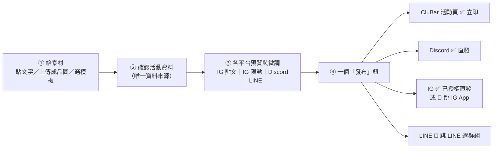

# 解決方案構想：幹部一站式發布 ＋ 落差分析修正（2026-11-28）

> **上游**：[ux-journey-gap-analysis.md](./ux-journey-gap-analysis.md)（Q1–Q4 落差）、[clubar-user-research.md](./clubar-user-research.md)（C1/C2/C3 旅程）、[clubar-prd-v2.md](./clubar-prd-v2.md) FR-MY-02/03。
> **狀態**：構想稿，尚未實作；標「需實機驗證」的項目未在真機上測過。外部 API 條件以 2026-11 查到的官方文件為準，正式開發前要再確認。

---

## 0. 一句話

**幹部只填一次活動資料，CluBar 自動產出各平台尺寸的圖與文案，按一個「發布」鈕，能直發的直發（CluBar 活動頁、Discord、已授權的 IG），不能直發的變成「一點就跳到該 App 並帶好內容」（LINE、未授權 IG）。改期時改一次，全部跟著更新。**

---

## 1. 現況流程與痛點（研究 C1/C2/C3）

```
Canva 做圖（每種尺寸各做一次、日期地點手打進圖）
 → Notion/DC 打文案（每個平台改一次）
 → IG 貼文 → IG 限動 → Discord → LINE 群組 → 改 IG Bio 連結
 → 臨時改地點：重做圖、刪文重發、各群組再公告一次
```

| 痛點 | 來源 | 根因 |
| :--- | :--- | :--- |
| 日期地點要手打進圖，改期就重做 | C2、C3 | 資訊寫死在圖片裡，沒有單一資料來源 |
| 每種尺寸各做一次 | C2 | IG 貼文 4:5、限動 9:16、DC／LINE 預覽各不同 |
| 每個平台改一次文案 | C1、C2 | 沒有「寫一次、分平台微調」的工具 |
| IG Bio 只能放一條連結 | C2 | 多場活動共用一個入口 |
| 發完只有個位數讚（小社團） | C1 | 曝光只在既有追蹤者 |

---

## 2. 市面上的參考工具（研究結果）

| 工具 | 解決了什麼 | CluBar 可以學的 | 限制 |
| :--- | :--- | :--- | :--- |
| **Buffer／Later** | 一個編輯器選多個平台，可「Customize for each network」分平台改文案，並預覽各平台樣子 | **分平台微調＋預覽**的編輯畫面 | 不處理做圖；免費版 3 個管道 |
| **Canva 內容規劃（Content Planner）** | 在 Canva 做完圖直接排程發 IG | 「做圖就是發布的起點」 | 限 Pro／Teams；只能發到綁 FB 粉專的商業帳號；**不能排限動與 Reels**；24 小時內最多 25 篇 |
| **Canva Connect API** | 自動填入：把資料填進品牌模板產生設計；可把檔案匯入成 Canva 設計；編輯完按 Return 回到原網站 | 「在 Canva 編輯 → 回到 CluBar」；用活動欄位自動填模板 | 自動填入的方案資格文件說法不一（Enterprise 或 Pro／Teams），要再確認 |
| **Bannerbear／Placid** | 一個模板、送資料、一次產出多種社群尺寸 | 「資料驅動做圖」＝日期地點不再手打 | 付費服務；**CluBar 已有同類能力**（見 §3.2），不必外購 |
| **Partiful／Luma** | 活動頁是主體，社群貼文只是入口；訪客免 App 就能報名 | CluBar 的 `/e/短碼` 已是此模式 | — |
| **Linktree 類工具** | 解決 IG Bio 只有一條連結 | CluBar 社團頁本身就能當 Bio 連結 | — |

### 各平台能不能「直接發」

| 平台 | 直發方式 | 條件 | 結論 |
| :--- | :--- | :--- | :--- |
| **Discord** | Webhook：POST 到頻道 Webhook 網址，可附圖與嵌入卡（每則最多 10 個嵌入卡） | 幹部在頻道設定貼一次網址；每個 Webhook 約每 2 秒 5 次的速率限制 | ✅ 最容易，第一階段就做 |
| **IG 貼文／輪播／限動** | Instagram 發文 API（建立內容容器 → 發布兩步） | 限**專業帳號**（商業或創作者）；**限動只有商業帳號能發**；正式上線要 Meta App Review 給進階權限；每個帳號 24 小時內有發文上限（文件寫 100 或 50，版本不一） | ✅ 有條件，第二階段 |
| **IG（未授權帳號）** | 手機網頁用 Web Share API 分享圖片檔，跳出系統分享選單，使用者選 Instagram | 需要 HTTPS、由點擊觸發；`navigator.canShare({files})` 先偵測；不支援就退回下載 | ⚠️ 需實機驗證 IG 是否接收 |
| **LINE 群組** | LINE Notify 已於 **2025-03-31 停止服務**；替代的 Messaging API 要官方帳號機器人被邀進群組 | 大多數社團群組不會加機器人 | ❌ 不直發，改用「一點開啟 LINE 選群組」的分享連結＋預填文字（需實機驗證） |
| **Threads** | 官方 API 或分享連結 | 同 Meta 授權 | 第三階段 |

**決定（2026-11-28）**：PRD v2 FR-MY-03 已改為「預設不依賴 Meta API，已授權帳號可直發」。Meta 開發者帳號與商家驗證暫不申請，IG 直發列為未來方向。

---

## 3. 解決方案：「發布中心」

### 3.1 流程（4 步，一個畫面內完成）



### 3.2 ① 給素材：三條入口，對應市場細分

| 入口 | 給誰 | 做法 | 現有程式可重用 |
| :--- | :--- | :--- | :--- |
| **A. 貼文字或海報** | 習慣先在 DC／Notion 寫好的幹部 | AI 抽出時間、地點、費用、非社員可否、報名連結，提醒漏填 | `/api/ai/draft-from-raw` 已有 |
| **B. 上傳 Canva 成品圖** | 重視美感的大社團美宣（C2） | 原比例上傳、不裁切；可一次傳多種尺寸 | `ImageUploader` 已有 |
| **C. 不用做圖，選模板** | 一人扛全部的小社團社長（C1） | 從活動欄位**自動產生** 4:5 貼文圖、1:1、9:16 限動圖；日期地點由資料填入 | `/api/og/events/[短碼]` 已支援 1200×630 與 `?format=story` 1080×1920，**補一個 1080×1350 就能涵蓋 IG 貼文** |

入口 C 就是「省掉 Canva 這一步」，用的是專案已在用的 `next/og`，不需外購 Bannerbear。

後期（第三階段）可加 **「在 Canva 編輯」**：用 Canva Connect 自動填入社團品牌模板 → 美宣在 Canva 微調 → 按 Return 回到發布中心。

### 3.3 ② 活動資料是唯一資料來源

- 圖上的日期、地點、費用都從欄位帶入，不再手打進圖。
- **改期只改欄位**：入口 C 的圖自動重出；活動頁即時更新；Discord 用同一個 Webhook 編輯原訊息或補發更新；IG 已發出的圖無法替換，系統產生「更新限動圖」並提醒幹部補發。
- 入口 B 的成品圖若內含日期，改期時提醒「你的圖上有舊日期」（AI 抽圖中文字比對）。

### 3.4 ③ 各平台預覽與微調（學 Buffer）

| 分頁 | 預設內容 | 平台規則自動處理 |
| :--- | :--- | :--- |
| IG 貼文 | 4:5 圖＋文案；連結改寫成「報名連結在社團主頁」 | IG 文案連結不能點，所以導向 Bio |
| IG 限動 | 9:16 圖＋短連結 | 限動 API 僅商業帳號 |
| Discord | 嵌入卡（標題、時間、地點、報名按鈕連結）＋ Markdown | 嵌入卡字數上限 |
| LINE | 純文字公告＋短網址（LINE 會自動出預覽卡） | — |

- 每個分頁可單獨改，改過的分頁標「已自訂」。
- **品牌規則**：產生的文案不寫報名人數、按讚數（AGENTS 規則 3）。

### 3.5 ④ 一個發布鈕，每個管道顯示狀態

```
✅ CluBar 活動頁　已上線　[複製連結]
✅ Discord #公告　已發出
📱 Instagram　　　[開啟 IG 分享]   ← 未授權；或 ✅ 已發出（已授權）
📱 LINE　　　　　 [開啟 LINE 選群組]
```

- 這個面板就是落差分析 Q3／Q4 說的「發布完成面板」，取代現在只顯示一行 `/e/xxx` 的橫幅。
- 桌機上無法跳 App 的管道：退回「下載圖片＋複製文案」。

### 3.6 IG Bio 連結

在社團設定提供「放到 IG Bio 的連結」＝社團頁網址（已聚合所有近期活動），解決 C2「Bio 只能一條連結」的問題，也讓每次發 IG 都把人導回 CluBar。

### 3.7 帳號連結（一次性設定）

社團管理頁新增「發布管道」：
- Discord：貼上 Webhook 網址（伺服器端加密保存，不回傳到前端；只限幹部可設定）。
- IG：「連結 Instagram 專業帳號」（OAuth）；權杖綁**社團**而非個人，換屆不用重新交接帳密（呼應 FR-MY-07）。

---

## 4. 一併處理落差分析的其他問題

| 落差 | 方案 | 與發布中心的關係 |
| :--- | :--- | :--- |
| **Q4 一般人找不到分享** | 活動頁與活動卡加「分享邀請卡」：手機用 Web Share API 一次分享**限動圖＋連結**（不支援檔案就只分享連結，再不行就複製）；直接重用現有 `ShareButton` 並擴充 | 同一套圖（9:16 邀請卡）同時給幹部與一般學生用 |
| Q4 登入後要再按一次報名 | 登入回跳帶 `?rsvp=1`，自動展開報名確認 | — |
| **Q1 首屏看不到內容** | 行動版主視覺縮成一行，貼紙捷徑併入「近期活動」篩選列，首屏至少露出 1.5 張卡 | — |
| Q1 測驗結果沒套用 | onboarding 結束帶 `domain_id`；修 `page.tsx` 沒傳入 `DiscoverClient` 的問題 | — |
| Q1 幹部首頁 | 首頁加一條幹部待辦細條（新提問、待審照片、**草稿未發布的活動**） | 待辦條可直接進發布中心 |
| **Q2 10 倍無證據** | 埋點：`publish_started` → 各管道 `publish_channel_done`；學生端 `landing` → `rsvp_created` | 發布中心本身產生計時資料 |
| Q3 幹部功能藏太深 | 「我的聚」社團卡直接放「發布活動」主按鈕 | 入口從 7 步縮到 2 步 |

---

## 5. 10 倍怎麼證明（以幹部發布為例）

| 項目 | 現況（Canva＋各平台） | 發布中心目標 |
| :--- | :--- | :--- |
| 做圖 | 每種尺寸各做一次，手打日期地點 | 入口 C：0 次手動做圖 |
| 寫文案 | 每平台改一次 | 寫一次，AI 分平台改寫 |
| 發布動作 | 4–5 個 App 各自操作 | 1 個按鈕＋至多 2 次跳 App |
| 改期 | 重做圖＋刪文＋各群組再公告 | 改 1 個欄位 |

驗證方法：找 3–5 位幹部，同一場活動分別用「Canva＋IG＋DC＋LINE」與「發布中心」各做一次，計時從「拿到活動資訊」到「四個管道都發出」。**沒有這次計時前，對外只說「目標 10 倍」。**

---

## 6. 分階段路線

| 階段 | 內容 | 外部依賴 | 規模 |
| :--- | :--- | :--- | :--- |
| **第一階段** | 發布完成面板；活動頁／活動卡分享邀請卡；1080×1350 貼文圖；Discord Webhook 直發；LINE／IG 跳 App 分享；Bio 連結；計時埋點 | 無（不需任何審核） | 中 |
| **第二階段** | IG 專業帳號 OAuth 直發（貼文、輪播、商業帳號限動）；改期同步更新 Discord 原訊息 | Meta App Review；比賽展示可先用開發模式（只對有 App 角色的測試帳號有效） | 中大 |
| **第三階段** | 「在 Canva 編輯」＋自動填入品牌模板；Threads；排程發布 | Canva Connect 方案資格 | 大 |

## 7. 待決事項

1. ~~PRD FR-MY-03~~：已改為「預設不依賴，已授權可直發」。
2. Web Share API 與 LINE 分享連結：第一階段做實機測試（iOS Safari、Android Chrome）。
3. Meta 開發者帳號與商家驗證：暫不申請，留作未來方向。

---

## 參考來源

- Instagram 發文 API 與發文上限：[Content Publishing](https://developers.facebook.com/docs/instagram-platform/content-publishing/)、[Content Publishing Limit](https://developers.facebook.com/docs/instagram-platform/instagram-graph-api/reference/ig-user/content_publishing_limit)、[Instagram API with Instagram Login](https://developers.facebook.com/documentation/instagram-platform/instagram-api-with-instagram-login)
- LINE Notify 停止服務：[LINE Notify 公告](https://notify-bot.line.me/doc/en/)、[LINE Developers News](https://developers.line.biz/en/news/3)
- Canva：[Autofill guide](https://www.canva.dev/docs/connect/autofill-guide/)、[Return navigation](https://www.canva.dev/docs/connect/return-navigation-guide/)、[Connect changelog](https://www.canva.dev/docs/connect/changelog/)、[Content Planner 排程 IG](https://www.canva.com/help/scheduling-posts-on-instagram/)
- 資料驅動做圖：[Bannerbear 多尺寸活動圖教學](https://www.bannerbear.com/blog/how-to-generate-event-marketing-graphics-in-any-size-from-a-single-template-using-bannerbear-nodejs-tutorial/)、[Bannerbear Multi Image API](https://bannerbear.com/product/image-collections)
- 多平台發文：[Buffer Publish](https://buffer.com/publish)、[Buffer：Using Threads](https://support.buffer.com/article/857-using-threads-with-buffer)
- 活動頁模式：[Luma vs Partiful](https://help.luma.com/p/luma-vs-partiful)、[Luma 邀請賓客](https://help.luma.com/p/inviting-and-adding-guests-to-your-event)
- 網頁分享：[web.dev Web Share API](https://web.dev/articles/web-share)、[web.dev 分享檔案](https://web.dev/articles/files/share-files)
- Discord Webhook：[Hookdeck Discord Webhooks 指南](https://hookdeck.com/webhooks/platforms/guide-to-discord-webhooks-features-and-best-practices)
